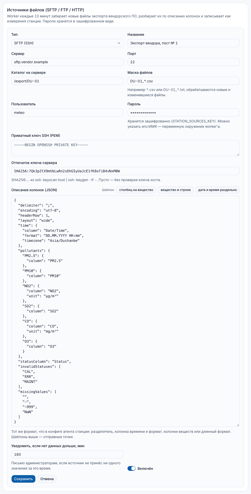
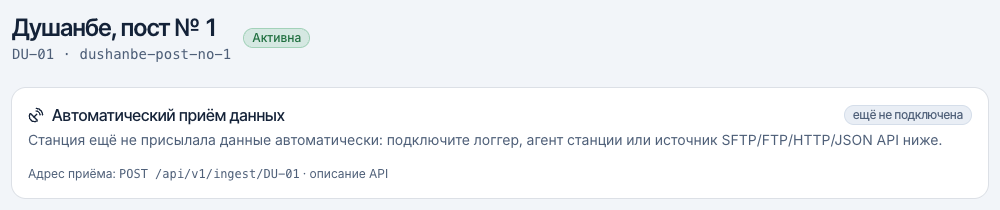
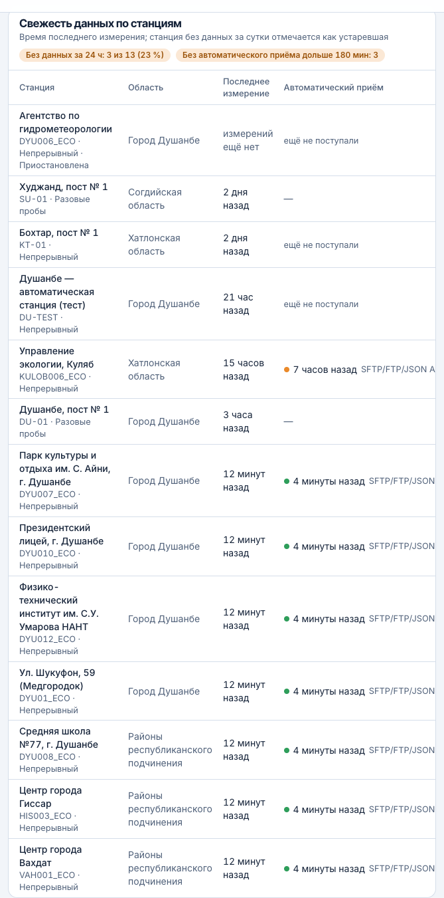

# Meteoportal Administrator Guide

Version 1.0 · 17 October 2026 · Languages: [Тоҷикӣ](tg.md) · [Русский](ru.md) · **English**

Audience: administrators, monitoring operators and editors of the Agency for Hydrometeorology who work in the Meteoportal administration panel (`/admin`). Server operations (deployment, backups, upgrades) are covered separately in the [Runbook for the IT service](../../runbook.en.md); the public portal is described in the [Portal user guide](../user/en.md).

Screenshots were taken with the Russian interface; the Tajik and English interfaces have the same layout with translated labels.

## 1. Overview

### 1.1. Address and access

The panel is available at `https://<portal domain>/admin` (for example `https://portal.meteo.tj/admin`). Any modern browser works (Chrome, Firefox, Edge, Safari) on a desktop or tablet; the panel also works on a phone, but data entry is more comfortable on screens wider than 1024 px.

Accounts are created by an administrator in the "Users" section (see [section 13](#13-users)); there is no self‑registration. Passwords must be at least 10 characters long and are handed over through a secure channel.

### 1.2. Layout


- **Sidebar** on the left: groups "Measurements", "Content" and "Settings". Sections your role cannot access are hidden. The button in the top‑left corner collapses the sidebar to icons.
- **Header**: interface language switch (TG / RU / EN), light/dark theme and the user menu (name, role, "Security & 2FA", "Sign out").
- The bottom sidebar item "Meteoportal" opens the public site.

The interface language does not affect the data: all multilingual fields (station names, news texts, health advice) are edited in all three languages at once through the TG / RU / EN tabs in each form.

### 1.3. Roles

| Capability | Administrator | Operator | Editor |
|---|---|---|---|
| Dashboard | ✓ | ✓ | ✓ |
| Station registry | create, edit, decommission, API key | view | view |
| Measurements: entry, CSV import, browse | ✓ | ✓ | — |
| Quality‑control queue (decisions) | ✓ | ✓ | — |
| Scales, thresholds, limit values; health advice | ✓ | — | — |
| Alert rules, exceedance events, CAP messages, event dictionary | ✓ | — | — |
| News | ✓ | list only | create, publish |
| Media, bulletins | ✓ | — | ✓ |
| Subscribers, users, audit log, settings | ✓ | — | — |

Permissions are enforced on the server: opening a section URL directly without the required role shows the "Access denied" page.

## 2. Signing in and two‑factor authentication

### 2.1. Signing in


1. Open `/admin`, enter your e‑mail and password and click "Sign in".
2. If two‑factor authentication (2FA) is enabled for the account, a verification‑code prompt follows.
3. After five failed attempts within a minute the server temporarily rejects requests — wait a minute.

A session lasts 7 days of regular use; sign out through the user menu → "Sign out". Changing a user's role, resetting the password or blocking the user terminates all of that user's sessions.

### 2.2. Mandatory 2FA for administrators

2FA is mandatory for the "Administrator" role: at the first sign‑in without it, the panel shows only the setup page.


How to enable it:

1. Install an authenticator app on your phone (Google Authenticator, Microsoft Authenticator, Aegis, FreeOTP — any TOTP app).
2. On the "Two‑factor authentication" page enter your password and click "Enable 2FA".
3. Scan the QR code with the app or type the key manually.
4. **Save the backup codes** (10 single‑use codes): click "Download" or "Copy" and store the file in a password manager or a safe. Without the phone and without backup codes you cannot sign in.
5. Enter the six‑digit code from the app and click "Verify and enable".


### 2.3. Signing in with a code


- Enter the code from the app (it changes every 30 seconds) and click "Verify".
- If the phone is not at hand, choose "Use a backup code". Each backup code works once.
- "Trust this device for 30 days" skips the code on this computer for a month. Do not enable it on shared computers.
- After 10 wrong codes the account is locked for 15 minutes; the limit is 5 attempts per minute.
- "Invalid or expired code" usually means the phone clock is off: enable automatic time synchronisation.

### 2.4. "Security & 2FA" page

User menu → "Security & 2FA" (`/admin/two-factor`): shows the 2FA state and lets you issue new backup codes (the old ones stop working; the password is required). An administrator cannot disable their own 2FA. Operators and editors may enable 2FA voluntarily — recommended.


If the phone is lost and there are no backup codes, another administrator resets 2FA in "Users" ("Reset 2FA"); it must be set up again at the next sign‑in. If there is only one administrator, access is restored by the IT service following the runbook.

## 3. Dashboard

The dashboard (`/admin`) summarises the system state (see Figure 1):

| Block | Shows | Watch for |
|---|---|---|
| Cards | stations in the registry and active, measurements in the last 24 hours, QC queue, active exceedances, users | a growing QC queue and exceedances need an operator's attention |
| Data freshness by station | time of the last measurement of each active station; "stale" — no data for 24 hours; share of stations without data | a post that stops reporting — check entry/import |
| Background service | whether the worker is alive (heartbeat every minute); "not responding" — contact the IT service | without the worker the index, forecasts and e‑mails stop updating |
| Mail queue | whether SMTP is configured, how many messages are pending, failed, sent in 24 hours; link to a test e‑mail | delivery errors — check SMTP in "Settings" |
| Integrations | SmartMet (weather forecast), SILAM (air‑quality forecast), SmartMet Alert (CAP): last successful load, model run, source address, status | statuses are explained in [section 14](#14-integration-statuses-and-background-jobs) |
| Recent actions | latest audit‑log entries | "Full log" link |

## 4. Station registry

"Stations" (`/admin/stations`) holds the passports of air‑monitoring posts and stations. The registry record controls: display on the map and in portal lists, which pollutants can be entered, input units, and the region used by alert rules.


### 4.1. Adding a station

Click "Add station" and fill in the form.


| Field | How to fill |
|---|---|
| Code | 2–32 characters: Latin letters, digits, hyphen, underscore (for example `DU-01`). Unique; used in import files and in the API. Changing it after data entry has started is not recommended |
| Address (slug) | part of the station page URL on the portal; leave empty to derive it from the name |
| Name, description, address | in three languages (TG / RU / EN tabs); one language is enough, the others fall back tg → ru → en |
| Type | air / meteo / combined |
| Status | active / suspended / decommissioned |
| Latitude, longitude | click the map, drag the marker or type the values (latitude 35–42, longitude 66–76) |
| Region, district | the district is chosen after the region; the district list comes from the loaded boundaries |
| Elevation, m | optional |
| Commissioned | start date of observations |
| Data source | manual entry / file import / API / automatic sensor — informational |
| Sampling mode | discrete samples (posts sampling 3–4 times a day) or continuous (automatic sensors). The mode defines the default time rows in manual entry |
| Show on the portal | clear the box to hide the station from the map and lists (data is still stored) |
| Measured pollutants | tick the pollutants and the input unit (µg/m³, mg/m³, ppb, ppm). Storage is always in the pollutant's reference unit; values are converted on entry |

"Save" opens the card of the created station. An error on the "Code" field means the code already exists.

### 4.2. Station card, API key, decommissioning


- All fields are edited as when creating; changes are written to the audit log (before/after).
- **Station API key** is needed for automatic measurement uploads (station agent, logger or vendor software → `POST /api/v1/ingest/{code}`). The key is shown once; only its hash is stored; "Rotate key" replaces the old one, which stops working immediately. How to connect a station — section 4.3.
- **Automatic data intake** (block above the form): when the station last sent data, through which channel (API or file pull), how many records were accepted and rejected, the data period. The state "no data for a long time" means there was no intake for longer than the threshold (3 hours by default).
- **File sources (SFTP / FTP / HTTP)** (block below the form): pulling export files from a vendor server — section 4.3.
- **Decommissioning**: the station disappears from the portal; the measurement history is kept and stays available in data browsing and the archive API. The action cannot be undone from the interface; if needed, the IT service changes the status.

### 4.3. Connecting a station: automatic data intake

The portal receives station data in three ways; none depends on the equipment vendor — the file or request format is described by settings.

| Method | When it fits | What the administrator configures |
|---|---|---|
| Station agent | the station software writes CSV/TSV files to a folder on the station computer | the API key in the card; the IT service installs the agent on the station (runbook, section 9.4) |
| Direct API upload | the logger or station software can send `POST /api/v1/ingest/{code}` requests | the API key in the card; format reference — the portal page "API for developers" (`/data/api`) |
| File pull (SFTP / FTP / FTPS / HTTP) | the data is already published on a vendor's or the Agency's server | a source in the "File sources" block of the station card |
| Sensor-network JSON API | several sensors publish data through one address as JSON — for example the Agency's PM sensor network (wwcs.tj API) | a "JSON API" source in the "Data sources" block of one station's card; the other stations receive data by code |

**Before connecting**, tick the measured pollutants and input units in the station card: values for pollutants not ticked for the station are rejected with the reason `pollutantNotConfigured`. In "Data source" choose "API" or "Automatic sensor" — then the dashboard and administrator e-mails watch for gaps in the intake.

**API key** ("Station API key" block): "Generate key" → copy the key immediately, it is not shown again. Hand it to the IT service for the agent or logger setup. If the key may have leaked — "Rotate key": the old one stops working at once. Suspending the station (status "suspended") also closes the intake (response 403).

**File source**: "Add source" → fill in the fields:



| Field | How to fill |
|---|---|
| Type | SFTP (SSH), FTP, FTPS, HTTP(S) — file by URL, or "JSON API — sensor network (several stations)" |
| Server, port, user, password | access to the vendor server; the password is stored encrypted and never shown again (an empty field when editing keeps it, "-" removes it). Instead of a password you can enter `env:NAME` — an environment variable of the portal server (IT service) |
| SSH private key, server key fingerprint | for key-based SFTP; the `SHA256:…` fingerprint protects against server spoofing (empty — no check) |
| Directory on the server, file mask | the export folder and a mask such as `*.csv` or `DU-01_*.txt`; for HTTP — the full file address |
| Column mapping (JSON) | the file format: delimiter, encoding, time column and date format, pollutant columns (wide layout) or "pollutant / value / unit" columns (long layout). The template buttons insert typical mappings — replace the column names with those in the file. The format is the same as in the station agent config (`apps/station-agent/README.md`) |
| JSON API address, response field mapping (JSON) | for the "JSON API" type: the address where the API returns the latest records of all stations and the field mapping — path to the record array, station code field (`stationField`; the code in the response must match the portal station code or is mapped in `stations`), time field with its time zone, pollutant fields and units, averaging period (`averagingMin`) and, if available, the address of the series for the past hours (`history`) to backfill gaps. The "JSON API (wwcs.tj)" template already fits the Agency's sensor network |
| Notify when no data for longer than, min | after how many minutes without accepted values the administrators get an e-mail (180 by default) |
| Enabled | a disabled source is not polled; its settings are kept |

After saving click "Check now": within a minute the source row shows the status ("working" / "failed" with the error text), the times of the last run, success and data, and the last run summary (files, accepted, rejected, first errors with line numbers). From then on the portal fetches new and changed files every 10 minutes; re-processing a file is safe — values are updated by the "time + pollutant" key and operator decisions in the QC queue are not overwritten.

**The Agency's PM sensor network (wwcs.tj API).** Nine PM2.5/PM10 sensors (six in Dushanbe, Kulob, Vahdat, Hisor) are created by the IT service with a script (runbook, section 9.4): the stations appear in the registry with names in three languages, coordinates and pollutants, and the card of station "Shukufon St. 59 (Medgorodok)" (DYU01_ECO) gets a "JSON API" source "WWCS airquality API" — the primary data channel of this network, already enabled: the portal backfills a day of history and then polls the API every 10 minutes; "Check now" triggers an extra poll, the "Enabled" switch stops polling without deleting the settings. Data arrives at all nine stations by sensor code; stations without a source of their own show it in the "Automatic data intake" block (channel "data pull"). The station "Agency for Hydrometeorology" (DYU006_ECO) is created **suspended**: its sensor reports hundreds of µg/m³ against a normal background at neighbours and the automatic quality rules do not reject such values — lift the suspension in the card after the sensor is repaired. Repeated API responses create no duplicates: the time of the last accepted record is kept per station, so a "frozen" sensor produces a "no data" e-mail after an hour and its index becomes "no data" after 6 hours.

**How to verify that data flows**: the "Automatic data intake" block in the card (time and channel of the last intake, accepted/rejected), the "Automatic intake" column on the dashboard (section 3), `measurements.ingest` and `measurements.pull` entries by `station:<code>` in the audit log (section 6). Rejected records are not lost silently: the reason for each (`unknownPollutant`, `unit`, `time`, `futureTime` …) is returned to the sender and appears in the source summary.





**E-mails to administrators**: when a source delivers no value for longer than its threshold or a station with API intake stays silent for more than 3 hours, all administrators (and the `ADMIN_ALERT_EMAILS` addresses) receive "No data from station…"; when data resumes — "Data is arriving again".

## 5. Measurements

"Measurements" (`/admin/measurements`) combines manual entry, CSV import, data browsing and the quality‑control queue; recent import batches are listed at the bottom.


### 5.1. Manual entry

For posts with discrete samples and laboratory data.


1. Choose the station and the date (local time, Dushanbe). The grid shows only the pollutants ticked for the station, with its input units.
2. Default time rows depend on the station's sampling mode (01:00, 07:00, 13:00, 19:00 for discrete samples); times can be changed and rows added or removed (up to 48 rows).
3. Enter the values. The decimal separator may be a dot or a comma. A row can be pasted from Excel: values separated by tabs or semicolons.
4. Click "Save measurements". A message "Values saved: N" appears.

What happens on save:

- values are converted to the pollutant's reference unit (for example ppb → µg/m³ using the molar mass);
- the range rule is checked: a value outside the allowed interval is saved with the "invalid" flag and goes to the QC queue; the others get the "valid" flag;
- re‑entering a value for the same time, station and pollutant replaces the old value (with an audit record);
- the station index is recalculated immediately and the portal updates within a minute.

### 5.2. CSV import

For files from posts, from a laboratory information system or from automatic sensors. Import has two steps: validation, then writing.


File format:

- columns `time`, `station`, `pollutant`, `value`, `unit` (the unit is optional); Russian headers are accepted too (`время`, `станция`, `вещество`, `значение`, `единица`);
- column separator — comma, semicolon or tab (detected automatically); UTF‑8 encoding (Excel: "CSV UTF‑8");
- time — ISO 8601 (`2026-10-17T07:00:00+05:00`) or `YYYY-MM-DD HH:MM` in Dushanbe time; times in the future are rejected;
- `station` — station code from the registry; if the column is missing, choose a "Default station";
- `pollutant` — pollutant code: `PM25`, `PM10`, `NO2`, `SO2`, `CO`, `O3`;
- `value` — a number with a dot or comma; `unit` — `ug/m3`, `µg/m³`, `мкг/м3`, `mg/m3`, `ppb`, `ppm` (empty — the station's input unit);
- up to 100,000 rows and 20 MB per file; duplicate rows (time + station + pollutant) within a file are rejected.

A template with correct headers is available via "Download CSV template". A training file can be generated with the command from the training materials (`node docs/training/make-sample-csv.mjs`).


After "Check file" a report is shown: rows in the file, valid, rejected (with row number and reason), out of range. "Apply (N)" writes the valid rows; rows with errors are skipped — fix them in the file and upload separately. "Reject" discards the batch without writing. A validated batch is kept for a limited time: if "Validation expired" appears, upload the file again.

Out‑of‑range values are stored with the "invalid" flag and wait for a decision in the QC queue. The index is recalculated after applying. Re‑importing the same file is safe: values with the same time, station and pollutant are updated.

### 5.3. Browsing data


Filters: station, pollutant, period. The table shows the time (local), the value in the pollutant unit, averaging (20 — single sample, 60 — hour, 1440 — day), the QC flag and the source (manual entry / import / API / sensor). Flags:

| Flag | Meaning | Used in the index and charts |
|---|---|---|
| Raw | received, automatic QC not yet run | yes (until decided) |
| Valid | passed QC or confirmed by an operator | yes |
| Suspect | automatic QC detected an anomaly, awaiting a decision | no |
| Invalid | out of range or rejected by an operator | no |
| Corrected | value corrected by an operator, original kept | yes (new value) |
| Missing | gap | no |

### 5.4. Quality‑control queue

Automatic quality control (QC) runs in the background every 15 minutes and on entry:

| Rule | Catches |
|---|---|
| Range (on entry and import) | value outside the physically plausible interval for the pollutant → "invalid" |
| Spike | sharp difference from neighbouring values in time → "suspect" |
| Stuck sensor | the same value for many hours in a row → "suspect" |
| Outlier against the station history | robust criterion (MAD) over the station history → "suspect" |


The operator's decision for each value:

- **Confirm** — the value is correct; flag "valid", the value takes part in calculations.
- **Correct** — enter a new value and a reason (for example "typing error: extra zero"); the original value is kept, flag "corrected".
- **Reject** — exclude from calculations and charts; flag "invalid".


After a decision the value is locked for automatic QC (it will not return to the queue), the station index is recalculated and an audit record with "before → after" and the reason is written. The filter "Decision → Already processed" shows the decision history.

## 6. Audit log

"Audit log" (`/admin/audit`) keeps every action in the panel: who (e‑mail and role), when, what (`stations.update`, `measurement.correct`, `news.publish`, `user.ban` and so on), on which object, and the "before" / "after" state as JSON. Records cannot be edited or deleted — not even by an administrator; when a user is deleted, their actions stay in the log with the e‑mail.


Search by action, e‑mail or identifier; filter by object and period. Use the log when investigating disputed values, restoring accidentally changed settings and during inspections.

## 7. Scales, thresholds and limit values

"Scales and thresholds" (`/admin/scales`) — administrators only. Changes apply to the index calculation immediately and affect the whole portal, widgets and API; change thresholds only according to an approved methodology and document the decision.


Three scales are supplied:

| Scale | Type | Purpose |
|---|---|---|
| Operational air‑quality index | breakpoint scale (5 levels by hourly concentrations, worst pollutant) | public default: map, station pages, widgets |
| WHO guideline scale | breakpoint scale (WHO 2021 daily guideline values) | reference |
| Air pollution index (IZA) | composite index from monthly means and limit values | national reporting |

### 7.1. Editing a scale


- **Basics**: name and description in three languages, "Enabled" and "Public default scale" (exactly one scale can be public), order.
- **Levels**: labels of the five levels in three languages; colours are fixed by the design system (green, yellow, orange, red, purple).
- **Pollutant thresholds** (breakpoint scale): the lower bound of each level in the pollutant unit and the averaging period (1 h, 8 h, 24 h). Bounds must strictly increase; for a pollutant fill in all five bounds or leave the row empty — then the pollutant is excluded from the index.

After "Save" the message "Scale saved, index recalculated" appears.

### 7.2. Limit values and hazard classes


"Limit values and hazard classes" (`/admin/scales/limits`): daily (MPCd), maximum single (MPCs) and annual limit values in the pollutant unit, plus the hazard class (1–4) used by the IZA. An empty field means no limit is set. Default values are the limit table of the Agency's daily air pollution bulletin (19 October 2026; mg/m³ converted to the pollutant unit): PM2.5 35/160, PM10 60/300, NO₂ 40/85, SO₂ 50/500, CO 3/5 mg/m³, O₃ 30/160, NO 60/400, formaldehyde 3/35, phenol 3/10, HF 5/20, dust 150/500 µg/m³, TVOC 300/900 ppb; CO₂ has no limit. Values edited here are kept on portal updates. From the daily and single MPC the portal calculates the ratios of the Agency method (the "Ratio to limit values" scale): NO₂+SO₂ summation and high/extremely high pollution cases — see the station page and `/air/index`.

## 8. Health advice

"Health advice" (`/admin/health-advice`) holds the texts the portal shows next to the index: on the home page, station pages, the "Health" section and in widgets.


- Choose the scale (normally the public default).
- For each level (1–5) and each population group (general population, children, pregnant and breastfeeding, elderly, chronic respiratory diseases, cardiovascular diseases) fill in the title and text in three languages.
- Save with the "Save level «…»" button under each level.

Texts must be agreed with medical experts; the portal shows a disclaimer that the advice does not replace a doctor's consultation.

## 9. Exceedance alerts and subscribers

### 9.1. Alert rules

"Alerts" (`/admin/alerts`): rules by which the portal shows an exceedance banner and e‑mails subscribers.


| Field | Description |
|---|---|
| Name | how the rule is named in the banner and e‑mails |
| Condition type | pollutant concentration (threshold in the pollutant unit, "greater than or equal" to the average over the 1 / 8 / 24 h averaging period) or index level (threshold 1–5 on the chosen scale) |
| Scope | all stations / one station / region |
| Channels | "Portal" — banner on the home page and station page, data in `/api/v1/exceedances`; "E‑mail" — messages to confirmed subscribers of the station or of all stations |
| Cooldown between events, min | after an event closes, a new one for the same rule and station does not open earlier than this (0–10080) |
| Rule enabled | a disabled rule is kept but not evaluated |

How evaluation works: every 10 minutes a background job takes the latest available hour of data for each station (not older than 6 hours), compares it with the threshold, opens an exceedance event, updates the peak and closes the event when the value drops below the threshold. E‑mails are queued once per event and subscriber.

### 9.2. Exceedance events


"Exceedance events" (`/admin/alerts/events`): start, end, peak, whether e‑mails were sent. An active event can be closed manually with "Resolve" (for example after rejecting a wrong value in QC).

### 9.3. Subscribers


"Subscribers" (`/admin/subscribers`) shows addresses, language, status (confirmed / pending / unsubscribed) and topics: all stations, selected stations, newsletter. Visitors subscribe on `/subscribe` and confirm through a link in the e‑mail (double opt‑in); every message contains an unsubscribe link. Addresses cannot be edited in the panel — this protects against mailing without consent. "Export CSV" downloads the list for reporting; treat it as personal data.

## 10. CAP warnings

"CAP messages" (`/admin/cap`) — weather warnings from the SmartMet Alert editor in CAP 1.2 format. The portal does not create them: a background job reads the feed every 5 minutes (the IT service sets the address in `CAP_FEED_URL`) and stores the messages; they then appear in the portal's "Warnings" section, on the map, on the home page, in the widget and in the API.


Statuses in the list:

| Status | Meaning |
|---|---|
| published | active or upcoming message, visible on the portal |
| expired | the validity period (`expires`) has passed — hidden from the portal, kept in the panel archive |
| superseded | an Update message referencing this one arrived; the new version is shown |
| cancelled | a Cancel message arrived; removed from the portal |
| not published | status `Test`, `Exercise`, `Draft` — visible only in the panel |

The "Synchronisation" block at the top shows the result of the last run (ok / partial / error / not modified / source not configured) and parsing errors of individual files.


The message card shows all `info` blocks (by language), affected areas mapped to warning regions, parameters and an "XML" button for the source file. This helps to understand why a message is displayed differently than expected (for example, there is no Tajik block — the fallback and the event dictionary are used).

### 10.1. Event dictionary


"Event types" (`/admin/cap/events`): translations of the `event` field (for example `Strong wind` → «Сильный ветер» / «Шамоли сахт») into three languages. They are used when a message has no `info` block in the portal language. New event types appear in the dictionary automatically after the first synchronisation — fill in the translations, otherwise the portal shows the original text from the message.

## 11. News, media and bulletins

### 11.1. News

"News" (`/admin/news`): publications for the portal's "News" section, home‑page cards, RSS and API.


| Field | Description |
|---|---|
| Title, excerpt, body | in three languages; one language is enough (Tajik recommended as the primary one), the others are shown with the tg → ru → en fallback |
| Body | Markdown: `#` headings, lists, `**bold**`, `*italic*`, `[link](https://…)`, ``; HTML tags are not allowed. The "Preview" tab shows the result |
| Address (slug) | shared by all languages; empty — derived from the title |
| Category | from the reference list ("Categories" page) |
| Cover | JPEG, PNG, WebP or GIF image up to 10 MB; uploaded from the form or chosen from media |
| Status | draft → published → archived. Drafts are not visible on the portal |
| Publication date | empty — the moment of publishing; a future date — scheduled publication (the item appears at that time) |
| Pin on the home page | a pinned item is shown first |

"Publish" / "Unpublish" change the status without re‑saving the form. "Open on the portal" leads to the news page. Categories are managed on the "Categories" page (name in three languages, slug, order).


### 11.2. Media


"Media" (`/admin/media`): images and PDFs for news and bulletins. JPEG, PNG, WebP, GIF and PDF up to 10 MB are accepted; the type is detected from the file content, so renamed files of other formats (for example SVG) are rejected. After upload, "Copy link" gives an address like `/uploads/2026/10/….png` for Markdown. Deleting a file breaks links to it in already published news.

### 11.3. Bulletins


"Bulletins" (`/admin/bulletins`) — mailing to subscribers who chose the newsletter.

1. Create a bulletin: subject and body (Markdown) in the subscribers' languages; optionally link a news item — a link is added to the e‑mail.
2. Save and check "E‑mail preview".
3. "Send to subscribers": the panel shows the number of recipients; after confirmation the messages are queued, each in the language of its subscription, with an unsubscribe link. A started mailing cannot be cancelled.
4. The status changes to "Queued", then to "Sent" when the background service has sent all messages (usually within a few minutes). A sent bulletin cannot be edited.

If the mail queue on the dashboard shows growing errors, the mailing is not delivered — check SMTP in "Settings" and contact the IT service.

### 11.4. Eco-bulletin

The “Eco-bulletin” section (`/admin/eco-bulletins`) prepares the Agency’s daily ecological bulletin — three documents
in Tajik and Russian: the city bulletin (“Экологический бюллетень г. Душанбе” / “Шарҳи ҳолати ифлосшавии ҳаво”), the
summary for the cities of the republic (“Загрязнение атмосферного воздуха” / “ИҲА”) and form 4a (“Намунаи 4а”, limit
exceedances by city). Available to administrators, operators and editors.

**How it is computed.** For the local day (00:00–24:00 Dushanbe time) and valid measurements (QC flags “valid” and
“corrected”), each pollutant of the station gets its daily mean and maximum single concentration (mg/m³ in the
documents), ratios to the daily and max‑single limits from “Scales and thresholds → Limits”, the number of exceedance
cases (> limit and ≥ 5 × limit), the NO2+SO2 summation (Agency method: sum of daily means divided by the max‑single
limits), the comparison with the previous day (“increase / decrease / unchanged”) and the high (single value ≥ 10 ×
max‑single limit) and extremely high (≥ 50 ×) pollution flags. The cities summary groups public stations by city
(Dushanbe; cities by the station’s district; otherwise the region); the selected station’s own city uses its data.
Pollutants in ppm/ppb (CO2, TVOC) are printed without ratios.

**Workflow.**

1. In the “New bulletin” form choose the date (yesterday by default) and the city station (the automatic Dushanbe
   station) → “Generate”. The bulletin page opens with a preview; generating again for the same date and station
   recomputes the existing draft.
2. Check the warnings above the document: “no data for the day”, “no data for the previous day” (comparison skipped),
   “no data for: …”. “Recompute from data” refreshes the draft after measurements were entered or corrected.
3. Switch the document (city bulletin / cities summary / form 4a) and the language (Tajik / Russian); the right column
   shows the computation summary: exceedances, summation, number of cities, high/extremely high pollution.
4. Enter the gamma radiation background (e.g. `0,014`) and press “Save” — the gamma paragraph appears in the
   document; without a value the paragraph is omitted.
5. Download the documents: **DOCX** (Word, Times New Roman, A4 — same structure as the Agency samples), **PDF** (when
   Chromium is installed on the server; otherwise a print version opens — save it as PDF from the print dialog) or
   **HTML**.
6. “Publish”: the files are stored in the portal archive (“Eco-bulletins”, `/air/bulletins`), a published news post in
   the “Bulletins” category is created with a short text and file links; the “Also e-mail the subscribers” checkbox
   queues e-mails to newsletter subscribers. A published bulletin cannot be changed; a draft can be deleted.

**Automatic draft.** The background service prepares a draft for the previous day every day at 08:00 Dushanbe time
for the stations from the settings (by default all public automatic stations) and e-mails operators and
administrators one digest “Eco-bulletin drafts for … are ready” with the stations, exceedances and links. The operator only reviews the data, enters the gamma
background and publishes.

**Settings** (the “Settings” button in the section): enable the schedule and notifications, stations for the
automatic draft, department signature (defaults “ОИ УМОС” / “ШИ РММЗ”), the exceedance causes phrase (“due to
meteorological conditions and anthropogenic factors …”) and the NO2+SO2 summation method. The remaining wording
(headings, table headers, notes with abbreviations, pollutant names) lives in the template file
`packages/core/src/bulletin-phrases.ts`, maintained by the IT service.

All actions (generate, recompute, gamma, publish, delete, settings) are written to the audit log.

## 12. Settings

"Settings" (`/admin/settings`) — administrators only.


- **Mail (SMTP)**: shows whether SMTP is configured (`SMTP_URL` is set on the server). "Send test e‑mail" queues a message and shows its status (queued → sent / error with text). The test checks the whole path: queue → SMTP → mailbox. Without `SMTP_URL`, messages are only written to the background‑service log — development mode.
- **Integration addresses**: SmartMet, SILAM, SmartMet Alert, portal address — read‑only; credentials are hidden. Only the IT service can change them through environment variables (see the runbook).
- **Display units**: the unit of mass concentrations on station pages, the home page, widgets, API and CSV — "µg/m³ (CO — mg/m³)" by default or "mg/m³ as in the Agency's bulletins". Data is stored in the pollutant unit and converted on output (three more decimals when shown in mg/m³); ppm (CO₂) and ppb (TVOC) are not affected. Applied within a minute.
- **Branding**: portal name, organisation name, e‑mail, phone, address, website, extra footer line — in three languages. Shown in the header, footer and on the "About" page within a minute after saving.

## 13. Users

"Users" (`/admin/users`) — administrators only.


### 13.1. Creating a user


"Create user": name, e‑mail (login), role, interface language, password (at least 10 characters; "Generate password" and "Copy" buttons). Hand the password over through a secure channel and ask the employee to have it changed at the first sign‑in through "Reset password" (there is no self‑service password change in the panel yet — an administrator sets a new one on request). An administrator must set up 2FA at the first sign‑in.

### 13.2. Actions


| Action | Effect |
|---|---|
| Change role | all of the user's sessions end; a new administrator must set up 2FA at sign‑in |
| Reset password | set a new password; sessions end |
| Revoke all sessions | forced sign‑out on all devices (if compromise is suspected) |
| Reset 2FA | deletes the secret and backup codes; 2FA must be set up again at the next sign‑in (mandatory for administrators) |
| Block / unblock | block with a reason (visible to administrators only) and a duration in days (empty — indefinitely); a blocked user cannot sign in, sessions end |
| Delete | irreversible; audit records are kept |

Safeguards: actions cannot be applied to your own account; the last active administrator cannot be demoted, blocked or deleted. Keep at least two administrators so one can restore access for the other.

## 14. Integration statuses and background jobs

The background service (worker) runs scheduled jobs; their state is shown on the dashboard and details are in the server logs (IT service).

| Job | Schedule | Purpose |
|---|---|---|
| Index computation | every 10 minutes and after entry/import | station index for all enabled scales over recent hours |
| Quality control | every 15 minutes | spike, stuck and outlier rules → QC queue |
| Threshold evaluation | every 10 minutes | exceedance events and e‑mails per alert rules |
| Mailer | every minute | mail queue → SMTP (subscription confirmations, alerts, bulletins, service messages) |
| SmartMet (weather forecast) | every 15 minutes | hourly and daily forecast for forecast points |
| SILAM (air‑quality forecast) | hourly (at :20) | new model run: map layers and point forecasts for cities and stations |
| SmartMet Alert (CAP) | every 5 minutes | new, updated and cancelled warnings |

Integration statuses on the dashboard:

| Status | Meaning | Action |
|---|---|---|
| up to date | the last load succeeded recently | — |
| stale | no load for a long time; the portal shows a "stale" mark | check the background service and the source |
| failure, in a row: N | the source returns errors | after 3 consecutive failures administrators receive an e‑mail; wait or inform the IT service |
| paused until … | after a series of failures requests to the source are stopped temporarily (circuit breaker); they resume automatically after 30–240 minutes | if the source is already back, the IT service can run the job manually |
| source not configured | the source address is not set (for example `CAP_FEED_URL`) | set the environment variable (runbook) |
| never run | the service has just started | wait |

Failure and recovery e‑mails are sent to all users with the "Administrator" role and to additional addresses configured on the server.

## 15. Common problems and questions

| Situation | Cause | What to do |
|---|---|---|
| "Access denied" when opening a section | the role lacks the permission | ask an administrator to change the role |
| "Invalid or expired code" at sign‑in | phone clock is off; the code changed before submission | enable automatic time on the phone, enter a fresh code |
| "Too many attempts" | limit of 5 attempts per minute or lock after 10 wrong codes | wait 1–15 minutes |
| Phone with the authenticator is lost | no second factor | use a backup code; otherwise another administrator → "Reset 2FA" |
| CSV fails validation: "Required column missing" | headers not recognised | check column names, download the template |
| "Unknown station" in the import report | the code in the file differs from the registry | fix the code or choose a default station |
| "Time in the future" / "Invalid time" | date format or time zone | use `YYYY-MM-DD HH:MM` in Dushanbe time or ISO 8601 with `+05:00` |
| "Unknown unit" | non‑standard spelling | `ug/m3`, `mg/m3`, `ppb`, `ppm` or empty |
| Index shows "no data" after entry | suspect or invalid values are excluded; or data is older than 6 hours | decide the values in the QC queue; check measurement times |
| Station marked "stale" on the dashboard | no data for 24 hours | enter or import data |
| Station missing from the map | "Show on the portal" is off, status is not "active", or no coordinates | check the station card |
| News item not visible on the portal | status "draft" or publication date in the future | publish or check the date |
| E‑mails are not sent, queue shows errors | SMTP not configured or unavailable | run a test e‑mail; inform the IT service |
| CAP warnings do not update | source not configured, unavailable or messages with errors | check the "Synchronisation" block in CAP; inform the IT service |
| Forecast marked "stale" on the portal | SmartMet/SILAM synchronisation has not run for a long time | integration status on the dashboard; IT service |
| "Not allowed: this is the last active administrator" | protection against losing access | create a second administrator first |
| Forgotten password | — | administrator → "Reset password" |

## Appendix A. Panel sections

| Section | Address | Roles |
|---|---|---|
| Dashboard | `/admin` | all |
| Stations | `/admin/stations` | administrator (edit), others — view |
| Measurements: entry, import, browse, QC | `/admin/measurements`, `/entry`, `/import`, `/browse`, `/qc` | administrator, operator |
| Scales and thresholds, limit values | `/admin/scales`, `/admin/scales/limits` | administrator |
| Health advice | `/admin/health-advice` | administrator |
| Alerts, events | `/admin/alerts`, `/admin/alerts/events` | administrator |
| CAP messages, event dictionary | `/admin/cap`, `/admin/cap/events` | administrator |
| News, categories | `/admin/news`, `/admin/news/categories` | administrator, editor; operator — view |
| Media | `/admin/media` | administrator, editor |
| Bulletins | `/admin/bulletins` | administrator, editor |
| Users | `/admin/users` | administrator |
| Subscribers | `/admin/subscribers` | administrator |
| Audit log | `/admin/audit` | administrator |
| Settings | `/admin/settings` | administrator |
| Security & 2FA | `/admin/two-factor` | all (own account) |

## Appendix B. CSV import template

```csv
time;station;pollutant;value;unit
2026-10-17 07:00;DU-01;PM25;42,5;ug/m3
2026-10-17 07:00;DU-01;PM10;88;ug/m3
2026-10-17 07:00;DU-01;NO2;31;ug/m3
2026-10-17 07:00;DU-01;CO;1,1;mg/m3
```
