# Дастури маъмури Метеопортал

> ⚠️ Матни тоҷикӣ бо ёрии тарҷумаи автоматӣ омода шудааст ва **аз ҷониби соҳибзабон тафтиш карда шавад** (требует проверки носителем). Истилоҳот мувофиқи `packages/i18n/GLOSSARY.md` истифода шудаанд.

Нусхаи 1.0 · 17.10.2026 · Забонҳо: **Тоҷикӣ** · [Русский](ru.md) · [English](en.md)

Барои кӣ: маъмурон, операторони мониторинг ва муҳаррирони Агентии обуҳавошиносӣ, ки дар панели маъмурии Метеопортал (`/admin`) кор мекунанд. Истифодаи серверҳо (ҷойгиркунӣ, нусхаҳои эҳтиётӣ, навсозӣ) дар [Runbook барои хадамоти IT](../../runbook.md) (ба забони русӣ ва [англисӣ](../../runbook.en.md)) тасвир шудааст; кор бо қисми оммавии портал — дар [Дастури корбар](../user/tg.md).

Аксҳои экран дар интерфейси русӣ гирифта шудаанд; дар забонҳои тоҷикӣ ва англисӣ ҷойгиршавии унсурҳо ҳамон аст, танҳо навиштаҷот фарқ мекунад.

## 1. Маълумоти умумӣ

### 1.1. Суроға ва вуруд

Панел бо суроғаи `https://<домени портал>/admin` кушода мешавад (масалан, `https://portal.meteo.tj/admin`). Ҳар браузери муосир (Chrome, Firefox, Edge, Safari) дар компютер ё планшет мувофиқ аст; дар телефон ҳам панел кор мекунад, аммо барои воридкунии маълумот экрани аз 1024 px васеътар қулайтар аст.

Ҳисобҳои корбарро маъмур дар бахши «Корбарон» месозад (ниг. [бахши 13](#13-корбарон)); бақайдгирии мустақилона нест. Парол на камтар аз 10 аломат; он ба корманд бо роҳи ҳифзшуда дода мешавад.

### 1.2. Сохтори панел


- **Менюи паҳлӯ** дар чап: гурӯҳҳои «Ченакҳо», «Мундариҷа», «Танзимот». Бахшҳое, ки ба нақши шумо дастрас нестанд, дар меню нишон дода намешаванд. Тугмаи болои чап менюро то нишонаҳо мепечонад.
- **Сарлавҳа**: интихоби забони интерфейс (TG / RU / EN), мавзӯи равшан/торик ва менюи корбар (ном, нақш, банди «Амният ва 2FA», «Баромадан»).
- Банди поёнии меню «Метеопортал» сомонаи оммавиро мекушояд.

Забони интерфейси панел ба маълумот таъсир намекунад: ҳамаи майдонҳои бисёрзабона (номи истгоҳҳо, матни ахбор, тавсияҳо) якбора ба се забон тавассути ҷадвалбандҳои TG / RU / EN дар шакл таҳрир мешаванд.

### 1.3. Нақшҳо

| Имконият | Маъмур | Оператор | Муҳаррир |
|---|---|---|---|
| Лавҳаи идора | ✓ | ✓ | ✓ |
| Феҳристи истгоҳҳо | сохтан, тағйир, аз истифода баровардан, калиди API | дидан | дидан |
| Ченакҳо: воридкунӣ, воридоти CSV, дидан | ✓ | ✓ | — |
| Навбати назорати сифат (қарорҳо) | ✓ | ✓ | — |
| Шкалаҳо, ҳадҳо, ҲИМ; тавсияҳои тиббӣ | ✓ | — | — |
| Қоидаҳои огоҳӣ, рӯйдодҳои аз ҳад гузаштан, паёмҳои CAP, луғати ҳодисаҳо | ✓ | — | — |
| Ахбор | ✓ | танҳо рӯйхат | сохтан, нашр кардан |
| Файлҳои медиа, бюллетенҳо | ✓ | — | ✓ |
| Обуначиён, корбарон, феҳристи аудит, танзимот | ✓ | — | — |

Ҳуқуқҳо дар сервер тафтиш мешаванд: ҳатто ҳангоми кушодани суроғаи бахш бевосита, бе нақши лозимӣ саҳифаи «Дастрасӣ манъ аст» пайдо мешавад.

## 2. Вуруд ва аутентификатсияи дуомила

### 2.1. Вуруд


1. `/admin`-ро кушоед, почтаи электронӣ ва паролро ворид кунед, «Ворид шудан»-ро пахш кунед.
2. Агар барои ҳисоб аутентификатсияи дуомила (2FA) фаъол бошад, дархости рамзи тасдиқ кушода мешавад.
3. Пас аз панҷ кӯшиши нодурусти вуруд дар як дақиқа сервер дархостҳоро муваққатан рад мекунад — як дақиқа интизор шавед.

Сессия ҳангоми кори мунтазам 7 рӯз амал мекунад; баромадан — тавассути менюи корбар → «Баромадан». Пас аз тағйири нақш, барқарорсозии парол ё бастани корбар ҳамаи сессияҳои ӯ маҷбуран қатъ мешаванд.

### 2.2. 2FA-и ҳатмӣ барои маъмурон

Барои нақши «Маъмур» 2FA ҳатмист: ҳангоми вуруди аввал бе он панел танҳо саҳифаи танзимро нишон медиҳад.

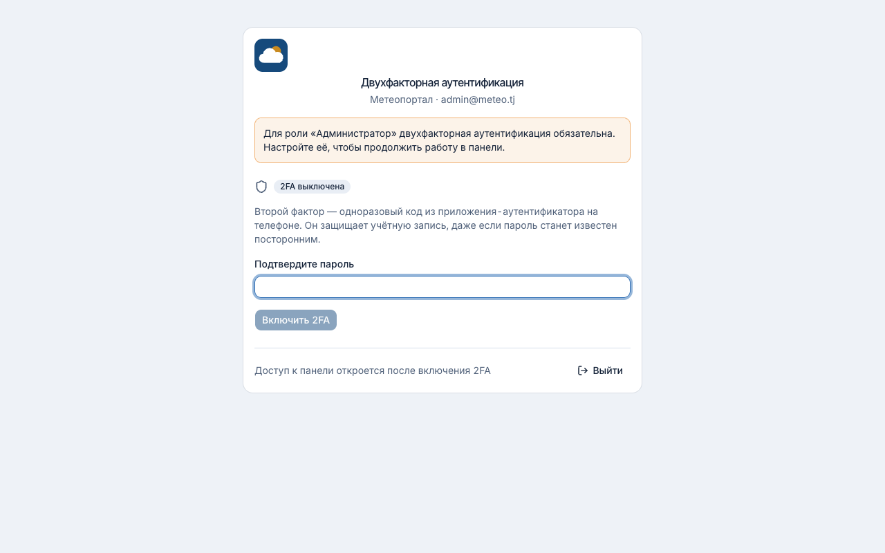

Тартиби фаъолсозӣ:

1. Ба телефон барномаи аутентификатор насб кунед (Google Authenticator, Microsoft Authenticator, Aegis, FreeOTP — ҳар барномаи стандарти TOTP).
2. Дар саҳифаи «Аутентификатсияи дуомила» паролро ворид карда, «Фаъол кардани 2FA»-ро пахш кунед.
3. QR-рамзро бо барнома скан кунед ё калидро дастӣ ворид намоед.
4. **Рамзҳои эҳтиётиро нигоҳ доред** (10 рамзи якдафъаина): «Боргирӣ» ё «Нусха гирифтан»-ро пахш карда, файлро дар менеҷери паролҳо ё сейф гузоред. Бе телефон ва бе рамзҳои эҳтиётӣ ворид шудан имконнопазир аст.
5. Рамзи шашрақамаро аз барнома ворид карда, «Тасдиқ ва фаъол кардан»-ро пахш кунед.

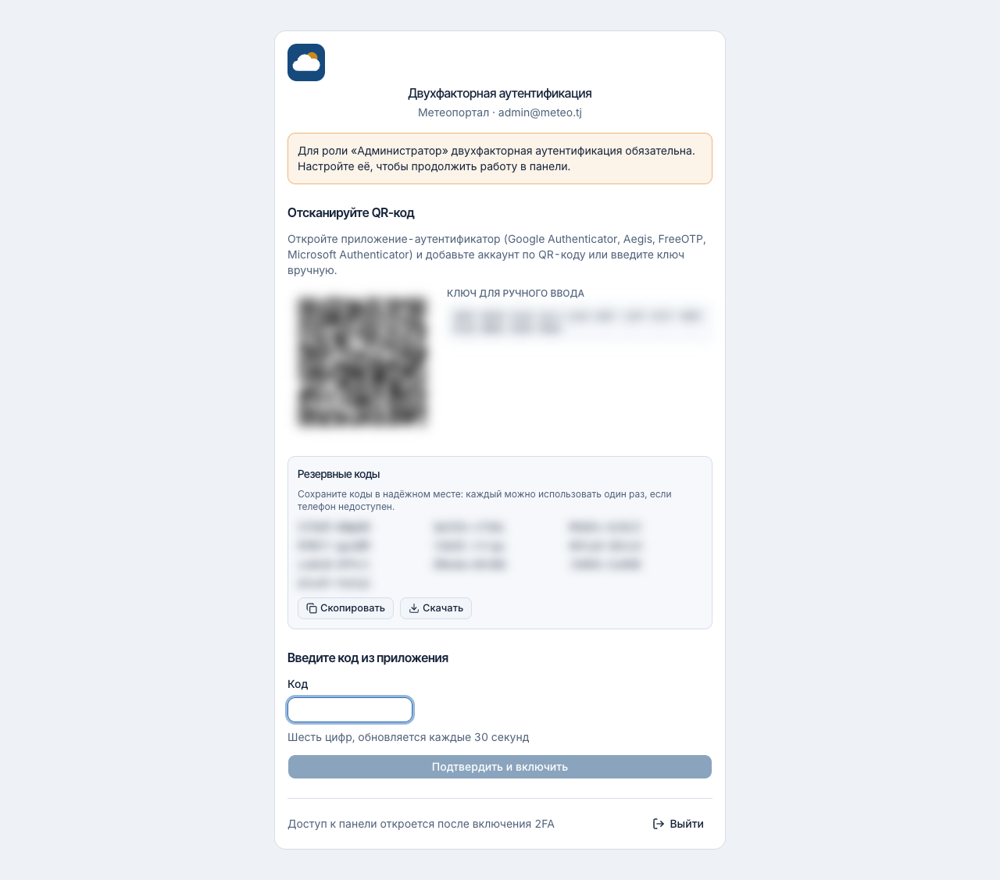

### 2.3. Вуруд бо рамз


- Рамзро аз барнома ворид кунед (ҳар 30 сония нав мешавад) ва «Тасдиқ кардан»-ро пахш кунед.
- Агар телефон дар даст набошад — «Истифодаи рамзи эҳтиётӣ». Ҳар рамзи эҳтиётӣ як маротиба амал мекунад.
- Нишонаи «Ба ин дастгоҳ 30 рӯз бовар кардан» дар ин компютер як моҳ аз вориди рамз озод мекунад. Онро дар компютерҳои умумӣ фаъол накунед.
- Пас аз 10 рамзи нодуруст ҳисоб 15 дақиқа баста мешавад; маҳдудият — 5 кӯшиш дар як дақиқа.
- Хатои «Рамз нодуруст ё мӯҳлаташ гузаштааст» аксаран маънои онро дорад, ки вақти телефон нодуруст аст: ҳамоҳангсозии автоматии вақтро фаъол кунед.

### 2.4. Саҳифаи «Амният ва 2FA»

Банди менюи корбар → «Амният ва 2FA» (`/admin/two-factor`): дар ин ҷо ҳолати 2FA дида мешавад, рамзҳои эҳтиётии нав баровардан мумкин аст (кӯҳнаҳо аз кор мемонанд; парол лозим аст). Маъмур 2FA-и худро хомӯш карда наметавонад. Операторон ва муҳаррирон метавонанд 2FA-ро ихтиёран фаъол кунанд — тавсия дода мешавад.


Агар телефон гум шуда, рамзҳои эҳтиётӣ набошанд, маъмури дигар дар бахши «Корбарон» 2FA-ро барқарор мекунад (амали «Барқарорсозии 2FA»); ҳангоми вуруди навбатӣ онро аз нав танзим кардан лозим аст. Агар маъмур як нафар бошад, дастрасиро хадамоти IT мувофиқи runbook барқарор мекунад.

## 3. Лавҳаи идора

Лавҳаи идора (`/admin`) — ҷамъбасти ҳолати система (ниг. расми 1):

| Блок | Чиро нишон медиҳад | Ба чӣ диққат додан лозим |
|---|---|---|
| Кортҳо | истгоҳҳо дар феҳрист ва фаъол, ченакҳо дар 24 соат, навбати назорати сифат, аз ҳад гузаштанҳои фаъол, корбарон | навбати QC ва аз ҳад гузаштанҳои афзоянда вокуниши операторро талаб мекунанд |
| Навии маълумот аз рӯи истгоҳҳо | вақти ченаки охирини ҳар истгоҳи фаъол; «кӯҳна шудааст» — дар 24 соат маълумот нест; ҳиссаи истгоҳҳои бе маълумот | пост маълумот намефиристад — воридкунӣ/воридотро тафтиш кунед |
| Хизмати фонӣ | оё worker кор мекунад (heartbeat ҳар дақиқа); «ҷавоб намедиҳад» — ба хадамоти IT муроҷиат кунед | бе worker индекс, пешгӯиҳо ва номаҳо нав намешаванд |
| Навбати номаҳо | оё SMTP танзим шудааст, чанд нома интизор аст, бо хато, дар як шабонарӯз фиристода шуд; истинод ба номаи санҷишӣ | хатоҳои фиристодан — SMTP-ро дар «Танзимот» тафтиш кунед |
| Интегратсияҳо | SmartMet (пешгӯии обу ҳаво), SILAM (пешгӯии сифати ҳаво), SmartMet Alert (CAP): боркунии охирини муваффақ, оғози модел, суроғаи манбаъ, ҳолат | ҳолатҳо дар [бахши 14](#14-ҳолати-интегратсияҳо-ва-вазифаҳои-фонӣ) тасвир шудаанд |
| Амалҳои охирин | сабтҳои охирини феҳристи аудит | истиноди «Тамоми феҳрист» |

## 4. Феҳристи истгоҳҳо

Бахши «Истгоҳҳо» (`/admin/stations`) — шиносномаҳои постҳо ва истгоҳҳои мониторинги ҳаво. Аз сабт дар феҳрист вобаста аст: нишон додан дар харита ва рӯйхатҳои портал, кадом моддаҳоро ворид кардан мумкин аст, воҳидҳои воридкунӣ, пайвастагӣ ба вилоят барои қоидаҳои огоҳӣ.

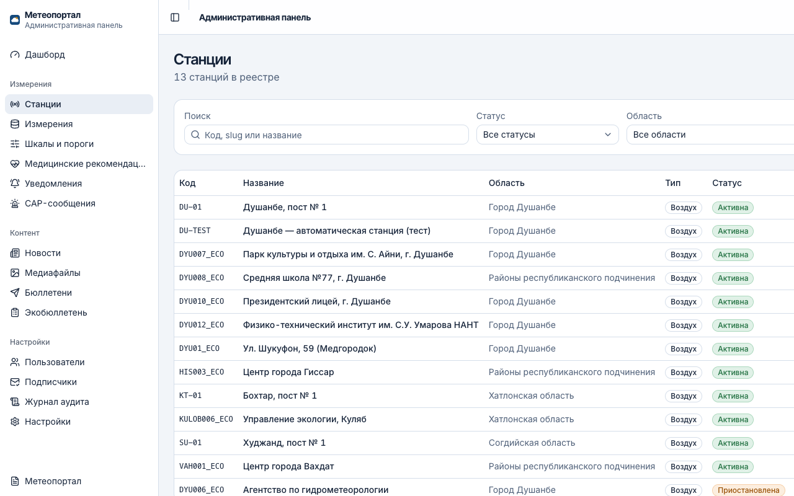

### 4.1. Илова кардани истгоҳ

«Илова кардани истгоҳ»-ро пахш карда, шаклро пур кунед.

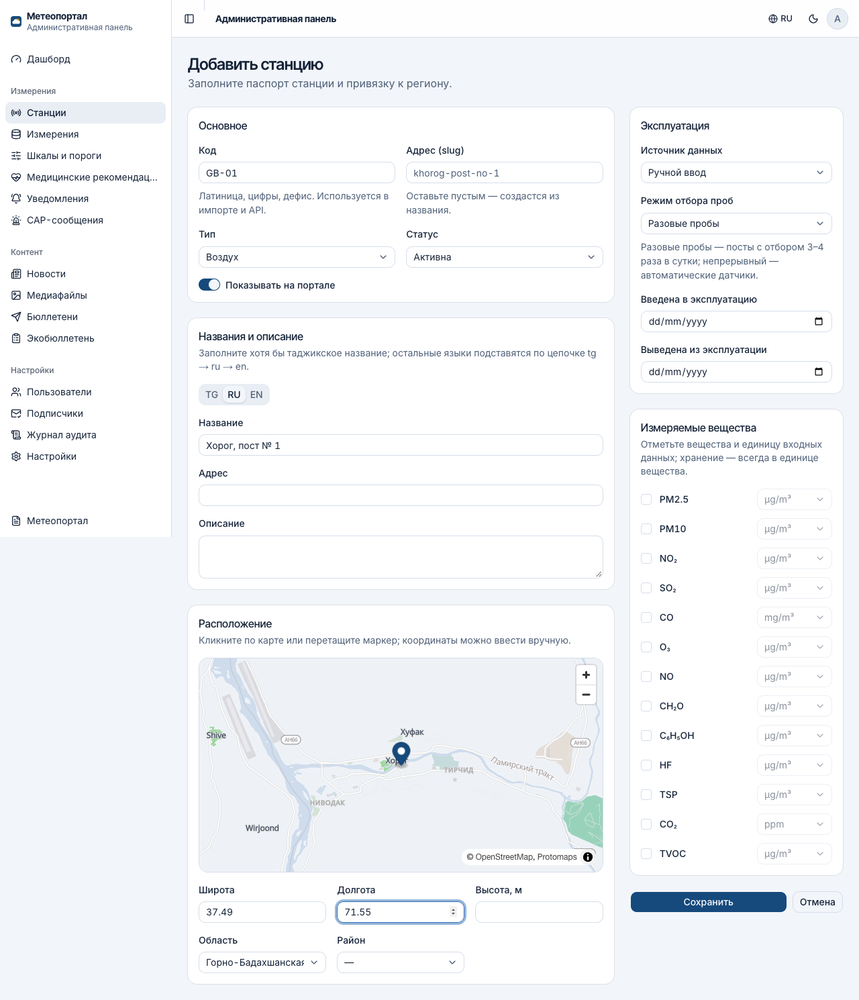

| Майдон | Чӣ тавр пур кардан |
|---|---|
| Рамз | 2–32 аломат: ҳарфҳои лотинӣ, рақамҳо, дефис, зерхат (масалан `DU-01`). Беназир; дар файлҳои воридот ва API истифода мешавад. Пас аз оғози воридкунии маълумот тағйир додан тавсия намешавад |
| Суроға (slug) | қисми суроғаи саҳифаи истгоҳ дар портал; холӣ — аз ном сохта мешавад |
| Ном, тавсиф, суроға | ба се забон (ҷадвалбандҳои TG / RU / EN); як забон кифоя аст, боқимонда бо занҷири tg → ru → en иваз мешаванд |
| Навъ | ҳаво / метео / омехта |
| Ҳолат | фаъол / боздошта / аз истифода баровардашуда |
| Арз, тӯл | дар харита клик кунед, нишонаро кашед ё дастӣ ворид кунед (арз 35–42, тӯл 66–76) |
| Вилоят, ноҳия | ноҳия пас аз вилоят интихоб мешавад; рӯйхати ноҳияҳо аз ҳудудҳои боршуда пур мешавад |
| Баландӣ, м | ихтиёрӣ |
| Ба истифода дода шуд | санаи оғози мушоҳидаҳо |
| Манбаи маълумот | воридкунии дастӣ / воридоти файлҳо / API / санҷишгари автоматӣ — майдони маълумотӣ |
| Тартиби намунагирӣ | намунаҳои яккарата (постҳо бо намунагирии 3–4 маротиба дар шабонарӯз) ё пайваста (санҷишгарҳои автоматӣ). Аз тартиб сатрҳои вақт бо нобаёнӣ дар воридкунии дастӣ вобастаанд |
| Дар портал нишон додан | нишонаро бардоред, то истгоҳ дар харита ва рӯйхатҳо пайдо нашавад (маълумот нигоҳ дошта мешавад) |
| Моддаҳои ченшаванда | моддаҳо ва воҳиди маълумоти воридшавандаро қайд кунед (µg/m³, mg/m³, ppb, ppm). Нигоҳдорӣ — ҳамеша дар воҳиди модда аз маълумотнома; қиматҳо ҳангоми воридкунӣ аз нав ҳисоб мешаванд |

«Нигоҳ доштан» — корти истгоҳи сохташуда кушода мешавад. Хато дар майдони «Рамз» маънои онро дорад, ки чунин рамз аллакай мавҷуд аст.

### 4.2. Корти истгоҳ, калиди API, аз истифода баровардан

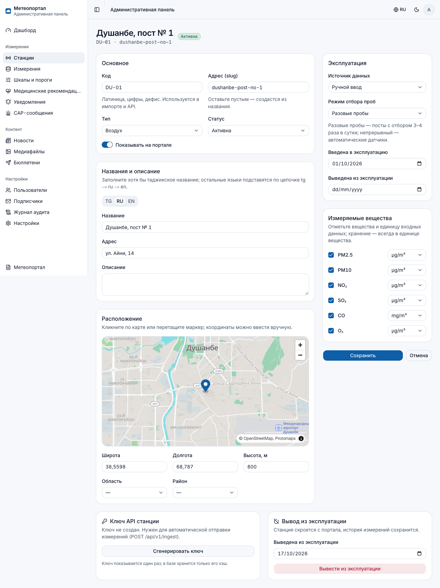

- Ҳамаи майдонҳо мисли ҳангоми сохтан таҳрир мешаванд; тағйирот ба феҳристи аудит меафтад (пеш/пас).
- **Калиди API-и истгоҳ** барои фиристодани автоматии ченакҳо лозим аст (агенти истгоҳ, логгер ё нармафзори истеҳсолкунанда → `POST /api/v1/ingest/{рамз}`). Калид як маротиба нишон дода мешавад, дар пойгоҳ танҳо хэши он нигоҳ дошта мешавад; «Навсозии калид» кӯҳнаро иваз мекунад ва калиди пешина дарҳол аз кор мемонад. Чӣ тавр истгоҳро пайваст кардан — боби 4.3.
- **Қабули автоматии маълумот** (блок дар болои шакл): истгоҳ бори охир кай маълумот фиристодааст, тавассути кадом канал (API ё гирифтани файлҳо), чанд сабт қабул ва рад шудааст, давраи маълумот. Ҳолати «дер боз маълумот нест» маънои онро дорад, ки қабул аз ҳадди муқарраршуда (аз рӯи пешфарз 3 соат) дарозтар набуд.
- **Манбаъҳои файлҳо (SFTP / FTP / HTTP)** (блок дар зери шакл): танзими гирифтани файлҳои содирот аз сервери истеҳсолкунанда — боби 4.3.
- **Аз истифода баровардан**: истгоҳ аз портал нопадид мешавад, таърихи ченакҳо нигоҳ дошта мешавад ва дар дидани маълумот ва API-и бойгонӣ дастрас мемонад. Амал тавассути интерфейс баргардонданашаванда аст; ҳангоми зарурат ҳолатро хадамоти IT тағйир медиҳад.

### 4.3. Пайвасти истгоҳ: қабули автоматии маълумот

> ⚠️ Матни ин боб тарҷумаи автоматӣ аст ва аз ҷониби соҳибзабон тафтиш карда шавад (требует проверки носителем).

Портал маълумотро аз истгоҳҳо бо се роҳ қабул мекунад; ҳеҷ кадоме аз онҳо ба истеҳсолкунандаи таҷҳизот вобаста нест — формати файл ё дархост бо танзимот тасвир мешавад.

| Роҳ | Кай мувофиқ аст | Маъмур чиро танзим мекунад |
|---|---|---|
| Агенти истгоҳ | нармафзори истгоҳ файлҳои CSV/TSV-ро ба ҷузвдон дар компютери истгоҳ менависад | калиди API дар корт; хадамоти IT агентро дар истгоҳ насб мекунад (runbook, боби 9.4) |
| Фиристодани мустақим тавассути API | логгер ё нармафзори истгоҳ дархостҳои `POST /api/v1/ingest/{рамз}` фиристода метавонад | калиди API дар корт; тавсифи формат — саҳифаи портал «API барои таҳиягарон» (`/data/api`) |
| Гирифтани файлҳо (SFTP / FTP / FTPS / HTTP) | маълумот аллакай дар сервери истеҳсолкунанда ё Агентӣ ҷойгир мешавад | манбаъ дар блоки «Манбаъҳои файлҳо»-и корти истгоҳ |

**Пеш аз пайваст** дар корти истгоҳ моддаҳои ченшаванда ва воҳидҳои маълумоти вурудиро қайд кунед: қиматҳои моддаҳое, ки барои истгоҳ қайд нашудаанд, бо сабаби `pollutantNotConfigured` рад мешаванд. Дар майдони «Манбаи маълумот» «API» ё «Санҷишгари автоматӣ»-ро интихоб кунед — он гоҳ лавҳаи идора ва мактубҳо ба маъмурон танаффусҳои қабулро назорат мекунанд.

**Калиди API** (блоки «Калиди API-и истгоҳ»): «Сохтани калид» → калидро дарҳол нусхабардорӣ кунед, он дигар нишон дода намешавад. Онро ба хадамоти IT барои танзими агент ё логгер супоред. Агар калид ба дасти бегонагон афтода бошад — «Навсозии калид»: калиди кӯҳна фавран аз кор мемонад. Боздоштани истгоҳ (ҳолати «боздошта шуда») низ қабулро мебандад (ҷавоби 403).

**Манбаи файлҳо**: «Иловаи манбаъ» → майдонҳоро пур кунед:

| Майдон | Чӣ тавр пур кардан |
|---|---|
| Намуд | SFTP (SSH), FTP, FTPS ё HTTP(S) — файл аз рӯи суроға |
| Сервер, порт, корбар, парол | маълумоти дастрасӣ ба сервери истеҳсолкунанда; парол рамзгузоришуда нигоҳ дошта мешавад ва пас аз нигоҳдорӣ нишон дода намешавад (майдони холӣ ҳангоми таҳрир — пешинаро нигоҳ доштан, «-» — нест кардан). Ба ҷои парол `env:НОМ` — тағйирёбандаи муҳити сервери порталро (хадамоти IT) нишон додан мумкин аст |
| Калиди хусусии SSH, нақши ангушти калиди сервер | барои SFTP бо калид; нақши ангушти `SHA256:…` аз ивазкунии сервер муҳофизат мекунад (холӣ — бе санҷиш) |
| Феҳрист дар сервер, ниқоби файлҳо | ҷузвдони содирот ва ниқоб, масалан `*.csv` ё `DU-01_*.txt`; барои HTTP — суроғаи пурраи файл |
| Тавсифи сутунҳо (JSON) | формати файл: ҷудокунанда, рамзгузорӣ, сутуни вақт ва формати сана, сутунҳои моддаҳо (формати васеъ) ё сутунҳои «модда / қимат / воҳид» (формати дароз). Тугмаҳои қолаб тавсифҳои маъмулиро мегузоранд — номҳои сутунҳоро ба номҳои файл иваз кунед. Формати тавсиф ҳамон аст, ки дар конфиги агенти истгоҳ (`apps/station-agent/README.ru.md`) |
| Огоҳ кардан, агар маълумот аз ин дарозтар набошад, дақ. | пас аз чанд дақиқаи бе қиматҳои қабулшуда маъмурон мактуб мегиранд (аз рӯи пешфарз 180) |
| Фаъол | манбаи хомӯш пурсида намешавад, танзимот нигоҳ дошта мешаванд |

Пас аз нигоҳдорӣ «Ҳозир санҷидан»-ро пахш кунед: дар як дақиқа дар сатри манбаъ ҳолат («кор мекунад» / «нокомӣ» бо матни хато), вақти иҷрои охирин, муваффақият ва маълумот ва хулосаи иҷрои охирин (файлҳо, қабул шуд, рад шуд, хатоҳои аввал бо рақамҳои сатр) пайдо мешаванд. Баъдан портал ҳар 10 дақиқа файлҳои нав ва тағйирёфтаро мегирад; коркарди такрории файл бехатар аст — қиматҳо аз рӯи калиди «вақт + модда» навсозӣ мешаванд, қарорҳои оператор дар навбати назорати сифат аз нав навишта намешаванд.

**Чӣ тавр санҷидан, ки маълумот меояд**: блоки «Қабули автоматии маълумот» дар корт (вақт ва канали қабули охирин, қабул/рад шуд), сутуни «Қабули автоматӣ» дар лавҳаи идора (боби 3), сабтҳои `measurements.ingest` ва `measurements.pull` аз номи `station:<рамз>` дар феҳристи аудит (боби 6). Сабтҳои радшуда хомӯшона гум намешаванд: сабаби ҳар кадом (`unknownPollutant`, `unit`, `time`, `futureTime` …) ба фиристанда баргардонида мешавад ва ба хулосаи манбаъ меафтад.

**Мактубҳо ба маъмурон**: агар манбаъ аз ҳадди худ дарозтар ягон қиматро наорад ё истгоҳи бо қабули API зиёда аз 3 соат хомӯш бошад, ба ҳамаи маъмурон (ва суроғаҳои `ADMIN_ALERT_EMAILS`) мактуби «Аз истгоҳ … маълумот нест» меравад, ҳангоми барқароршавӣ — «Маълумот боз меояд».

## 5. Ченакҳо

Бахши «Ченакҳо» (`/admin/measurements`) воридкунии дастӣ, воридоти CSV, дидани маълумот ва навбати назорати сифатро муттаҳид мекунад; дар поён — бастаҳои охирини воридот.

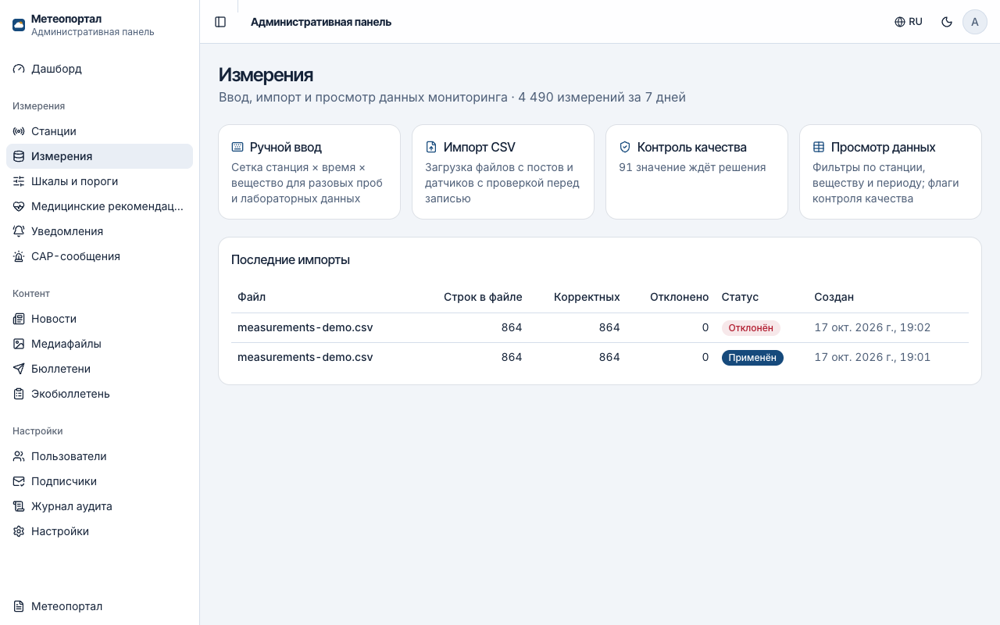

### 5.1. Воридкунии дастӣ

Барои постҳо бо намунаҳои яккарата ва маълумоти лабораторӣ.

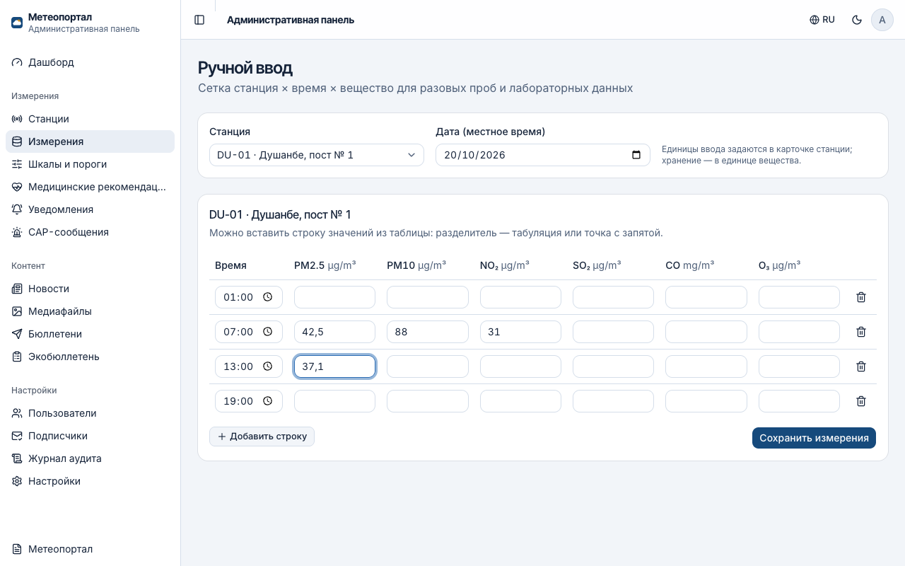

1. Истгоҳ ва санаро интихоб кунед (вақти маҳаллӣ, Душанбе). Дар ҷадвал танҳо моддаҳое пайдо мешаванд, ки дар истгоҳ қайд шудаанд, бо воҳидҳои воридкунии он.
2. Сатрҳои вақт бо нобаёнӣ аз тартиби истгоҳ вобастаанд (барои намунаҳои яккарата — 01:00, 07:00, 13:00, 19:00); вақтро тағйир додан, сатрҳоро илова ё нест кардан мумкин аст (то 48 сатр).
3. Қиматҳоро ворид кунед. Ҷудокунандаи даҳӣ — нуқта ё вергул. Сатрро аз Excel гузоштан мумкин аст: қиматҳо бо табулятсия ё нуқта-вергул.
4. «Нигоҳ доштани ченакҳо». Дар поён паёми «Қиматҳои нигоҳдошташуда: N» пайдо мешавад.

Ҳангоми нигоҳдорӣ чӣ мешавад:

- қиматҳо ба воҳиди модда аз нав ҳисоб мешаванд (масалан, ppb → µg/m³ аз рӯи массаи молярӣ);
- қоидаи ҳудуд тафтиш мешавад: қимати берун аз фосилаи иҷозатдодашуда бо нишонаи «беэътимод» нигоҳ дошта шуда, ба навбати назорати сифат меафтад; боқимонда нишонаи «эътимоднок» мегиранд;
- воридкунии такрорӣ барои ҳамон вақт, истгоҳ ва модда қимати кӯҳнаро иваз мекунад (бо сабт дар аудит);
- индекси истгоҳ фавран аз нав ҳисоб мешавад, портал дар давоми як дақиқа нав мешавад.

### 5.2. Воридоти CSV

Барои файлҳо аз постҳо, аз системаи иттилоотии лабораторӣ ё аз санҷишгарҳои автоматӣ. Воридот дар ду қадам мегузарад: аввал санҷиш, баъд сабт.

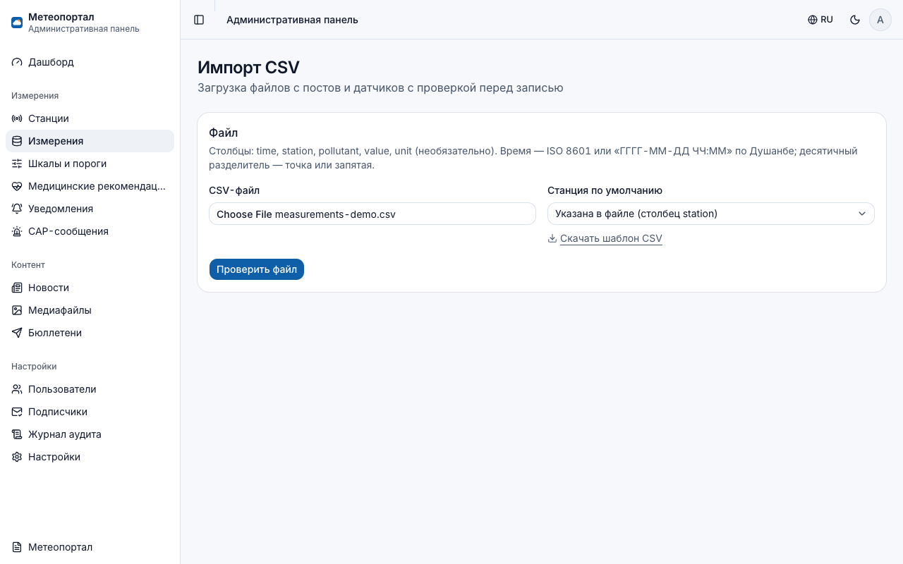

Формати файл:

- сутунҳои `time`, `station`, `pollutant`, `value`, `unit` (воҳид ихтиёрӣ); сарлавҳаҳо ба русӣ ҳам қабул мешаванд (`время`, `станция`, `вещество`, `значение`, `единица`);
- ҷудокунандаи сутунҳо — вергул, нуқта-вергул ё табулятсия (автоматӣ муайян мешавад); рамзгузорӣ UTF‑8 (Excel: «CSV UTF‑8»);
- вақт — ISO 8601 (`2026-10-17T07:00:00+05:00`) ё `СССС-ММ-РР СС:ДД` бо вақти Душанбе; вақти оянда рад мешавад;
- `station` — рамзи истгоҳ аз феҳрист; агар сутун набошад, «Истгоҳ бо нобаёнӣ»-ро интихоб кунед;
- `pollutant` — рамзи модда: `PM25`, `PM10`, `NO2`, `SO2`, `CO`, `O3`;
- `value` — рақам бо нуқта ё вергул; `unit` — `ug/m3`, `µg/m³`, `мкг/м3`, `mg/m3`, `ppb`, `ppm` (холӣ — воҳиди воридкунии истгоҳ);
- то 100 000 сатр ва 20 МБ дар як файл; сатрҳои такрорӣ (вақт + истгоҳ + модда) дар дохили файл рад мешаванд.

Намуна бо сарлавҳаҳои дуруст — истиноди «Боргирии намунаи CSV». Файли таълимиро бо фармон аз маводи омӯзишӣ сохтан мумкин аст (`node docs/training/make-sample-csv.mjs`).


Пас аз «Санҷиши файл» ҳисобот нишон дода мешавад: сатрҳо дар файл, дуруст, радшуда (бо рақами сатр ва сабаб), берун аз ҳудуд. «Татбиқ кардан (N)» сатрҳои дурустро сабт мекунад; сатрҳои хатодор гузаронида мешаванд — онҳоро дар файл ислоҳ карда, алоҳида бор кунед. «Рад кардан» бастаро бе сабт нест мекунад. Бастаи санҷиш муддати маҳдуд нигоҳ дошта мешавад: агар паёми «Мӯҳлати санҷиш гузашт» пайдо шавад, файлро аз нав бор кунед.

Қиматҳои берун аз ҳудуд бо нишонаи «беэътимод» сабт шуда, дар навбати QC қарорро интизор мешаванд. Индекс пас аз татбиқ аз нав ҳисоб мешавад. Воридоти такрории ҳамон файл бехатар аст: қиматҳо бо ҳамон вақт, истгоҳ ва модда нав мешаванд.

### 5.3. Дидани маълумот

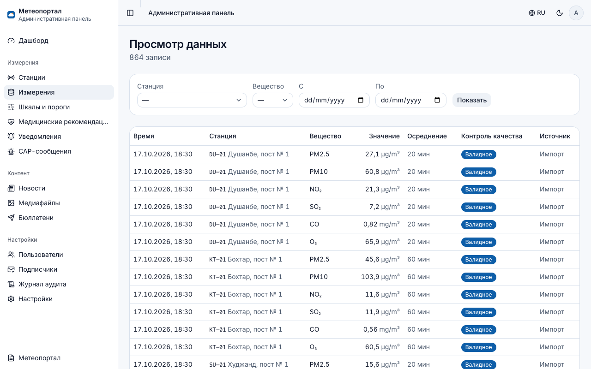

Филтрҳо: истгоҳ, модда, давра. Дар ҷадвал — вақт (маҳаллӣ), қимат дар воҳиди модда, миёнагирӣ (20 — намунаи яккарата, 60 — соат, 1440 — шабонарӯз), нишонаи назорати сифат, манбаъ (воридкунии дастӣ / воридот / API / санҷишгар). Нишонаҳо:

| Нишона | Маъно | Дар индекс ва графикҳо ба ҳисоб гирифта мешавад |
|---|---|---|
| Хом | қабул шуд, назорати автоматӣ ҳоло нагузаштааст | ҳа (то қарор) |
| Эътимоднок | назоратро гузашт ё аз ҷониби оператор тасдиқ шуд | ҳа |
| Шубҳанок | назорати автоматӣ аномалияро қайд кард, қарорро интизор аст | не |
| Беэътимод | берун аз ҳудуд ё аз ҷониби оператор рад шуд | не |
| Ислоҳшуда | қимат аз ҷониби оператор ислоҳ шуд, аслӣ нигоҳ дошта шуд | ҳа (қимати нав) |
| Маълумот нест | холигӣ | не |

### 5.4. Навбати назорати сифат

Назорати автоматии сифат (QC) аз ҷониби хизмати фонӣ ҳар 15 дақиқа ва ҳангоми воридкунӣ иҷро мешавад:

| Қоида | Чиро меёбад |
|---|---|
| Ҳудуд (ҳангоми воридкунӣ ва воридот) | қимати берун аз фосилаи физикан имконпазир барои модда → «беэътимод» |
| Ҷаҳиш | фарқи якбора аз қиматҳои ҳамсоя аз рӯи вақт → «шубҳанок» |
| Часпидани санҷишгар | ҳамон як қимат якчанд соат пайи ҳам → «шубҳанок» |
| Партофта нисбат ба таърихи истгоҳ | меъёри устувор (MAD) аз рӯи таърихи истгоҳ → «шубҳанок» |

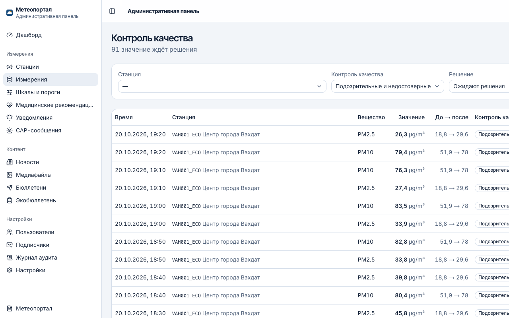

Қарори оператор барои ҳар қимат:

- **Тасдиқ** — қимат дуруст аст; нишонаи «эътимоднок», қимат дар ҳисобҳо иштирок мекунад.
- **Ислоҳ** — қимати нав ва сабабро ворид кунед (масалан, «хатои воридкунӣ: сифри зиёдатӣ»); қимати аслӣ нигоҳ дошта мешавад, нишонаи «ислоҳшуда».
- **Рад** — аз ҳисобҳо ва графикҳо хориҷ кардан; нишонаи «беэътимод».

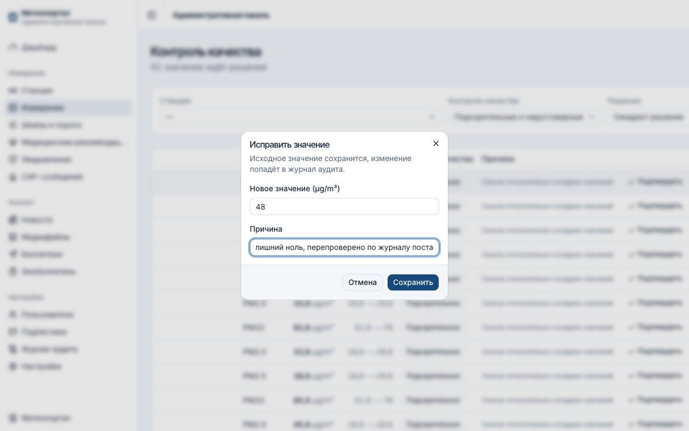

Пас аз қарор қимат барои назорати автоматӣ баста мешавад (такроран ба навбат намеафтад), индекси истгоҳ аз нав ҳисоб мешавад, дар феҳристи аудит амал бо «пеш → пас» ва сабаб сабт мешавад. Филтри «Қарор → Аллакай коркардшуда» таърихи қарорҳоро нишон медиҳад.

## 6. Феҳристи аудит

Бахши «Феҳристи аудит» (`/admin/audit`) ҳамаи амалҳоро дар панел нигоҳ медорад: кӣ (e‑mail ва нақш), кай, чӣ кард (`stations.update`, `measurement.correct`, `news.publish`, `user.ban` ва ғайра), бо кадом объект, ва ҳолати «пеш» / «пас» дар шакли JSON. Сабтҳоро тағйир ё нест кардан мумкин нест — ҳатто маъмур; ҳангоми нест кардани корбар амалҳои ӯ бо e‑mail дар феҳрист мемонанд.

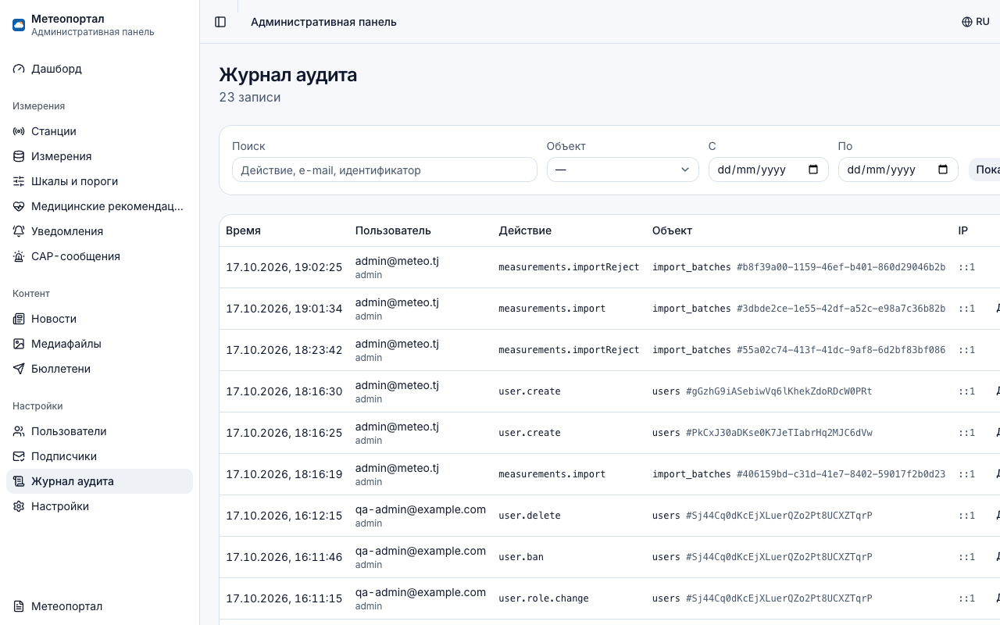

Ҷустуҷӯ аз рӯи амал, e‑mail ё идентификатор; филтр аз рӯи объект ва давра. Феҳристро ҳангоми баррасии қиматҳои баҳснок, барқарорсозии танзимоти тасодуфан тағйирёфта ва санҷишҳо истифода баред.

## 7. Шкалаҳо, ҳадҳо ва ҲИМ

Бахши «Шкалаҳо ва ҳадҳо» (`/admin/scales`) — танҳо барои маъмурон. Тағйирот ба ҳисоби индекс фавран татбиқ мешавад ва ба тамоми портал, виҷетҳо ва API таъсир мерасонад; ҳадҳоро танҳо мувофиқи методикаи тасдиқшуда тағйир диҳед ва қарорро ҳуҷҷатӣ сабт кунед.

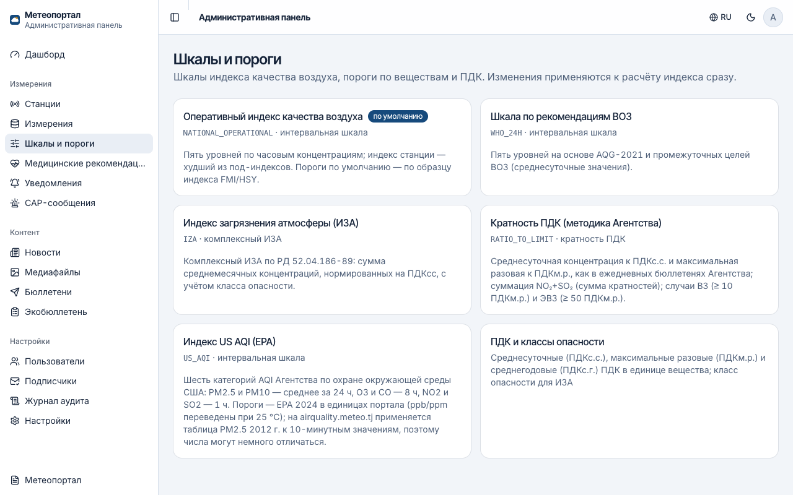

Дар маҷмӯа се шкала мавҷуд аст:

| Шкала | Навъ | Таъинот |
|---|---|---|
| Индекси оперативии сифати ҳаво | фосилавӣ (5 сатҳ аз рӯи консентратсияҳои соатӣ, бадтарин модда) | шкалаи оммавӣ бо нобаёнӣ: харита, саҳифаҳои истгоҳҳо, виҷетҳо |
| Шкала аз рӯи тавсияҳои ТУТ | фосилавӣ (меъёрҳои миёнаи шабонарӯзии ТУТ 2021) | маълумотӣ |
| Индекси ифлосшавии атмосфера (ИИА) | маҷмӯӣ аз рӯи консентратсияҳои миёнаи моҳона ва ҲИМ | ҳисоботи миллӣ |

### 7.1. Таҳрири шкала

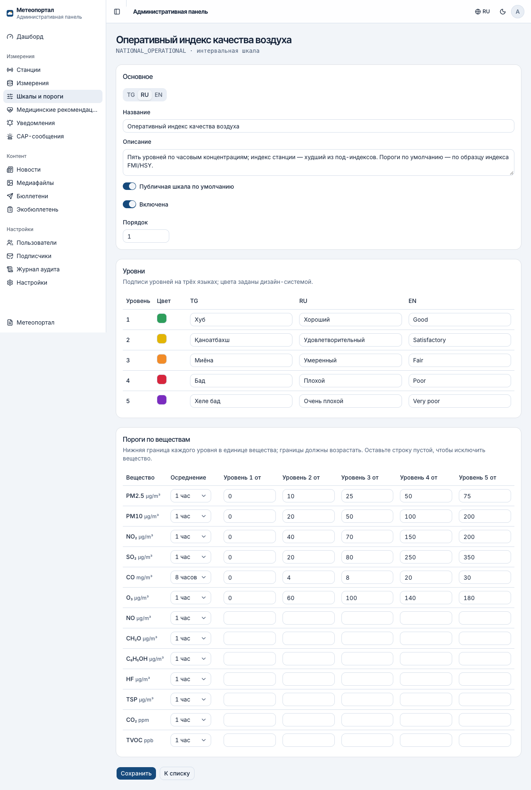

- **Асосӣ**: ном ва тавсиф ба се забон, нишонаҳои «Фаъол» ва «Шкалаи оммавӣ бо нобаёнӣ» (маҳз як шкала метавонад оммавӣ бошад), тартиб.
- **Сатҳҳо**: навиштаҷоти панҷ сатҳ ба се забон; рангҳо аз ҷониби системаи дизайн муқаррар шудаанд (сабз, зард, норанҷӣ, сурх, бунафш) ва тағйир намеёбанд.
- **Ҳадҳо аз рӯи моддаҳо** (шкалаи фосилавӣ): ҳудуди поёнии ҳар сатҳ дар воҳиди модда ва давраи миёнагирӣ (1 с, 8 с, 24 с). Ҳудудҳо бояд қатъиян афзоянд; барои модда ҳамаи панҷ ҳудудро пур кардан ё сатрро холӣ гузоштан лозим аст — он гоҳ модда ба индекс дохил намешавад.

Пас аз «Нигоҳ доштан» паёми «Шкала нигоҳ дошта шуд, индекс аз нав ҳисоб карда шуд» пайдо мешавад.

### 7.2. ҲИМ ва синфҳои хатар

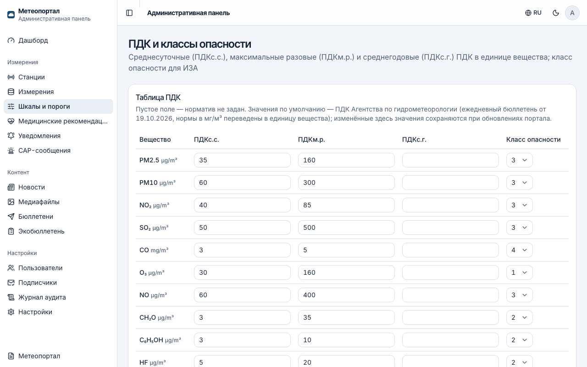

Саҳифаи «ҲИМ ва синфҳои хатар» (`/admin/scales/limits`): ҲИМ-и миёнаи шабонарӯзӣ, ниҳоии яккарата ва миёнаи солона дар воҳиди модда, инчунин синфи хатар (1–4) барои ҳисоби ИИА. Майдони холӣ — меъёр муқаррар нашудааст. Қиматҳо бо нобаёнӣ аз СанПиН 1.2.3685‑21 гирифта шудаанд ва бояд аз ҷониби Агентӣ тасдиқ шаванд.

## 8. Тавсияҳои тиббӣ

Бахши «Тавсияҳои тиббӣ» (`/admin/health-advice`) — матнҳое, ки портал дар назди индекс нишон медиҳад: дар саҳифаи асосӣ, дар саҳифаҳои истгоҳҳо, дар бахши «Саломатӣ» ва дар виҷетҳо.


- Шкаларо интихоб кунед (одатан — оммавӣ бо нобаёнӣ).
- Барои ҳар сатҳ (1–5) ва ҳар гурӯҳи аҳолӣ (аҳолии умумӣ, кӯдакон, занони ҳомила ва ширдеҳ, пиронсолон, бемориҳои музмини роҳи нафас, бемориҳои дилу раг) сарлавҳа ва матнро ба се забон пур кунед.
- Бо тугмаи «Нигоҳ доштани сатҳи «…»» дар зери ҳар сатҳ нигоҳ доред.

Матнҳо бояд бо коршиносони тиббӣ мувофиқа шаванд; дар портал дар назди онҳо қайд нишон дода мешавад, ки тавсияҳо машварати духтурро иваз намекунанд.

## 9. Огоҳиҳо дар бораи аз ҳад гузаштан ва обуначиён

### 9.1. Қоидаҳои огоҳӣ

Бахши «Огоҳиҳо» (`/admin/alerts`): қоидаҳое, ки мувофиқи онҳо портал баннери аз ҳад гузаштанро нишон медиҳад ва ба обуначиён нома мефиристад.

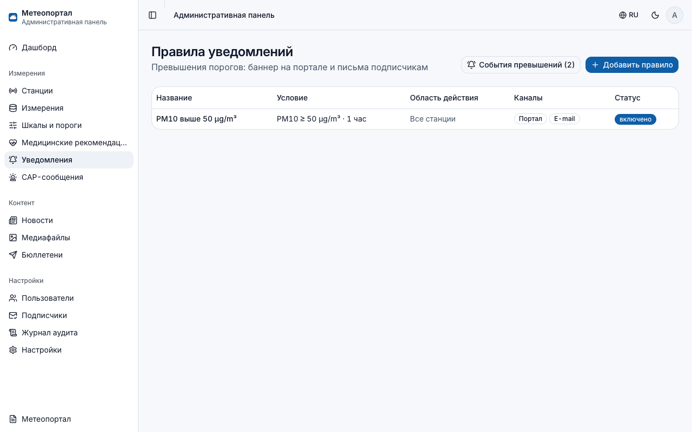

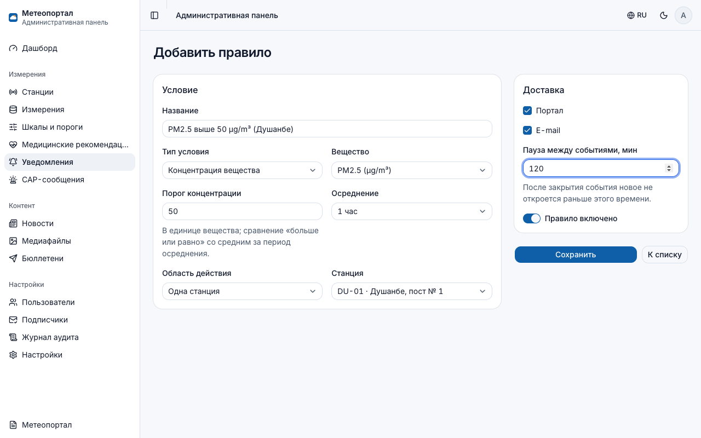

| Майдон | Тавсиф |
|---|---|
| Ном | қоида дар баннер ва номаҳо чӣ тавр номида мешавад |
| Навъи шарт | консентратсияи модда (ҳад дар воҳиди модда, муқоисаи «калон ё баробар» бо миёна барои давраи миёнагирии 1 / 8 / 24 с) ё сатҳи индекс (ҳади 1–5 аз рӯи шкалаи интихобшуда) |
| Доираи амал | ҳама истгоҳҳо / як истгоҳ / вилоят |
| Каналҳо | «Портал» — баннер дар саҳифаи асосӣ ва саҳифаи истгоҳ, маълумот дар `/api/v1/exceedances`; «E‑mail» — номаҳо ба обуначиёни тасдиқшудаи истгоҳ ё ҳамаи истгоҳҳо |
| Танаффус байни рӯйдодҳо, дақ | пас аз бастани рӯйдод рӯйдоди нав аз рӯи ҳамон қоида ва истгоҳ пеш аз ин вақт кушода намешавад (0–10080) |
| Қоида фаъол аст | қоидаи хомӯшшуда нигоҳ дошта мешавад, аммо тафтиш намешавад |

Санҷиш чӣ тавр кор мекунад: вазифаи фонӣ ҳар 10 дақиқа соати охирини дастраси маълумоти ҳар истгоҳро мегирад (на кӯҳнатар аз 6 соат), бо ҳад муқоиса мекунад, рӯйдоди аз ҳад гузаштанро мекушояд, қимати ниҳоиро нав мекунад ва рӯйдодро мебандад, вақте ки қимат аз ҳад поён мефарояд. Номаҳо як маротиба барои ҳар рӯйдод ва обуначӣ ба навбат гузошта мешаванд.

### 9.2. Рӯйдодҳои аз ҳад гузаштан

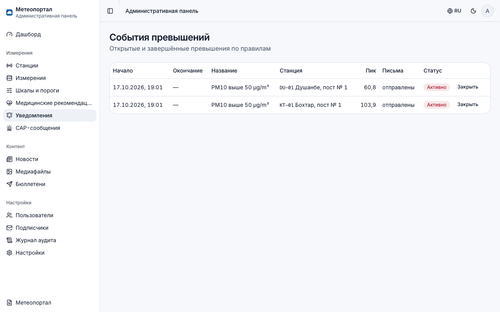

Саҳифаи «Рӯйдодҳои аз ҳад гузаштан» (`/admin/alerts/events`): оғоз, анҷом, қимати ниҳоӣ, оё номаҳо фиристода шуданд. Рӯйдоди фаъолро бо тугмаи «Бастан» дастӣ бастан мумкин аст (масалан, пас аз рад кардани қимати хато дар QC).

### 9.3. Обуначиён

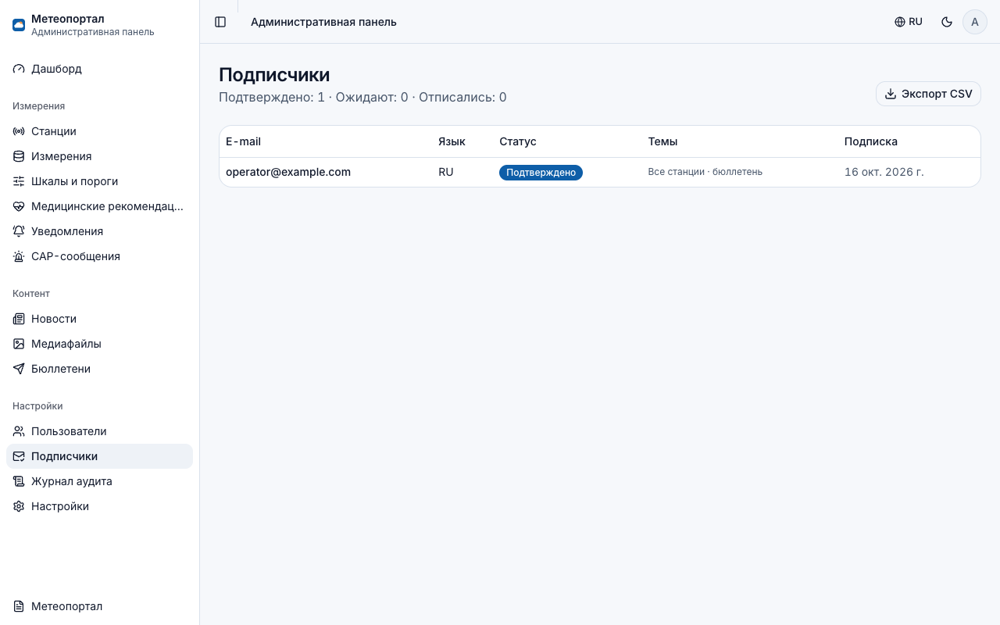

Бахши «Обуначиён» (`/admin/subscribers`) суроғаҳо, забон, ҳолат (тасдиқшуда / интизор / обунаро қатъ карданд) ва мавзӯъҳоро нишон медиҳад: ҳама истгоҳҳо, истгоҳҳои интихобшуда, бюллетени иттилоотӣ. Обуна аз ҷониби меҳмонон дар саҳифаи `/subscribe` бо тасдиқ тавассути истинод аз нома (double opt‑in) расмӣ мешавад; қатъи обуна — тавассути истинод дар ҳар нома. Суроғаҳоро дар панел таҳрир кардан мумкин нест — ин аз фиристодани нома бе розигӣ муҳофизат мекунад. «Содироти CSV» рӯйхатро барои ҳисобот бор мекунад; бо он мисли маълумоти шахсӣ муносибат кунед.

## 10. Огоҳиҳои CAP

Бахши «Паёмҳои CAP» (`/admin/cap`) — огоҳиҳои тӯфонӣ аз муҳаррири SmartMet Alert дар формати CAP 1.2. Портал онҳоро худаш намесозад: вазифаи фонӣ ҳар 5 дақиқа фидро мехонад (суроғаро хадамоти IT бо тағйирёбандаи `CAP_FEED_URL` муқаррар мекунад) ва паёмҳоро нигоҳ медорад; дар портал онҳо дар бахши «Огоҳиҳо», дар харита, дар саҳифаи асосӣ, дар виҷет ва дар API пайдо мешаванд.

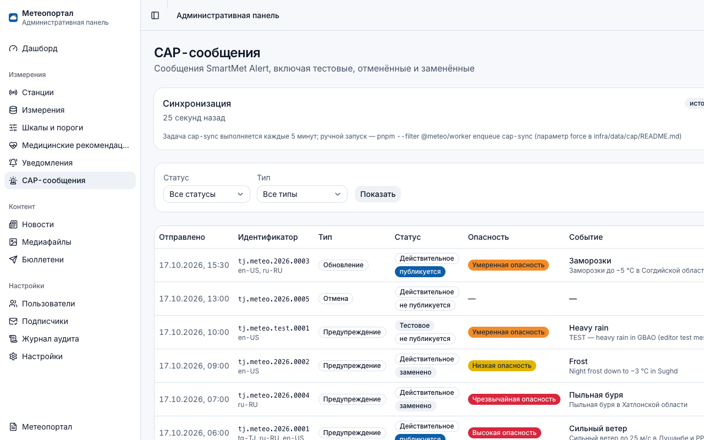

Ҳолатҳо дар рӯйхат:

| Ҳолат | Маъно |
|---|---|
| нашр мешавад | паёми амалкунанда ё интизоршаванда, дар портал дида мешавад |
| мӯҳлаташ гузашт | мӯҳлати амал (`expires`) гузашт — аз портал пинҳон шуд, дар бойгонии панел мемонад |
| иваз шуд | паёми навъи Update бо истинод ба ин омад; нусхаи нав нишон дода мешавад |
| бекор шуд | паёми Cancel омад; аз портал гирифта шуд |
| нашр намешавад | ҳолати `Test`, `Exercise`, `Draft` — танҳо дар панел дида мешавад |

Блоки «Ҳамоҳангсозӣ» дар боло натиҷаи иҷрои охиринро нишон медиҳад (муваффақ / қисман / хато / бе тағйирот / манбаъ танзим нашудааст) ва хатоҳои таҳлили файлҳои алоҳидаро.

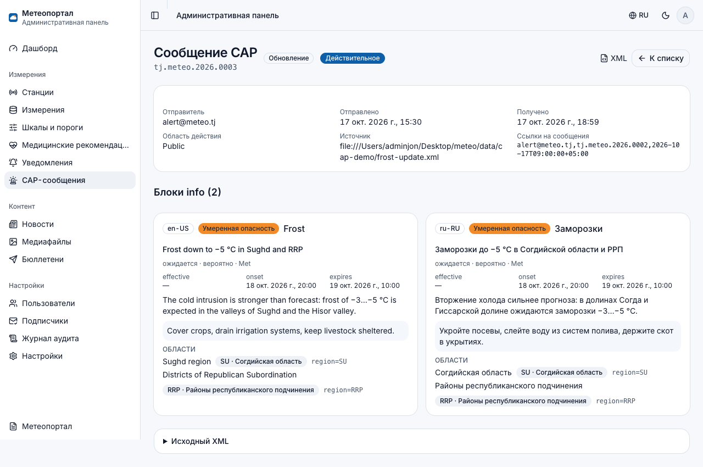

Дар корти паём — ҳамаи блокҳои `info` (аз рӯи забонҳо), минтақаҳои амал бо пайвастагӣ ба минтақаҳои огоҳӣ, параметрҳо ва тугмаи «XML» барои файли аслӣ. Ин ба фаҳмидани он кӯмак мекунад, ки чаро паём на он тавре ки интизор мерафт, нишон дода мешавад (масалан, блок ба тоҷикӣ нест — фолбэк ва луғати ҳодисаҳо истифода мешаванд).

### 10.1. Луғати ҳодисаҳо

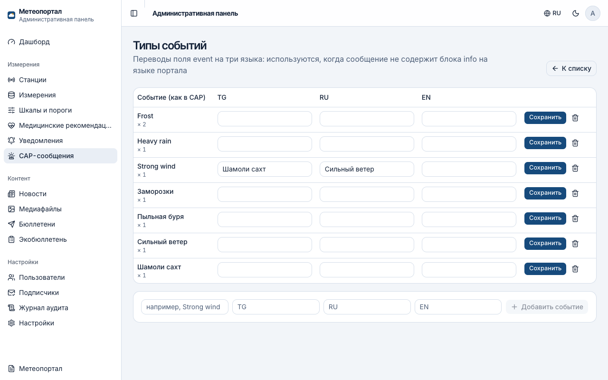

Саҳифаи «Навъҳои ҳодиса» (`/admin/cap/events`): тарҷумаҳои майдони `event` (масалан, `Strong wind` → «Сильный ветер» / «Шамоли сахт») ба се забон. Онҳо вақте истифода мешаванд, ки паём блоки `info`-ро ба забони портал надорад. Навъҳои нави ҳодисаҳо пас аз ҳамоҳангсозии аввал дар луғат автоматӣ пайдо мешаванд — тарҷумаҳоро пур кунед, вагарна дар портал матни аслӣ аз паём нишон дода мешавад.

## 11. Ахбор, файлҳои медиа ва бюллетенҳо

### 11.1. Ахбор

Бахши «Ахбор» (`/admin/news`): нашрияҳо барои бахши «Ахбор»-и портал, кортҳо дар саҳифаи асосӣ, RSS ва API.

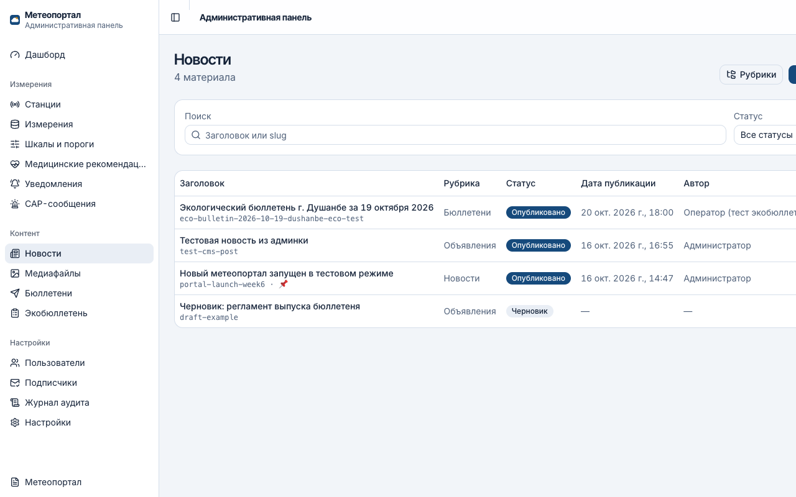

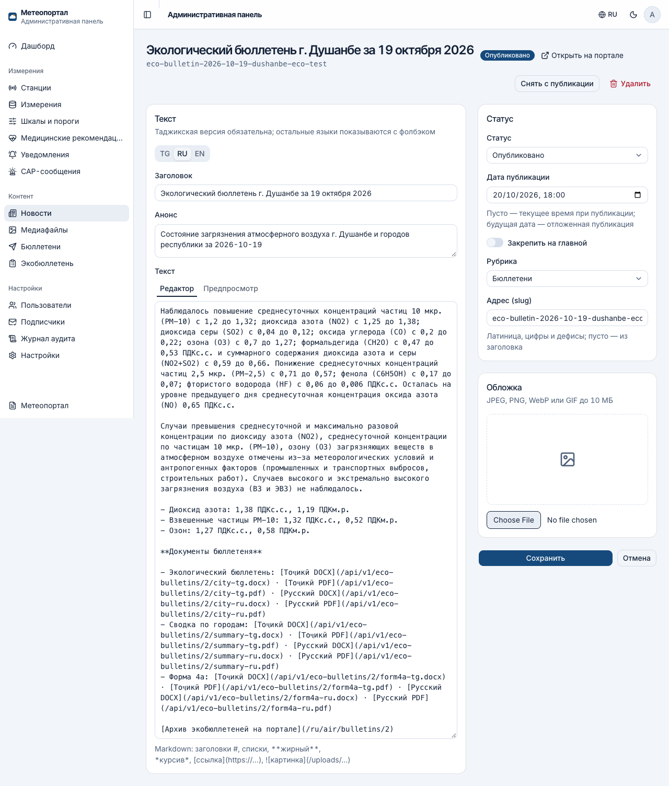

| Майдон | Тавсиф |
|---|---|
| Сарлавҳа, аннотатсия, матн | ба се забон; як забон кифоя аст (тоҷикӣ ҳамчун асосӣ тавсия мешавад), боқимонда бо фолбэки tg → ru → en нишон дода мешаванд |
| Матн | Markdown: сарлавҳаҳо `#`, рӯйхатҳо, `**ғафс**`, `*курсив*`, `[истинод](https://…)`, ``; тегҳои HTML гузаронида намешаванд. Ҷадвалбанди «Пешнамоиш» натиҷаро нишон медиҳад |
| Суроға (slug) | барои ҳамаи забонҳо умумӣ; холӣ — аз сарлавҳа |
| Рубрика | аз маълумотнома (саҳифаи «Рубрикаҳо») |
| Муқова | расми JPEG, PNG, WebP ё GIF то 10 МБ; бевосита аз шакл бор мешавад ё аз файлҳои медиа интихоб мешавад |
| Ҳолат | сиёҳнавис → нашршуда → дар бойгонӣ. Сиёҳнависҳо дар портал дида намешаванд |
| Санаи нашр | холӣ — лаҳзаи нашр; санаи оянда — нашри мавқуф (хабар дар вақти нишондодашуда пайдо мешавад) |
| Дар саҳифаи асосӣ мустаҳкам кардан | хабари мустаҳкамшуда аввал нишон дода мешавад |

Тугмаи «Нашр кардан» / «Аз нашр баровардан» ҳолатро бе нигоҳдории такрории шакл тағйир медиҳад. «Дар портал кушодан» ба саҳифаи хабар мебарад. Рубрикаҳо дар саҳифаи «Рубрикаҳо» идора мешаванд (ном ба се забон, slug, тартиб).

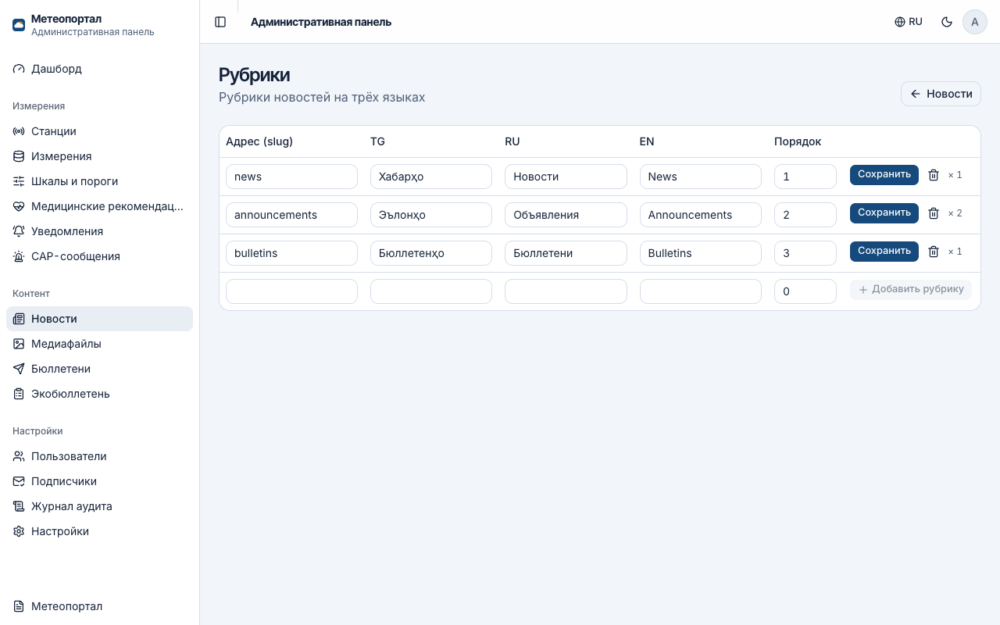

### 11.2. Файлҳои медиа

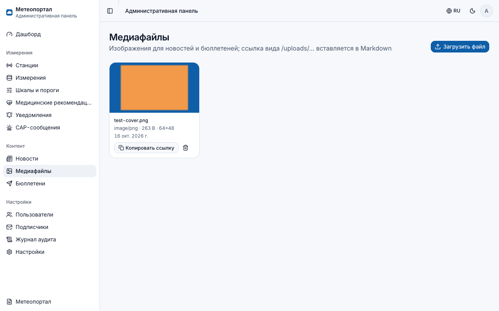

Бахши «Файлҳои медиа» (`/admin/media`): расмҳо ва PDF барои ахбор ва бюллетенҳо. JPEG, PNG, WebP, GIF ва PDF то 10 МБ иҷозат дода мешаванд; навъ аз рӯи мундариҷаи файл муайян мешавад, бинобар ин файлҳои номивазшудаи форматҳои дигар (масалан, SVG) рад мешаванд. Пас аз боркунӣ тугмаи «Нусхаи истинод» суроғаи намуди `/uploads/2026/10/….png`-ро барои гузоштан ба Markdown медиҳад. Нест кардани файл истинодҳоро ба он дар хабарҳои аллакай нашршуда вайрон мекунад.

### 11.3. Бюллетенҳо

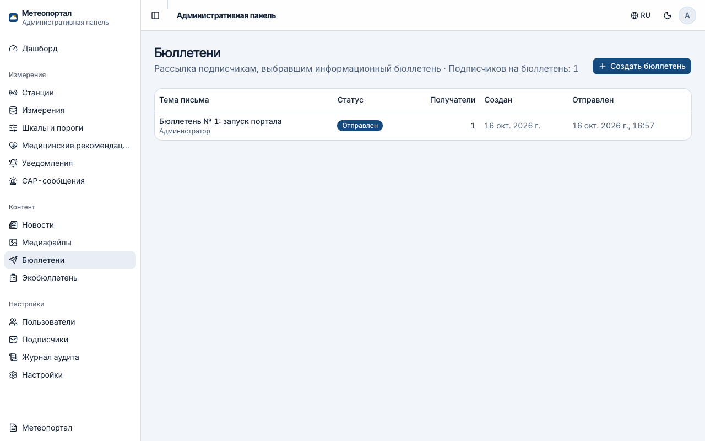

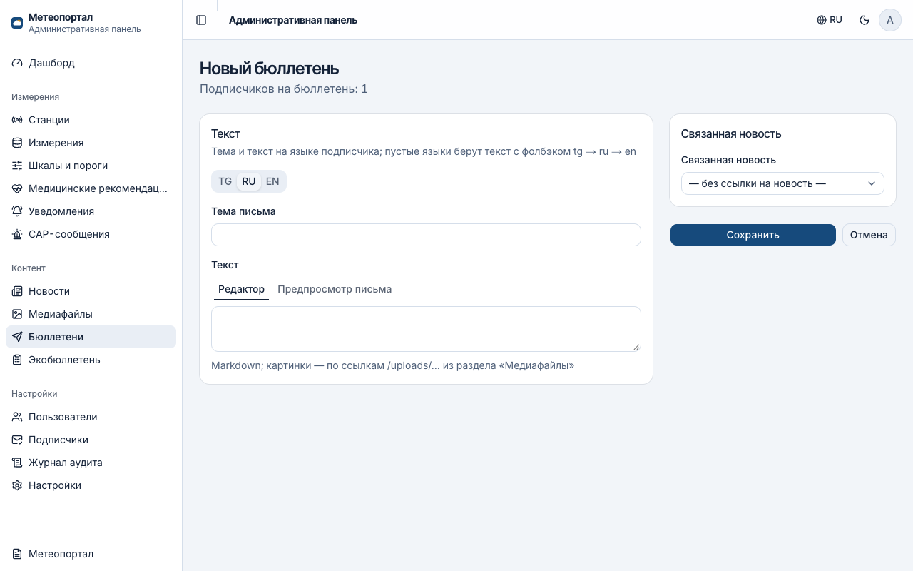

Бахши «Бюллетенҳо» (`/admin/bulletins`) — фиристодан ба обуначиёне, ки бюллетени иттилоотиро интихоб кардаанд.

1. Бюллетен созед: мавзӯъ ва матни нома (Markdown) ба забонҳои обуначиён; ҳангоми хоҳиш бо хабар пайваст кунед — ба нома истинод илова мешавад.
2. Нигоҳ доред ва «Пешнамоиши мактуб»-ро тафтиш кунед.
3. «Ба обуначиён фиристодан»: панел шумораи гирандагонро нишон медиҳад; пас аз тасдиқ номаҳо ба навбат гузошта мешаванд, ба ҳар кас — ба забони обунаи ӯ, бо истиноди қатъи обуна. Фиристоданро пас аз оғоз бекор кардан мумкин нест.
4. Ҳолат ба «Дар навбат», баъд ба «Фиристода шуд» тағйир меёбад, вақте ки хизмати фонӣ ҳамаи номаҳоро мефиристад (одатан дар давоми чанд дақиқа). Бюллетени фиристодашударо тағйир додан мумкин нест.

Агар дар лавҳаи идора дар навбати номаҳо хатоҳо афзоянд, фиристодан намеравад — SMTP-ро дар «Танзимот» тафтиш кунед ва ба хадамоти IT муроҷиат намоед.

## 12. Танзимот

Бахши «Танзимот» (`/admin/settings`) — танҳо барои маъмурон.

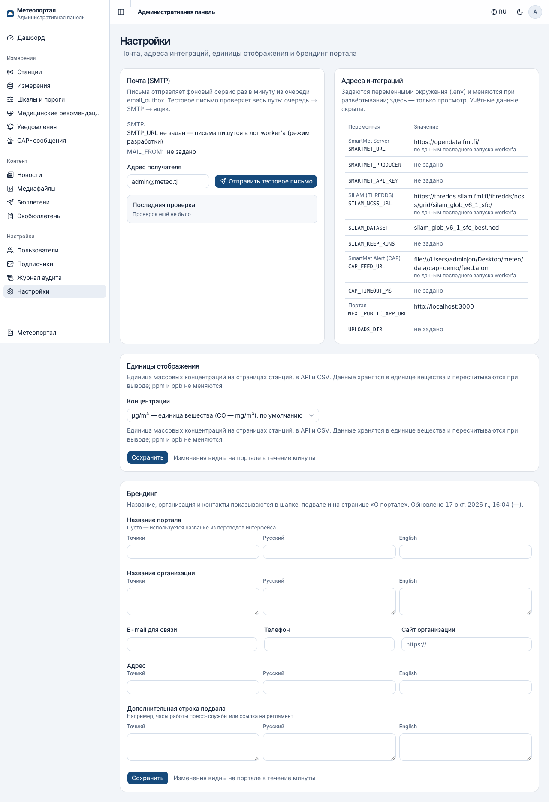

- **Почта (SMTP)**: нишон медиҳад, ки оё SMTP танзим шудааст (параметри `SMTP_URL` дар сервер муқаррар мешавад). «Фиристодани номаи санҷишӣ» номаро ба навбат мегузорад ва ҳолати онро нишон медиҳад (дар навбат → фиристода шуд / хато бо матн). Санҷиш тамоми роҳро тафтиш мекунад: навбат → SMTP → қуттии почта. Бе `SMTP_URL` номаҳо танҳо дар феҳристи хизмати фонӣ сабт мешаванд — реҷаи таҳия.
- **Суроғаҳои интегратсияҳо**: SmartMet, SILAM, SmartMet Alert, суроғаи портал — танҳо барои дидан; маълумоти ҳисобӣ пинҳон аст. Онҳоро танҳо хадамоти IT тавассути тағйирёбандаҳои муҳит тағйир дода метавонад (ниг. runbook).
- **Брендинг**: номи портал, номи ташкилот, e‑mail, телефон, суроға, сомона, сатри иловагии поёни саҳифа — ба се забон. Дар сарлавҳа, поёни саҳифа ва дар саҳифаи «Дар бораи портал» дар давоми як дақиқа пас аз нигоҳдорӣ нишон дода мешаванд.

## 13. Корбарон

Бахши «Корбарон» (`/admin/users`) — танҳо барои маъмурон.

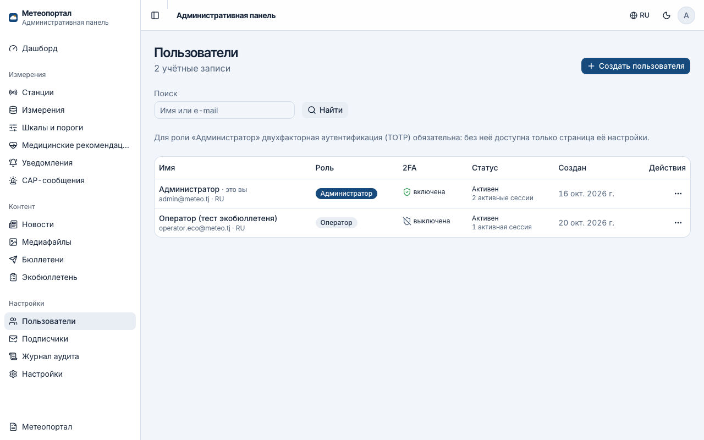

### 13.1. Сохтан


«Сохтани корбар»: ном, e‑mail (логин), нақш, забони интерфейс, парол (на камтар аз 10 аломат; тугмаҳои «Тавлиди парол» ва «Нусха гирифтан»). Паролро ба корманд бо роҳи ҳифзшуда диҳед ва хоҳиш кунед, ки ҳангоми вуруди аввал онро тавассути «Барқарорсозии парол» иваз кунад (ивазкунии мустақилонаи парол дар панел ҳоло нест — маъмур бо дархост пароли нав муқаррар мекунад). Барои нақши «Маъмур» ҳангоми вуруди аввал танзими 2FA ҳатмист.

### 13.2. Амалҳо

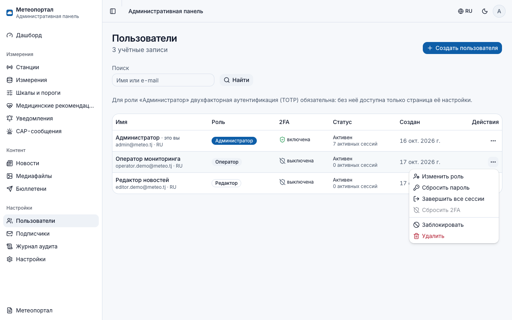

| Амал | Натиҷа |
|---|---|
| Тағйири нақш | ҳамаи сессияҳои корбар қатъ мешаванд; ба маъмури нав ҳангоми вуруд 2FA лозим мешавад |
| Барқарорсозии парол | паролро нав муқаррар кардан; сессияҳо қатъ мешаванд |
| Қатъи ҳамаи сессияҳо | баромади маҷбурӣ дар ҳамаи дастгоҳҳо (ҳангоми гумони ошкоршавӣ) |
| Барқарорсозии 2FA | махфӣ ва рамзҳои эҳтиётиро нест мекунад; ҳангоми вуруди навбатӣ 2FA-ро аз нав танзим кардан лозим аст (барои маъмур — ҳатмӣ) |
| Бастан / кушодан | бастан бо сабаб (танҳо ба маъмурон намоён) ва мӯҳлат бо рӯзҳо (холӣ — бемӯҳлат); корбари басташуда ворид шуда наметавонад, сессияҳо қатъ мешаванд |
| Нест кардан | баргардонданашаванда; сабтҳои аудит нигоҳ дошта мешаванд |

Ҳифз: амалҳоро ба ҳисоби худ татбиқ кардан мумкин нест, маъмури охирини фаъолро паст кардан, бастан ё нест кардан мумкин нест. Тавсия дода мешавад, ки ҳадди ақал ду маъмур дошта бошед, то яке дастрасии дигарро барқарор карда тавонад.

## 14. Ҳолати интегратсияҳо ва вазифаҳои фонӣ

Хизмати фонӣ (worker) вазифаҳоро аз рӯи ҷадвал иҷро мекунад; ҳолати онҳо дар лавҳаи идора дида мешавад, тафсилот — дар феҳристҳои сервер (хадамоти IT).

| Вазифа | Ҷадвал | Чӣ мекунад |
|---|---|---|
| Азнавҳисобкунии индекс | ҳар 10 дақиқа ва пас аз воридкунӣ/воридот | индекси истгоҳҳо аз рӯи ҳамаи шкалаҳои фаъол барои соатҳои охир |
| Назорати сифат | ҳар 15 дақиқа | қоидаҳои ҷаҳиш, часпидан, партофтаҳо → навбати QC |
| Санҷиши ҳадҳо | ҳар 10 дақиқа | рӯйдодҳои аз ҳад гузаштан ва номаҳо аз рӯи қоидаҳои огоҳӣ |
| Фиристодани номаҳо | ҳар дақиқа | навбати номаҳо → SMTP (тасдиқи обуна, огоҳиҳо, бюллетенҳо, номаҳои хизматӣ) |
| SmartMet (пешгӯии обу ҳаво) | ҳар 15 дақиқа | пешгӯии соатӣ ва шабонарӯзӣ барои нуқтаҳои пешгӯӣ |
| SILAM (пешгӯии сифати ҳаво) | ҳар соат (дар :20) | оғози нави модел: қабатҳо барои харита ва пешгӯиҳои нуқтавӣ барои шаҳрҳо ва истгоҳҳо |
| SmartMet Alert (CAP) | ҳар 5 дақиқа | огоҳиҳои нав, навшуда ва бекоршуда |

Ҳолати интегратсияҳо дар лавҳаи идора:

| Ҳолат | Маъно | Амал |
|---|---|---|
| навсозӣ шуда | боркунии охирин ба наздикӣ муваффақ гузашт | — |
| кӯҳна шудааст | боркунӣ кайҳо иҷро нашудааст; дар портал қайди «кӯҳна шудааст» пайдо мешавад | хизмати фонӣ ва манбаъро тафтиш кунед |
| нокомӣ, пайи ҳам: N | манбаъ бо хато ҷавоб медиҳад | пас аз 3 нокомии пайи ҳам маъмурон нома мегиранд; интизор шавед ё ба хадамоти IT хабар диҳед |
| то … боздошта шудааст | пас аз силсилаи нокомиҳо дархостҳо ба манбаъ муваққатан қатъ шудаанд («муҳофиз»-и ҳифзӣ); пас аз 30–240 дақиқа автоматӣ аз нав оғоз мешаванд | агар манбаъ аллакай барқарор шуда бошад, хадамоти IT вазифаро дастӣ оғоз карда метавонад |
| манбаъ танзим нашудааст | суроғаи манбаъ муқаррар нашудааст (масалан, `CAP_FEED_URL`) | тағйирёбандаи муҳитро муқаррар кунед (runbook) |
| ҳоло иҷро нашудааст | хизмат нав оғоз шудааст | интизор шавед |

Номаҳо ба маъмурон дар бораи нокомиҳо ва барқароршавӣ ба суроғаҳои ҳамаи корбарони дорои нақши «Маъмур» ва ба суроғаҳои иловагӣ аз танзимоти сервер меоянд.

## 15. Хатоҳо ва саволҳои маъмул

| Вазъият | Сабаб | Чӣ кор кардан лозим |
|---|---|---|
| «Дастрасӣ манъ аст» ҳангоми кушодани бахш | нақш ҳуқуқ намедиҳад | барои тағйири нақш ба маъмур муроҷиат кунед |
| «Рамз нодуруст ё мӯҳлаташ гузаштааст» ҳангоми вуруд | вақти телефон фарқ мекунад; рамз пас аз иваз ворид шудааст | вақти автоматиро дар телефон фаъол кунед, рамзи навро ворид кунед |
| «Кӯшишҳо аз ҳад зиёданд» | маҳдудияти 5 кӯшиш дар дақиқа ё бастан пас аз 10 рамзи нодуруст | 1–15 дақиқа интизор шавед |
| Телефон бо барнома гум шудааст | омили дуюм нест | рамзи эҳтиётиро истифода баред; вагарна маъмури дигар → «Барқарорсозии 2FA» |
| Файли CSV санҷишро намегузарад: «Сутуни ҳатмӣ нест» | сарлавҳаҳо шинохта нашуданд | номи сутунҳоро тафтиш кунед, намунаро боргирӣ намоед |
| «Истгоҳи номаълум» дар ҳисоботи воридот | рамз дар файл бо рамз дар феҳрист мувофиқ нест | рамзро ислоҳ кунед ё истгоҳ бо нобаёниро интихоб намоед |
| «Вақти оянда» / «Вақти нодуруст» | формати сана ё минтақаи вақт | `СССС-ММ-РР СС:ДД` бо вақти Душанбе ё ISO 8601 бо `+05:00` истифода баред |
| «Воҳиди номаълум» | воҳид ғайристандартӣ навишта шудааст | `ug/m3`, `mg/m3`, `ppb`, `ppm` ё холӣ |
| Пас аз воридкунӣ индекс «маълумот нест» | қиматҳои «шубҳанок» ё «беэътимод» иштирок намекунанд; ё маълумот аз 6 соат кӯҳнатар аст | қиматҳоро дар навбати QC ҳал кунед; вақти ченакҳоро тафтиш намоед |
| Дар лавҳаи идора истгоҳ «кӯҳна шудааст» | дар 24 соат маълумот нест | маълумотро ворид ё импорт кунед |
| Истгоҳ дар харита нест | нишонаи «Дар портал нишон додан» бардошта шудааст ё ҳолат «фаъол» нест; координатаҳо нестанд | корти истгоҳро тафтиш кунед |
| Хабар дар портал дида намешавад | ҳолати «сиёҳнавис» ё санаи нашр дар оянда аст | нашр кунед ё санаро тафтиш намоед |
| Номаҳо намераванд, дар навбат хатоҳо | SMTP танзим нашудааст ё дастнорас аст | бо номаи санҷишӣ тафтиш кунед; ба хадамоти IT хабар диҳед |
| Огоҳиҳои CAP нав намешаванд | манбаъ танзим нашудааст, дастнорас аст ё паёмҳо бо хато | блоки «Ҳамоҳангсозӣ»-ро дар бахши CAP бинед; ба хадамоти IT хабар диҳед |
| Пешгӯӣ дар портал «кӯҳна шудааст» | ҳамоҳангсозии SmartMet/SILAM кайҳо иҷро нашудааст | ҳолати интегратсияҳо дар лавҳаи идора; хадамоти IT |
| «Мумкин нест: ин маъмури охирини фаъол аст» | ҳифз аз гум кардани дастрасӣ | аввал маъмури дуюмро созед |
| Парол фаромӯш шуд | — | маъмур → «Барқарорсозии парол» |

## Замимаи А. Бахшҳои панел

| Бахш | Суроға | Нақшҳо |
|---|---|---|
| Лавҳаи идора | `/admin` | ҳама |
| Истгоҳҳо | `/admin/stations` | маъмур (тағйир), дигарон — дидан |
| Ченакҳо: воридкунии дастӣ, воридот, дидан, QC | `/admin/measurements`, `/entry`, `/import`, `/browse`, `/qc` | маъмур, оператор |
| Шкалаҳо ва ҳадҳо, ҲИМ | `/admin/scales`, `/admin/scales/limits` | маъмур |
| Тавсияҳои тиббӣ | `/admin/health-advice` | маъмур |
| Огоҳиҳо, рӯйдодҳо | `/admin/alerts`, `/admin/alerts/events` | маъмур |
| Паёмҳои CAP, луғати ҳодисаҳо | `/admin/cap`, `/admin/cap/events` | маъмур |
| Ахбор, рубрикаҳо | `/admin/news`, `/admin/news/categories` | маъмур, муҳаррир; оператор — дидан |
| Файлҳои медиа | `/admin/media` | маъмур, муҳаррир |
| Бюллетенҳо | `/admin/bulletins` | маъмур, муҳаррир |
| Корбарон | `/admin/users` | маъмур |
| Обуначиён | `/admin/subscribers` | маъмур |
| Феҳристи аудит | `/admin/audit` | маъмур |
| Танзимот | `/admin/settings` | маъмур |
| Амният ва 2FA | `/admin/two-factor` | ҳама (барои ҳисоби худ) |

## Замимаи Б. Намунаи CSV барои воридот

```csv
time;station;pollutant;value;unit
2026-10-17 07:00;DU-01;PM25;42,5;ug/m3
2026-10-17 07:00;DU-01;PM10;88;ug/m3
2026-10-17 07:00;DU-01;NO2;31;ug/m3
2026-10-17 07:00;DU-01;CO;1,1;mg/m3
```
