# Meteoportal User Guide

Version 1.1 · 2 November 2026 · Languages: [Тоҷикӣ](tg.md) · [Русский](ru.md) · **English**

Meteoportal is the official website of the Agency for Hydrometeorology of the Republic of Tajikistan on air quality and weather: measurements of the monitoring station network, the air‑quality index, weather and air‑quality forecasts, severe‑weather warnings, health advice and news. This guide covers the public part of the portal; staff work in the administration panel is described in the [Administrator guide](../admin/en.md).

## 1. Overview

- **Address**: `https://<portal domain>` (for example `https://havo.tj`). The portal works on desktops, tablets and phones; no registration is needed.
- **Languages**: Tajik (primary, addresses without a prefix - `/air`), Russian (`/ru/air`) and English (`/en/air`). The language switch is in the top‑right corner (globe icon).
- **Theme**: light or dark (moon/sun icon next to the language; on a phone - in the ☰ menu).
- **Sections** are in the ☰ menu on the left of the header (as on data.meteo.uz): MeteoAlert (SmartMet) - warnings, SmartMet (forecast) - weather, SmartMet (SILAM) - air‑quality forecast, Air monitoring, Map, News, Health, Open data · API, About; below them - "About the index", "Eco-bulletins", "Email alerts". The menu also holds the language, theme and project credits. Every page except the home page has a footer with the same links and contacts.
- **Time** on the portal is shown in Dushanbe time (UTC+5); the API and CSV use UTC together with local time.
- **Accessibility**: pollution levels are always labelled with words, not only colour; the interface works with the keyboard and screen readers.

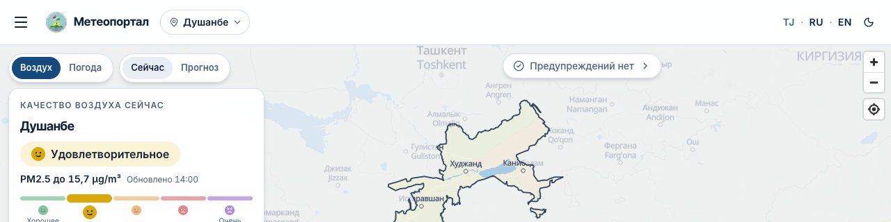

## 2. Air‑quality index and levels

The portal shows an **operational five‑level index**: for each pollutant the latest hourly mean is taken (8‑hour mean for CO), compared with the threshold table and assigned a level from 1 to 5; the station index is the worst of the sub‑indices, and the pollutant with the highest sub‑index is called the **dominant pollutant** and is shown next to the level. Within a level a fraction is calculated, so the index can also be shown as a number (for example 1.3).

| Level | Colour | Meaning |
|---|---|---|
| 1 · Good | green | Clean air, no restrictions |
| 2 · Satisfactory | yellow | Acceptable quality; very sensitive people may notice slight discomfort |
| 3 · Fair | orange | Sensitive groups should reduce prolonged outdoor exertion |
| 4 · Poor | red | Pollution is noticeable for everyone: limit time outdoors, especially children and the elderly |
| 5 · Very poor | purple | Very high pollution: stay indoors if possible, close the windows |
| No data | grey | No measurements or they are stale (older than 6 hours) |

The level is always shown three ways: colour, word and a face icon - from a smile (1) to crossed-out eyes (5), a dash for no data. So the level can be told apart without colour vision and on a black-and-white printout.

Only measurements that passed the Agency's quality control are used. If the latest measurement is older than 6 hours, the portal honestly shows "no data" instead of an outdated number.

Pollutants: PM2.5 and PM10 particles, nitrogen dioxide NO₂, sulphur dioxide SO₂, carbon monoxide CO, ozone O₃; the Dushanbe automatic station and the posts also report nitric oxide NO, formaldehyde CH₂O, phenol, hydrogen fluoride HF, suspended particulates (dust), carbon dioxide CO₂ (ppm) and total volatile organic compounds (TVOC, ppb). The display unit is chosen by the Agency: µg/m³ (CO - mg/m³) or mg/m³ as in the daily bulletins; the unit is always shown next to the value, and the API and CSV carry it in the `unit` field.

The "About the index" page (`/air/index`) lists the current thresholds per pollutant, describes the Agency for Hydrometeorology method (ratio to the daily and single MPC, NO₂+SO₂ summation, high and extremely high pollution cases), the national index (ratio to the limit value and the composite IZA) and the WHO guideline scale, shows the MPC table and explains the quality‑control rules.

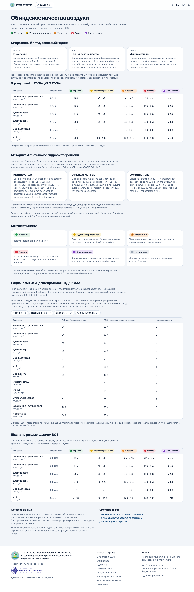

## 3. Home page

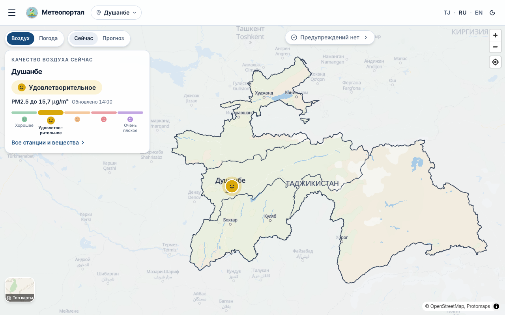

The home page is a full‑screen map of Tajikistan (modelled on data.meteo.uz); neighbouring countries are dimmed so that the eye stays on Tajikistan. Two switches sit at the top left:

- **Air quality · Weather** - what to show: air‑monitoring stations or the weather in cities. Only one is shown at a time so that markers do not overlap.
- **Now · Forecast** - current data or a forecast with a time slider (the switch appears once a forecast is loaded).

Below the switches (at the bottom of the screen on a phone) is the card of the city selected in the header. In "Air quality" mode it shows the air‑quality level as a word and a colour, the dominant pollutant, the update time and the level scale, which is also the legend of the map colours; in "Weather" mode - the weather symbol, temperature, the day's maximum and minimum and a link to the detailed forecast. When you pick another city the card changes and the map flies to it. Chips above the map:

- **Warnings** - the number of severe-weather warnings in force and of those starting within 24 hours ("1 active warning · 1 more expected"); with no warnings the chip says "No warnings". If warning data has not been updated for a while, the chip says it may be out of date. The chip leads to the "Warnings" section, and the warning areas are shaded on the map.
- **Threshold exceedances** (orange, when present) - e.g. "PM10 above the threshold at 1 station"; leads to the exceedance list in the "Air monitoring" section. All other sections are in the ☰ menu.

## 4. Stations and charts

The "Air quality" section (`/air`) lists stations with the current level, value and dominant pollutant; the data refreshes every minute.

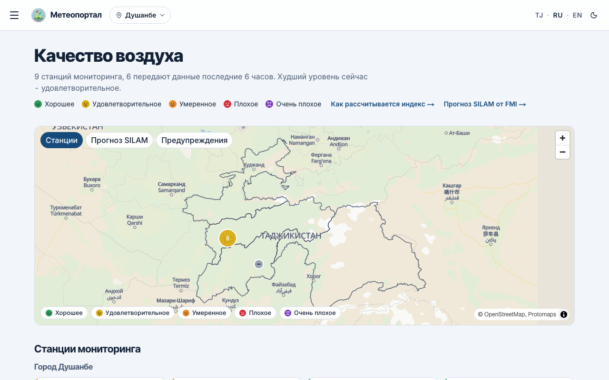

Station page (`/air/stations/<station slug>`):

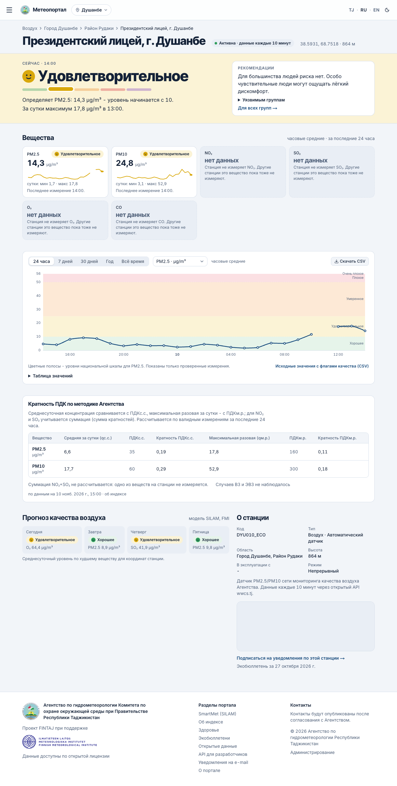

- **Current values** - the index with its level, the dominant pollutant, cards for each pollutant (value, unit, level) and the scale used.
- **Location** - map with the station position.
- **Weather - GFS forecast** - weather maps from the Agency's SmartMet Server: air temperature, precipitation, wind (speed in colour and direction arrows) or cloud cover - pick the parameter in the drop‑down. The slider and the "‹ ›" buttons step through the forecast every 3 hours for 5 days, then every 6 hours up to 10 days; "▶" starts the animation. Below the slider are the value scale and the GFS run time. One forecast layer is shown at a time: turning on the weather turns off SILAM and vice versa.
- **SILAM forecast** - model air‑quality forecast for the station coordinates for today, tomorrow and the day after (daily mean level by the worst pollutant).
- **Ratio to limit values (Agency method)** - a table like the daily bulletins: the daily mean concentration and its ratio to the daily MPC, the maximum single value of the day and its ratio to the single MPC for every pollutant; below it the NO₂+SO₂ summation (sum of the daily-MPC ratios when the station measures both) and a note on high (≥ 10 single MPCs) and extremely high (≥ 50) pollution cases. Ratios ≥ 1 are highlighted. Calculated from valid measurements of the last 24 hours.
- **Advice** - what to do at the current level: for the general population and (the expandable "For vulnerable groups" block) for children, pregnant and breastfeeding women, elderly people, people with chronic respiratory and heart diseases; the link leads to this level in the "Health" section.
- **Get exceedance alerts for this station** - link to the subscription.
- **Measurement history** - chart with period and pollutant selection (section 4.1).
- **Station passport** - code, type, coordinates, elevation, commissioning date, sampling mode, data source.

### 4.1. Chart

- **Period**: 24 hours, 7 days, 30 days, Year or **All time** (up to 10 years).
- **Averaging**: "Hourly", "Daily" or "Monthly" - days and months follow local time. Each period offers suitable options: 24 hours - hourly; 7 and 30 days - hourly or daily; Year - daily or monthly; All time - monthly or daily.
- The pollutant is chosen from the drop‑down next to the periods.
- Coloured bands in the background are the scale levels for the selected pollutant: it is immediately visible which level a value falls into.
- Hover (or tap on a phone) a point to see the time and value; with daily and monthly averaging also the minimum and maximum. With many points a zoom slider appears under the chart.
- The **Data table** under the chart (expand it with a click) gives the same data as text, for screen readers and copying.
- Only valid and corrected measurements are shown; gaps mean missing data, not zero pollution.

## 5. CSV download

The **"Download CSV"** button above the chart saves the means of the selected period, averaging and pollutant (all station pollutants if none is selected) to a file for Excel, LibreOffice or analysis.

File format: UTF‑8 with BOM (Excel opens it without configuration), comma separator, columns:

| Column | Content |
|---|---|
| `time_utc` | interval start in UTC (ISO 8601) |
| `time_local` | the same in Dushanbe time (`YYYY-MM-DD HH:MM`) |
| `station` | station code |
| `pollutant` | pollutant code (`PM25`, `PM10`, `NO2`, `SO2`, `CO`, `O3`, `NO`, `CH2O`, `C6H5OH`, `HF`, `TSP`, `CO2`, `TVOC`) |
| `value` | interval mean in the portal display unit (from valid and corrected values) |
| `unit` | unit (`µg/m³` or `mg/m³`; `ppm` for CO₂, `ppb` for VOC) - as chosen by the Agency in the settings |
| `aggregation` | `hour` - hourly mean, `day` - daily, `month` - monthly |
| `samples` | number of measurements included in the mean |
| `min`, `max` | minimum and maximum in the interval |
| `qc_flag` | point quality: `valid` - all values passed quality control, `corrected` - some were corrected by an operator; if there are no valid values - the worst flag of the excluded ones (`suspect`, `invalid`, `raw`) or `missing` |
| `excluded` | how many values in the interval were excluded by quality control |

The **"Original values with quality flags (CSV)"** link exports every measurement without averaging (up to 30 days): `time_utc`, `time_local`, `station`, `pollutant`, `value`, `unit`, `averaging_min` (instrument averaging period, min) and `qc_flag` per value.

The same file is available at `…/api/v1/stations/<slug>/measurements?range=7d&agg=day&pollutant=PM25&format=csv`, original values - `…&agg=raw&format=csv` (see section 13).

## 6. Map

The map is the portal's home page (`/`; the old address `/map` leads there too). It works without external services; zoom with the mouse wheel, the "+/−" buttons (gestures on a phone); the "my location" button centres the map (with the browser's permission). The choice on the map is reflected in the page address, so the link can be shared: `/?layer=silam` opens the air‑quality forecast, `/?layer=weather` - the weather.

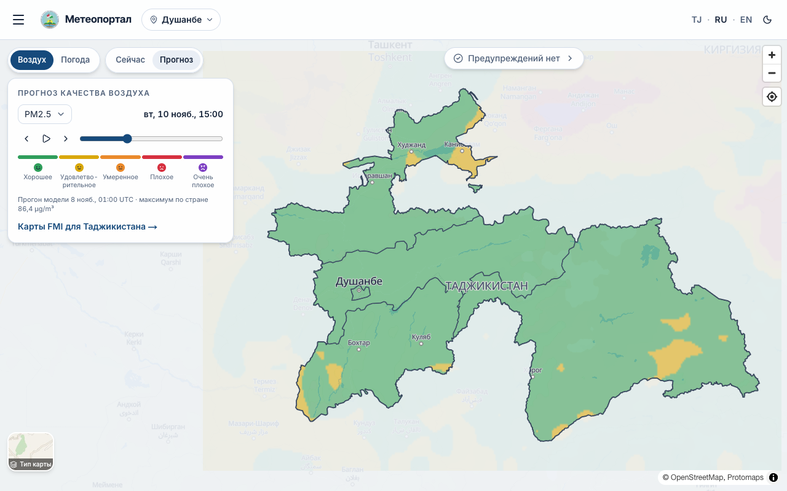

**Air quality · Now** (opens by default):

- Coloured dots are stations with their current index level. Click a station to see a card with its name, the level as a word, the dominant pollutant and its value, the update time and a link to the station page.
- When zoomed out, nearby stations merge into a circle coloured by the worst level, with a halo; click it to zoom in.
- Stations without recent data appear as pale rings when zoomed in; at country scale they are hidden.

**Air quality · Forecast** - the SILAM model forecast: a coloured grid of public‑scale levels for the selected pollutant (`PM2.5`, `PM10`, etc.). The slider and the "‹ ›" buttons step through the forecast by hour for 5 days ahead; "▶" starts the animation. Below the slider - the level scale, the model run time and the country maximum; the "FMI maps for Tajikistan" link opens the ready‑made FMI maps ("SmartMet (SILAM)" section).

**Weather · Now** - the weather symbol and the current temperature in cities (SmartMet forecast points); click a city for the weather description, the day's maximum and minimum and a link to the detailed forecast. Other places appear as you zoom in.

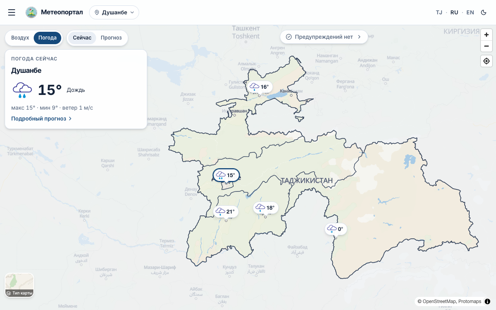

**Weather · Forecast** (when SmartMet Server maps are connected) - air temperature, precipitation, wind or cloud cover with a time slider and a value scale.

**Map type** - a button with a map thumbnail (bottom left on a computer, top right under the location button on a phone): "Map" (a regular colour map: vegetation, water, roads), "Grey" (the same map without colour, so station and forecast colours stand out most), "Terrain" (hill shading from the Copernicus digital elevation model) and "Satellite" (a cloud‑free Sentinel‑2 image for 2021). The choice is remembered in the browser. All base maps are built from open data and stored on the portal's server.

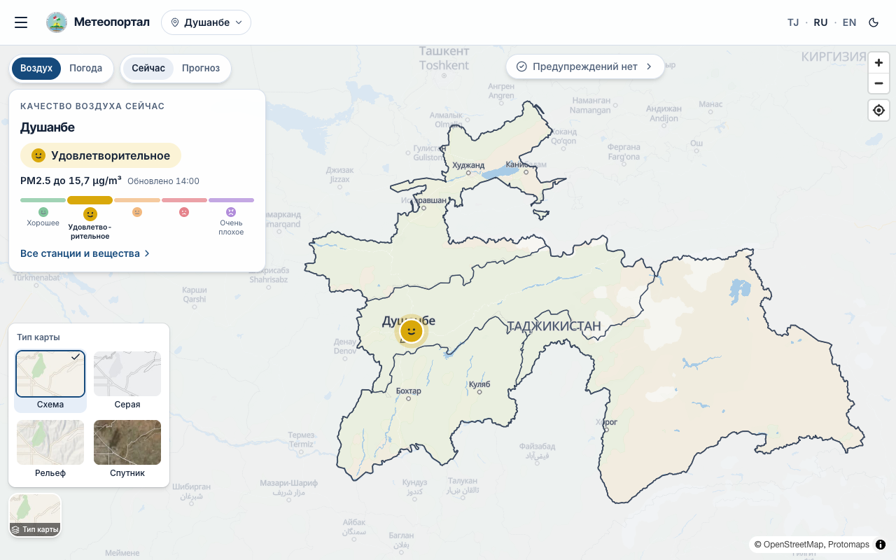

The outlines of the regions, Dushanbe and the RRP are always shown, and dashed district boundaries appear when zoomed in. Hover over a region to highlight it and see its name; click to open a card with the number of stations and a link to the station list. Active warnings are polygons coloured by danger level; warnings starting within 24 hours have a pale fill and a dashed outline. A legend of danger levels with digits 1–4 appears next to the chip. Click a polygon to read the level (digit and word), headline and validity period. The link `/?layer=warnings` zooms the map straight to the warning areas. Station markers and station-group circles carry the level face icon (the worst level for a group).

If the browser does not support WebGL (very old computers, hardware acceleration disabled), a message is shown instead of the map - use the station list.

### 6.1. FMI maps "SmartMet (SILAM)"

The "SmartMet (SILAM)" section (`/air/silam`, in the ☰ menu) shows ready-made air pollution forecast maps for Tajikistan and neighbouring countries, computed every day by the Finnish Meteorological Institute (FMI) with the SILAM model under the FINTAJ project. The portal shows them unchanged.

- **Parameter** - buttons above the map: air quality index AQI (the worst of the pollutant levels), PM2.5, PM10, NO₂, O₃, CO, SO₂ and boundary layer height (ABL - the lower it is, the more pollution accumulates near the ground).
- **Time** - mouse wheel over the map (down for later, up for earlier) or hover over the hour strip; on a phone, swipe the map left or right; on a keyboard, use the arrow keys. "Animate" plays all 48 hours.
- The 48-hour forecast usually starts at 00 UTC of the previous day, and new maps appear at about 07:00 Dushanbe time; when FMI publishes later, the run starts at 00 UTC of the same day - the portal accounts for this. The map gives the time in UTC ("06Z" = 11:00 in Dushanbe), the portal shows local time above it. If FMI has not updated the maps for a while, the portal says so and shows the latest run.
- Below the map - explanations, the FMI index thresholds table and links to the SILAM layer on the portal map and to station measurements. The model shows background pollution on a grid of tens of kilometres; the official assessment is based on station data.

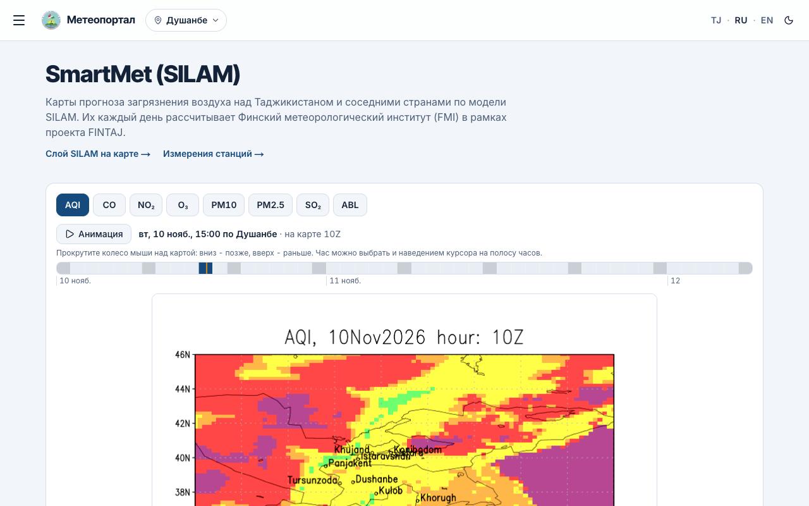

## 7. Weather

The "Weather" section (`/weather`) - SmartMet Server (FMI) forecast for cities and districts, updated every 15 minutes.

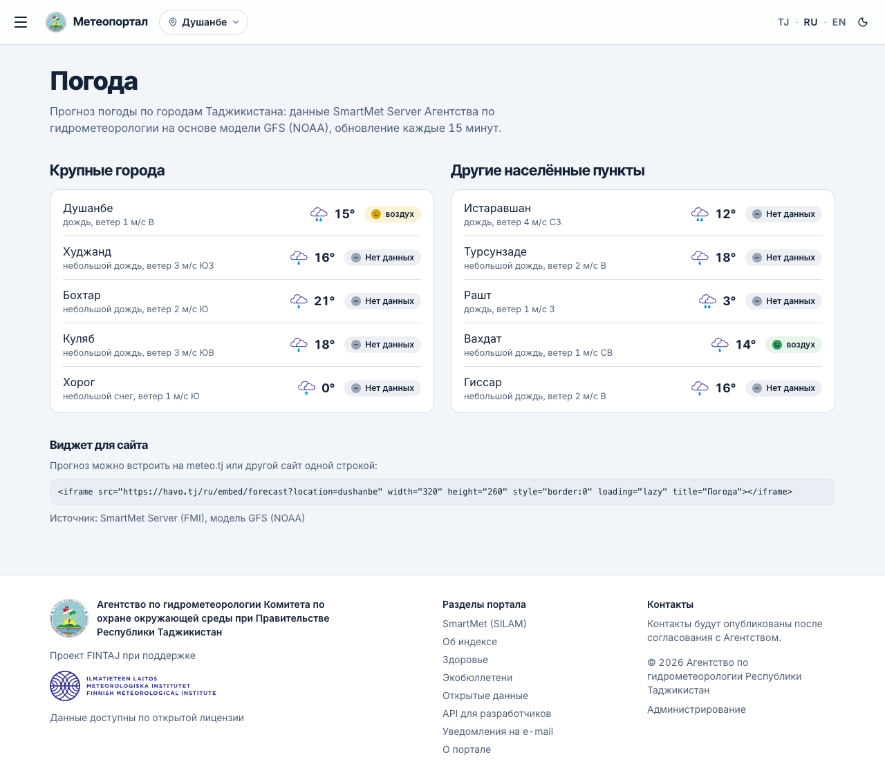

Cards of major cities show the current temperature, wind, precipitation and weather symbol; below is a list of other localities. City page (`/weather/<slug>`):

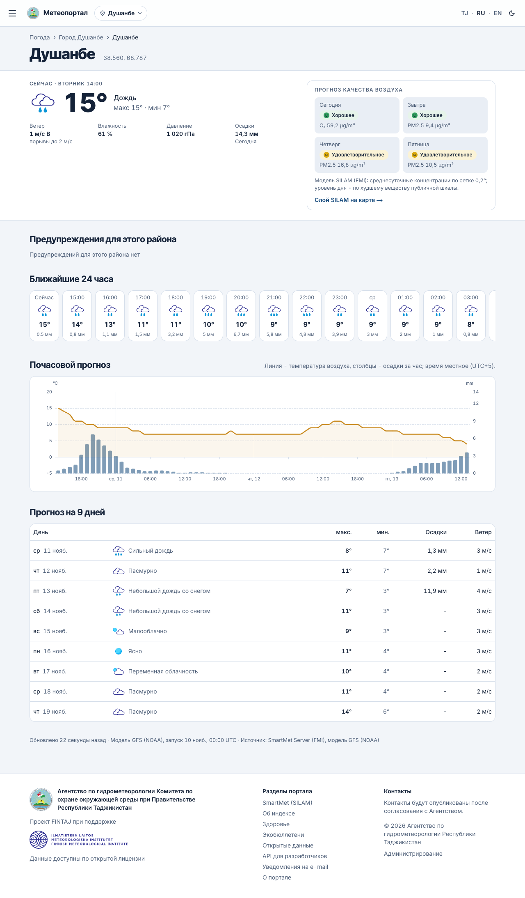

- **Now** - temperature, wind, humidity, pressure, dew point, cloudiness, precipitation.
- **Next 24 hours** - hourly strip.
- **Chart** for 72 hours: line - temperature, bars - hourly precipitation.
- **10‑day forecast** - table: minimum/maximum temperature, precipitation, wind, weather symbol.
- **Air‑quality forecast** (SILAM) for the coming days with the dominant pollutant and a link to the map layer.
- **Warnings for this area**, if any.
- At the bottom - model run time and source. The note "Forecast is stale" means no update has arrived from the source for a long time.
- **Website widget** - ready‑made code to embed the forecast (section 12).

## 8. Warnings

The "Warnings" section (`/warnings`) - the Agency's severe‑weather warnings in CAP format (SmartMet Alert editor).

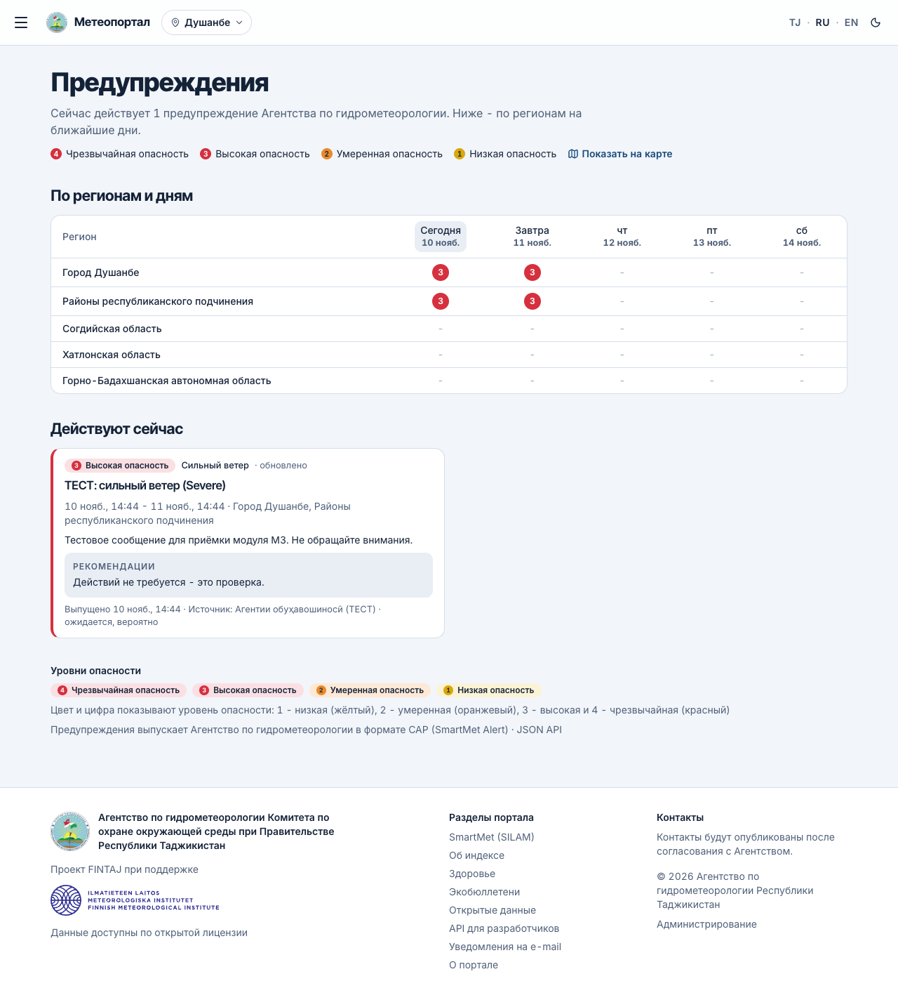

- **Active now** and **Upcoming** - cards with headline, danger level, validity period, area, description and instructions; the "CAP XML" button opens the source message.
- **By region and day** - a table: rows - regions (Dushanbe, RRP, Sughd, Khatlon, GBAO), columns - the coming days; a cell holds a circle with the digit of the maximum danger level. A region link filters the list.
- Danger levels are shown by colour and digit: 1 - minor (green), 2 - moderate (yellow), 3 - severe (orange), 4 - extreme (red).
- The "Show on the map" link opens the home map zoomed to the warning areas.
- If data from the warning editor has not arrived for a while, a note at the top of the section says the list may be incomplete.
- An updated warning replaces the previous one, a cancelled one disappears; expired warnings are not shown.

Active warnings are also visible on the home page map, on the weather pages of the affected area and in the widget.

## 9. Health

The "Health" section (`/health`) - advice for each index level for different groups: general population, children, pregnant and breastfeeding women, elderly people, people with chronic respiratory and cardiovascular diseases. Choose a group and read what to do at each of the five levels. The advice is general and does not replace a doctor's consultation.

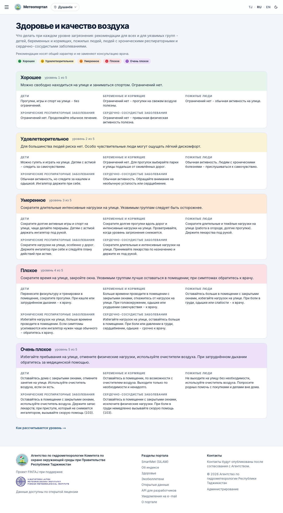

## 10. News

The "News" section (`/news`) - Agency publications with categories, pinned ("Important") items and pagination. RSS feed: `/api/v1/news/rss.xml?locale=en` (the "RSS feed" link in the section). The "Get the newsletter by e‑mail" link leads to the subscription.

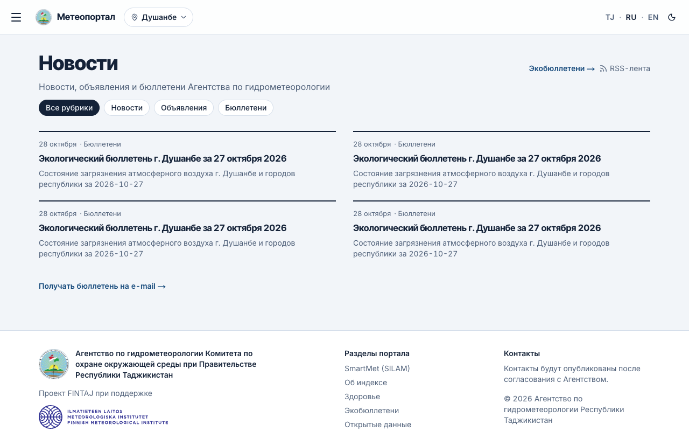

### 10.1. Eco-bulletins

The "Eco-bulletins" section (`/air/bulletins`, in the ☰ menu and the footer) is the archive of the Agency's daily ecological bulletins on air pollution in the cities of the republic for the previous day. Open the bulletin for the date you need: the document is shown right on the page. The switches above it choose the document type ("City bulletin", "Cities summary", "Form 4a") and the language (Tajik or Russian - the documents are issued in these two languages). The DOCX and PDF buttons download the document, HTML opens a printable version. Each published bulletin also appears in "News".

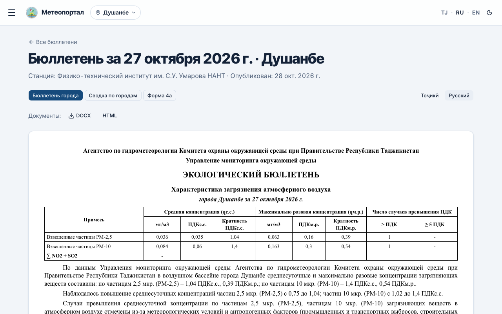

## 11. E‑mail alerts subscription

The "E‑mail alerts" page (`/subscribe`, linked from the ☰ menu, the footer and station pages):

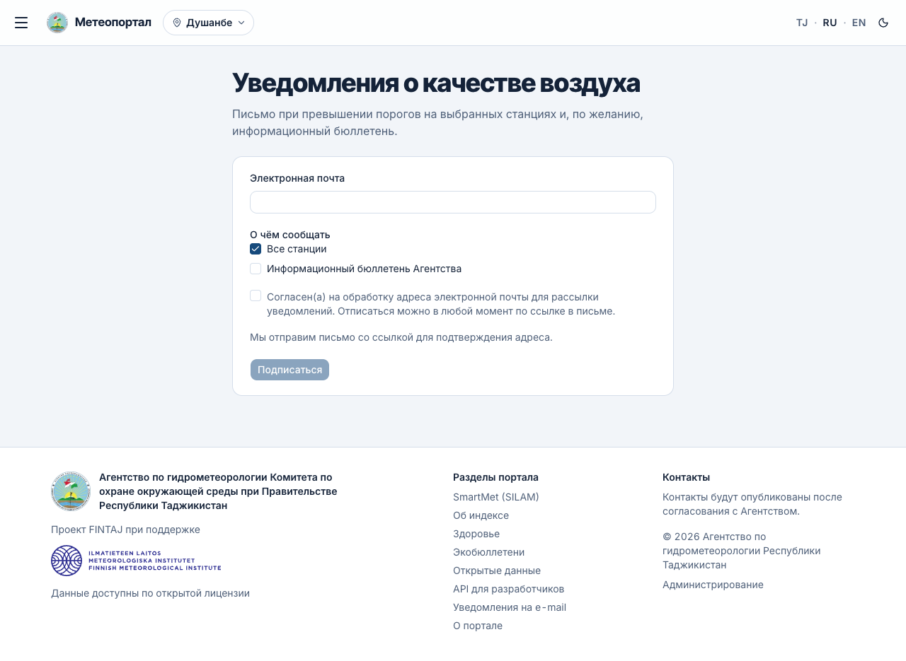

1. Enter your e‑mail address.
2. Choose what to receive: all stations or selected stations (an e‑mail when thresholds are exceeded), and/or the Agency's newsletter.
3. Confirm consent to processing the address and click "Subscribe".
4. Open the e‑mail and follow the confirmation link - without it no alerts are sent (protection against subscribing someone else's address).

E‑mails arrive in the language in which the subscription was made. You can unsubscribe at any time through the link at the bottom of any message. If the e‑mail does not arrive, check the spam folder and the address; subscribing the same address again is safe.

## 12. Widgets for websites

Ready‑made blocks for embedding on meteo.tj and other websites via `<iframe>` - no programming needed. Addresses (replace `<portal>` with the portal address):

| Widget | Address | Parameters |
|---|---|---|
| Station index | `<portal>/embed/aqi?station=<slug>&lang=tg` | `station` - station slug from the station list (without it - the first station with data); `lang` - `tg`, `ru`, `en` |
| Weather forecast | `<portal>/embed/forecast?location=dushanbe&lang=ru` | `location` - forecast point slug (`dushanbe`, `khujand`, `bokhtar`, `kulob`, `khorugh`, …; full list - `/api/v1/forecast`). If the forecast has not been updated for a while, the widget shows an "outdated" note |
| Warnings | `<portal>/embed/alerts?region=DU&lang=en&limit=5` | `region` - region code (`DU`, `RRP`, `SU`, `KT`, `GB`), without it - the whole country; `limit` - number of messages |

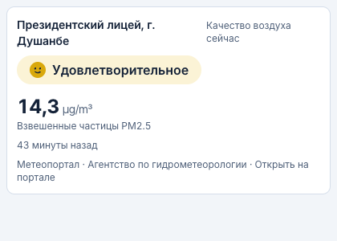

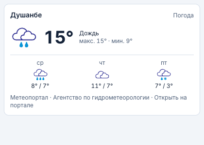

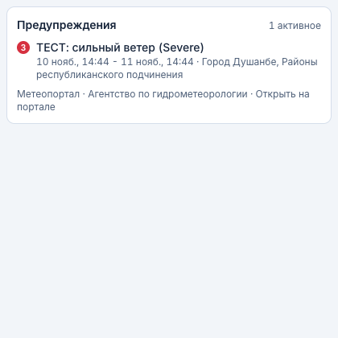

Example code (a ready line is available on a city page in "Weather" and in "Open data"):

```html
<iframe src="https://havo.tj/en/embed/forecast?location=dushanbe"
        width="320" height="260" style="border:0" loading="lazy"
        title="Weather in Dushanbe"></iframe>
```

Recommended width 300–400 px; the height depends on the content (the widget adapts to the width). Each widget has an "Open on the portal" link at the bottom. Embedding is allowed for the Agency's websites; the list of allowed domains for other sites is configured by the IT service.

## 13. Open data and API for developers

The "Open data" section (`/data`) lists datasets, formats and the licence; "API for developers" (`/data/api`) - interactive documentation with parameters, response schemas and examples.

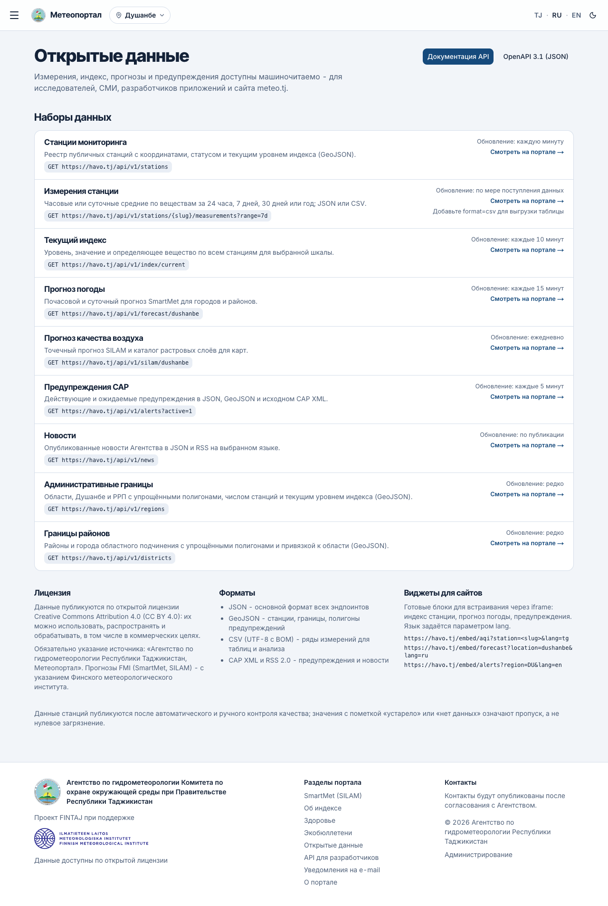

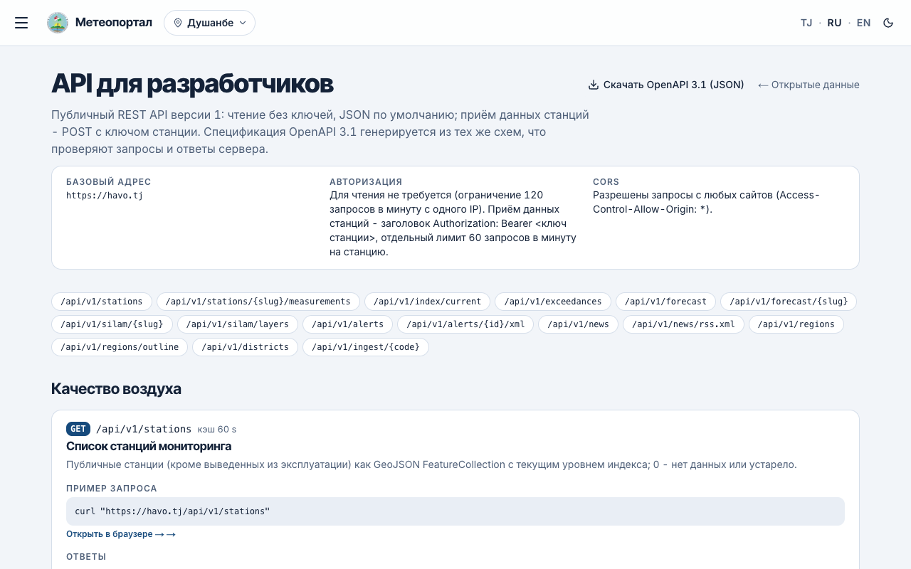

Essentials:

- **Base address**: `https://<portal>/api/v1`. Read‑only, `GET` method, no keys required.
- **Format**: JSON by default; GeoJSON for stations, boundaries and warnings; CSV for measurement series; CAP XML and RSS 2.0.
- **Time** - UTC in ISO 8601; local time - `Asia/Dushanbe` (UTC+5). Multilingual fields are objects `{ "tg": …, "ru": …, "en": … }`.
- **Rate limit**: 120 requests per minute per IP address (default, may be changed by the Agency); above it - response `429` with a `Retry-After` header. Current limits are in `X-RateLimit-Limit`, `X-RateLimit-Remaining`, `X-RateLimit-Reset`.
- **Cache**: responses are cached for 60–3600 seconds (`Cache-Control` header, `X-Cache: HIT|MISS`); do not poll the API more often than the data updates.
- **CORS**: requests from any site are allowed (`Access-Control-Allow-Origin: *`).
- **Licence**: CC BY 4.0 - credit "Agency for Hydrometeorology of the Republic of Tajikistan, Meteoportal"; forecasts - with credit to FMI (SmartMet, SILAM).
- **OpenAPI 3.1 specification**: `GET /api/v1/openapi.json?lang=en` (works with Swagger UI, Postman, client generators).

### 13.1. Endpoint reference

| Endpoint | Purpose | Parameters | Cache |
|---|---|---|---|
| `GET /api/v1/stations` | public stations (GeoJSON) with the current index level | - | 60 s |
| `GET /api/v1/stations/{slug}/measurements` | station measurement series | `range` = `24h` (default) / `7d` / `30d` / `1y` / `all` (up to 10 years); `agg` = `hour` / `day` / `month` (allowed combinations as in section 4.1) or `raw` - original values with quality flag (CSV only, up to 30 days); `pollutant` = pollutant code (all if omitted); `format` = `json` / `csv` | 60 s |
| `GET /api/v1/index/current` | current index of all stations | `scale` = `NATIONAL_OPERATIONAL` (default) / `WHO_24H` / `RATIO_TO_LIMIT` / `US_AQI` / `IZA` | 60 s |
| `GET /api/v1/exceedances` | active threshold exceedances | - | 60 s |
| `GET /api/v1/forecast` | list of forecast points: slug, names in three languages, coordinates, kind (`city`, `district`, `station`), region | - | 600 s |
| `GET /api/v1/forecast/{slug}` | weather forecast for a point; `stale: true` - the forecast has not been updated for a while | `hours` 1–240 (72), `days` 1–16 (10) | 300 s |
| `GET /api/v1/silam/{slug}` | SILAM point air‑quality forecast | - | 600 s |
| `GET /api/v1/silam/layers` | catalogue of raster layers of the latest SILAM run | - | 600 s |
| `GET /api/v1/alerts` | CAP warnings | `active=1` - only active; `region` = `DU` / `RRP` / `SU` / `KT` / `GB`; `lang` = `tg` / `ru` / `en`; `days` 1–14 (7); `format` = `json` / `geojson` | 60 s |
| `GET /api/v1/alerts/{id}/xml` | source CAP 1.2 message | - | 300 s |
| `GET /api/v1/news` | published news | `locale`, `page`, `pageSize` 1–50 (12), `category` | 300 s |
| `GET /api/v1/news/rss.xml` | RSS 2.0 | `locale` | 300 s |
| `GET /api/v1/regions` | region boundaries (GeoJSON, simplified) | - | 3600 s |

Errors: `400` - invalid parameters, `404` - object not found; body - `{ "error": "…" }`.

### 13.2. Response examples

Station list - `GET /api/v1/stations` (abridged):

```json
{
  "type": "FeatureCollection",
  "features": [
    {
      "type": "Feature",
      "id": 1,
      "geometry": { "type": "Point", "coordinates": [68.787, 38.5598] },
      "properties": {
        "id": 1, "slug": "dushanbe-post-no-1", "code": "DU-01",
        "name": { "tg": "Душанбе, пости № 1", "ru": "Душанбе, пост № 1", "en": "Dushanbe, post No. 1" },
        "kind": "air", "status": "active",
        "region": { "tg": "Шаҳри Душанбе", "ru": "Город Душанбе", "en": "Dushanbe city" },
        "level": 1, "indexValue": 1.26, "indexTime": "2026-10-17T14:00:00.000Z"
      }
    }
  ]
}
```

Measurement series - `GET /api/v1/stations/dushanbe-post-no-1/measurements?range=24h&pollutant=PM25`:

```json
{
  "station": { "id": 1, "slug": "dushanbe-post-no-1", "code": "DU-01", "name": { "en": "Dushanbe, post No. 1" } },
  "range": "24h",
  "from": "2026-10-16T13:30:03.699Z",
  "to": "2026-10-17T13:30:03.699Z",
  "aggregation": "hour",
  "timezone": "Asia/Dushanbe",
  "series": [
    {
      "pollutant": { "id": 1, "code": "PM25", "shortName": "PM2.5", "unit": "µg/m³", "decimals": 1 },
      "points": [
        { "t": "2026-10-16T14:00:00.000Z", "v": 25.5, "min": 25.5, "max": 25.5, "n": 1 },
        { "t": "2026-10-16T15:00:00.000Z", "v": 26.6, "min": 26.6, "max": 26.6, "n": 1 }
      ]
    }
  ]
}
```

The same request with `format=csv`:

```csv
time_utc,time_local,station,pollutant,value,unit,aggregation,samples,min,max
2026-10-16T14:00:00.000Z,2026-10-16 19:00,DU-01,PM25,25.5,µg/m³,hour,1,25.5,25.5
2026-10-16T15:00:00.000Z,2026-10-16 20:00,DU-01,PM25,26.6,µg/m³,hour,1,26.6,26.6
```

Current index - `GET /api/v1/index/current`:

```json
{
  "scale": {
    "code": "NATIONAL_OPERATIONAL", "kind": "breakpoints",
    "levels": [ { "level": 1, "color": "#2E9E5B", "label": { "tg": "Хуб", "ru": "Хороший", "en": "Good" } } ]
  },
  "generatedAt": "2026-10-17T13:30:03.726Z",
  "stations": [
    {
      "id": 1, "slug": "dushanbe-post-no-1", "code": "DU-01",
      "name": { "en": "Dushanbe, post No. 1" },
      "level": 1, "value": 1.26, "time": "2026-10-17T14:00:00.000Z", "stale": false,
      "dominantPollutant": "CO",
      "subIndices": { "CO": { "index": 1.26, "level": 1, "value": 1.02 } }
    }
  ]
}
```

Weather forecast - `GET /api/v1/forecast/dushanbe?hours=3&days=2` (fields: `t` temperature °C, `ws`/`wd`/`gust` wind m/s and direction °, `rh` humidity %, `p` pressure hPa, `dew` dew point, `cloud` cloudiness %, `precip` precipitation mm, `symbol` weather symbol code):

```json
{
  "location": { "slug": "dushanbe", "name": { "en": "Dushanbe" }, "lat": 38.5598, "lon": 68.787 },
  "producer": "ecmwf",
  "originTime": "2026-10-17T00:00:00.000Z",
  "fetchedAt": "2026-10-17T13:16:55.557Z",
  "timeZone": "Asia/Dushanbe",
  "hourly": [ { "time": "2026-10-17T13:00:00.000Z", "t": 16, "ws": 0, "wd": null, "rh": 38, "p": 1018, "precip": 0, "symbol": null } ],
  "daily": [ { "date": "2026-10-17T00:00:00.000Z", "tmin": 10, "tmax": 20, "precipSum": 0, "symbol": null } ]
}
```

Air‑quality forecast - `GET /api/v1/silam/dushanbe` (hourly series per pollutant and a daily summary with the level):

```json
{
  "location": { "slug": "dushanbe", "name": { "en": "Dushanbe" }, "lat": 38.5598, "lon": 68.787 },
  "run": { "originTime": "2026-10-16T01:00:00.000Z", "fetchedAt": "2026-10-17T13:15:26.460Z" },
  "units": { "PM25": "µg/m³", "PM10": "µg/m³", "NO2": "µg/m³", "SO2": "µg/m³", "CO": "mg/m³", "O3": "µg/m³" },
  "hourly": { "PM25": [ ["2026-10-16T19:00:00.000Z", 12.4] ] },
  "days": [ { "date": "2026-10-17", "level": 2, "dominantPollutant": "PM25",
              "means": { "PM25": 14.22, "PM10": 19.69, "NO2": 17.02, "SO2": 25.69, "CO": 0.29, "O3": 62.24 } } ]
}
```

Warnings - `GET /api/v1/alerts?active=1&lang=en`:

```json
{
  "generatedAt": "2026-10-17T13:30:03.816Z",
  "lang": "en",
  "count": 1,
  "alerts": [
    {
      "id": 16, "identifier": "tj.meteo.2026.0001", "sent": "2026-10-17T01:00:00.000Z",
      "msgType": "Alert", "language": "en-GB",
      "event": "Strong wind",
      "headline": "Strong wind up to 25 m/s in Dushanbe and RRP",
      "description": "Strong westerly wind of 18–25 m/s is expected from midday 16 October until the evening of 17 October.",
      "instruction": "Stay away from trees and unstable structures, secure loose objects.",
      "severity": "Severe", "color": "orange", "colorHex": "#EA8A2B",
      "urgency": "Expected", "certainty": "Likely",
      "onset": "2026-10-17T07:00:00.000Z", "expires": "2026-10-18T16:00:00.000Z",
      "active": true, "upcoming": false,
      "regions": [ { "code": "DU", "name": { "en": "Dushanbe city" } } ],
      "areas": [ "Dushanbe and the Districts of Republican Subordination" ],
      "xml": "https://havo.tj/api/v1/alerts/16/xml"
    }
  ]
}
```

News - `GET /api/v1/news?locale=en&pageSize=1`:

```json
{
  "locale": "en", "page": 1, "pageSize": 1, "total": 2,
  "items": [
    {
      "id": 1, "slug": "portal-launch-week6",
      "title": "New meteoportal launched in test mode",
      "excerpt": "Air quality, forecast and warnings in one place.",
      "publishedAt": "2026-10-16T09:47:58.056Z", "pinned": true,
      "category": { "slug": "news", "name": "News" }, "cover": null,
      "url": "https://havo.tj/en/news/portal-launch-week6"
    }
  ]
}
```

Active exceedances - `GET /api/v1/exceedances`:

```json
{
  "generatedAt": "2026-10-17T13:30:03.743Z",
  "events": [
    { "id": 2, "startedAt": "2026-10-17T13:16:52.683Z",
      "station": { "id": 3, "slug": "bokhtar-post-no-1", "name": { "en": "Bokhtar, post No. 1" } },
      "rule": "PM10 above 50 µg/m³", "kind": "pollutant", "pollutant": "PM10", "unit": "µg/m³",
      "value": 103.9, "threshold": 50, "level": null }
  ]
}
```

SILAM layers - `GET /api/v1/silam/layers` returns the raster bounds and, for each pollutant, a list of frames `{ "time", "url", "max" }`; the PNG images are available at `url` (for example `/silam/2026101601/PM25/000.png`) and are overlaid on the map in Web Mercator using `run.bounds`.

### 13.3. Tips

- Use `format=csv` for tables and analysis; for charts use JSON with `range=7d` (hourly) or `1y` (daily).
- `stale: true` or `level: 0` means no current data - do not show such values as zero pollution.
- SILAM forecasts update once a day, weather every 15 minutes, warnings every 5 minutes; do not poll the API more often.
- Take station codes from `/api/v1/stations` and forecast point slugs from `/api/v1/forecast`.

## 14. Frequently asked questions

| Question | Answer |
|---|---|
| Why does a station show "no data"? | No measurements for more than 6 hours, or they did not pass quality control. Posts with discrete samples report several times a day |
| Why is the index "good" while I smell smoke? | The index is computed from the pollutants measured at the nearest station; local sources may not reach the measurements. Check the SILAM forecast and warnings |
| How does the SILAM forecast differ from measurements? | SILAM is an FMI model calculation on a 20 km grid for 5 days; measurements are facts at a station. The forecast helps to plan, measurements show the current state |
| How often is the data updated? | index and stations - every 10 minutes (pages refresh every minute), weather - every 15 minutes, SILAM - daily, warnings - every 5 minutes |
| May the data be used in media and apps? | Yes, under CC BY 4.0 with attribution; forecasts - with credit to FMI |
| How do I unsubscribe? | Through the link at the bottom of any e‑mail |
| The map does not show | The browser lacks WebGL support or hardware acceleration is off; update the browser or use the station list |
| Where is historical data for past years? | On the station page choose the "All time" period (up to 10 years, monthly or daily means); data older than what the portal holds - on request from the Agency |
