# Meteoportal User Guide

Version 1.0 · 17 October 2026 · Languages: [Тоҷикӣ](tg.md) · [Русский](ru.md) · **English**

Meteoportal is the official website of the Agency for Hydrometeorology of the Republic of Tajikistan on air quality and weather: measurements of the monitoring station network, the air‑quality index, weather and air‑quality forecasts, severe‑weather warnings, health advice and news. This guide covers the public part of the portal; staff work in the administration panel is described in the [Administrator guide](../admin/en.md).

## 1. Overview

- **Address**: `https://<portal domain>` (for example `https://portal.meteo.tj`). The portal works on desktops, tablets and phones; no registration is needed.
- **Languages**: Tajik (primary, addresses without a prefix — `/air`), Russian (`/ru/air`) and English (`/en/air`). The language switch is in the top‑right corner (globe icon).
- **Theme**: light or dark (moon/sun icon next to the language).
- **Sections** in the top menu: Home, Air quality, Map, Weather, Warnings, Health, News. In the footer: "About", "About the index", "Open data", "API for developers", "E‑mail alerts".
- **Time** on the portal is shown in Dushanbe time (UTC+5); the API and CSV use UTC together with local time.
- **Accessibility**: pollution levels are always labelled with words, not only colour; the interface works with the keyboard and screen readers.

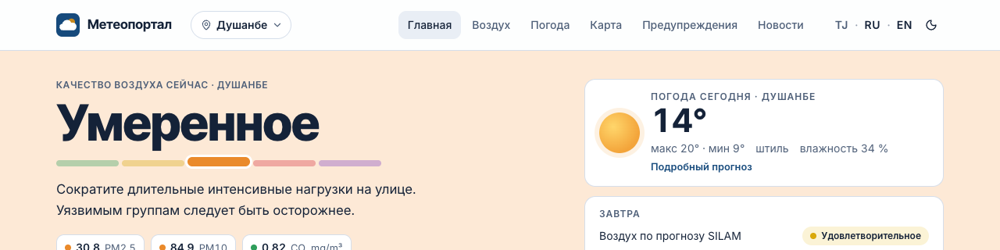

## 2. Air‑quality index and levels

The portal shows an **operational five‑level index**: for each pollutant the latest hourly mean is taken (8‑hour mean for CO), compared with the threshold table and assigned a level from 1 to 5; the station index is the worst of the sub‑indices, and the pollutant with the highest sub‑index is called the **dominant pollutant** and is shown next to the level. Within a level a fraction is calculated, so the index can also be shown as a number (for example 1.3).

| Level | Colour | Meaning |
|---|---|---|
| 1 · Good | green | Clean air, no restrictions |
| 2 · Satisfactory | yellow | Acceptable quality; very sensitive people may notice slight discomfort |
| 3 · Fair | orange | Sensitive groups should reduce prolonged outdoor exertion |
| 4 · Poor | red | Pollution is noticeable for everyone: limit time outdoors, especially children and the elderly |
| 5 · Very poor | purple | Very high pollution: stay indoors if possible, close the windows |
| No data | grey | No measurements or they are stale (older than 6 hours) |

Only measurements that passed the Agency's quality control are used. If the latest measurement is older than 6 hours, the portal honestly shows "no data" instead of an outdated number.

Pollutants: PM2.5 and PM10 particles, nitrogen dioxide NO₂, sulphur dioxide SO₂, carbon monoxide CO, ozone O₃; the Dushanbe automatic station and the posts also report nitric oxide NO, formaldehyde CH₂O, phenol, hydrogen fluoride HF, suspended particulates (dust), carbon dioxide CO₂ (ppm) and total volatile organic compounds (TVOC, ppb). The display unit is chosen by the Agency: µg/m³ (CO — mg/m³) or mg/m³ as in the daily bulletins; the unit is always shown next to the value, and the API and CSV carry it in the `unit` field.

The "About the index" page (`/air/index`) lists the current thresholds per pollutant, describes the Agency for Hydrometeorology method (ratio to the daily and single MPC, NO₂+SO₂ summation, high and extremely high pollution cases), the national index (ratio to the limit value and the composite IZA) and the WHO guideline scale, shows the MPC table and explains the quality‑control rules.

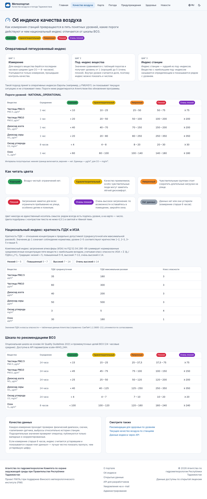

## 3. Home page

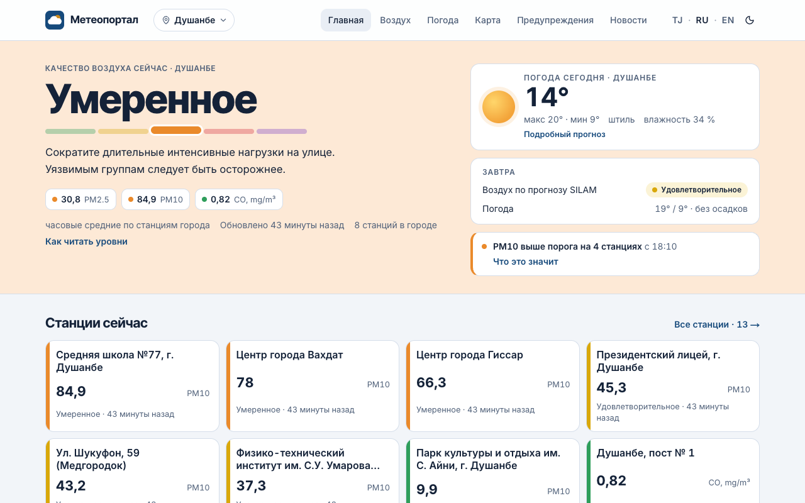

From top to bottom:

1. **Warning banner** — active severe‑weather warnings (red, orange or yellow by danger level) with a link to details.
2. **Active threshold exceedances** — stations where a concentration exceeded a threshold set by the Agency, with the value and start time.
3. **Air quality now** — index, dominant pollutant, level and short advice for the selected city. City buttons switch the station; "Station page" and "Open map" lead to details.
4. **Map** of stations coloured by level (see section 6).
5. **Weather today** — cards of major cities: temperature, wind, precipitation.
6. **Air quality tomorrow** — SILAM model forecast by city (daily mean level).
7. **Latest news** of the Agency.

## 4. Stations and charts

The "Air quality" section (`/air`) lists stations with the current level, value and dominant pollutant; the data refreshes every minute.

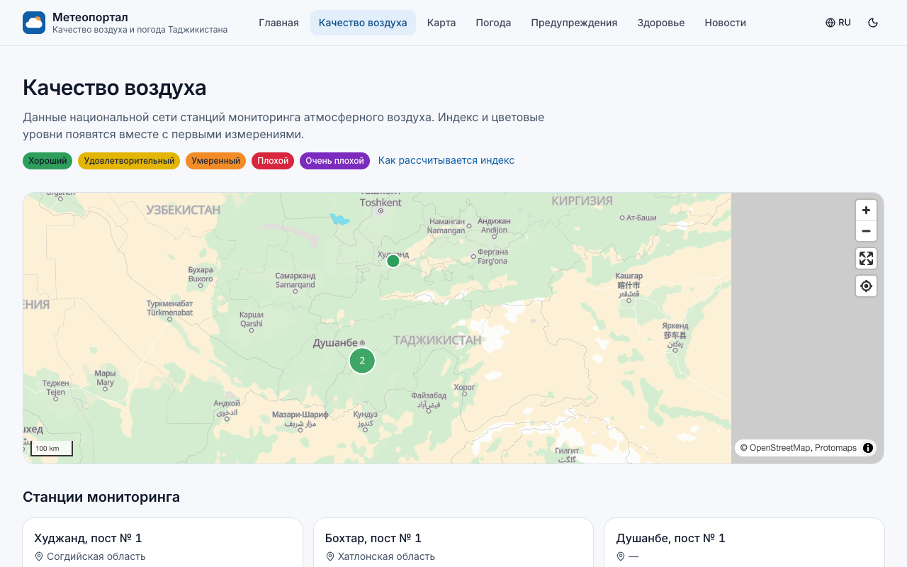

Station page (`/air/stations/<station slug>`):

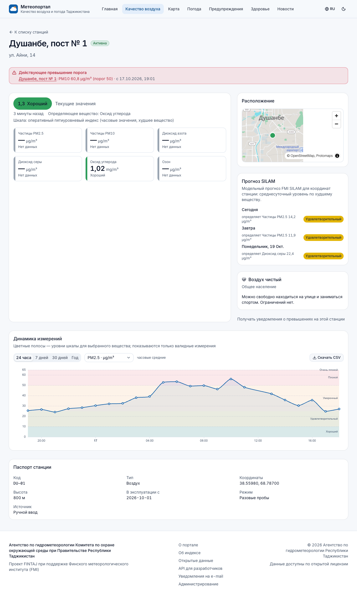

- **Current values** — the index with its level, the dominant pollutant, cards for each pollutant (value, unit, level) and the scale used.
- **Location** — map with the station position.
- **Weather — GFS forecast** — weather maps from the Agency's SmartMet Server: air temperature, precipitation, wind (speed in colour and direction arrows) or cloud cover — pick the parameter in the drop‑down. The slider and the "‹ ›" buttons step through the forecast every 3 hours for 5 days, then every 6 hours up to 10 days; "▶" starts the animation. Below the slider are the value scale and the GFS run time. One forecast layer is shown at a time: turning on the weather turns off SILAM and vice versa.
- **SILAM forecast** — model air‑quality forecast for the station coordinates for today, tomorrow and the day after (daily mean level by the worst pollutant).
- **Ratio to limit values (Agency method)** — a table like the daily bulletins: the daily mean concentration and its ratio to the daily MPC, the maximum single value of the day and its ratio to the single MPC for every pollutant; below it the NO₂+SO₂ summation (sum of the daily-MPC ratios when the station measures both) and a note on high (≥ 10 single MPCs) and extremely high (≥ 50) pollution cases. Ratios ≥ 1 are highlighted. Calculated from valid measurements of the last 24 hours.
- **Advice** — what to do at the current level (general population); the full version by group is in the "Health" section.
- **Get exceedance alerts for this station** — link to the subscription.
- **Measurement history** — chart with period and pollutant selection (section 4.1).
- **Station passport** — code, type, coordinates, elevation, commissioning date, sampling mode, data source.

### 4.1. Chart

- Periods: **24 hours** and **7 days** — hourly means; **30 days** and **Year** — daily means in local time.
- The pollutant is chosen from the drop‑down next to the periods.
- Coloured bands in the background are the scale levels for the selected pollutant: it is immediately visible which level a value falls into.
- Hover (or tap on a phone) a point to see the time and value; on long periods also the daily minimum and maximum.
- Only valid and corrected measurements are shown; gaps mean missing data, not zero pollution.

## 5. CSV download

The **"Download CSV"** button above the chart saves the data of the selected period and pollutant (all station pollutants if none is selected) to a file for Excel, LibreOffice or analysis.

File format: UTF‑8 with BOM (Excel opens it without configuration), comma separator, columns:

| Column | Content |
|---|---|
| `time_utc` | interval start in UTC (ISO 8601) |
| `time_local` | the same in Dushanbe time (`YYYY-MM-DD HH:MM`) |
| `station` | station code |
| `pollutant` | pollutant code (`PM25`, `PM10`, `NO2`, `SO2`, `CO`, `O3`) |
| `value` | interval mean in the pollutant unit |
| `unit` | unit (`µg/m³` or `mg/m³`) |
| `aggregation` | `hour` — hourly mean, `day` — daily |
| `samples` | number of measurements in the interval |
| `min`, `max` | minimum and maximum in the interval |

The same file is available at `…/api/v1/stations/<slug>/measurements?range=7d&pollutant=PM25&format=csv` (see section 13). Request historical data for periods longer than a year from the Agency.

## 6. Map

The "Map" section (`/map`) shows stations, the SILAM air‑quality forecast and severe‑weather warnings on one map of Tajikistan. The map works without external services; zoom with the mouse wheel, the "+/−" buttons or gestures; the "my location" button centres the map (with the browser's permission).

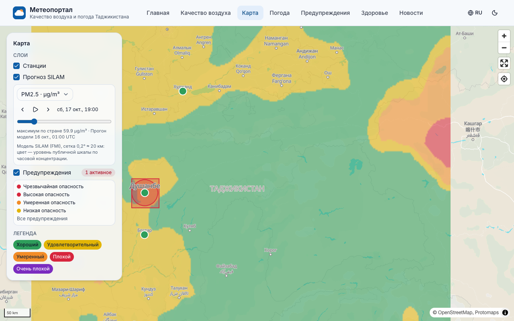

Layer panel:

- **Stations** — points coloured by level; click a station to see its index and open its page. When zoomed out, nearby stations merge into clusters with a count.
- **Region boundaries** — outlines of the regions, Dushanbe and the RRP (on by default); when zoomed in, thin dashed district boundaries appear. Hover over a region to highlight it and see its name; click to open a card with the number of stations and a link to the station list. The **"Levels by region"** checkbox fills each region with the colour of the worst current index level among its stations (grey fill — no data). The same outlines are shown on the home page map and in the "Air quality" section.
- **SILAM forecast** — a coloured grid of concentrations for the selected pollutant (drop‑down `PM2.5 · µg/m³` etc.). The time slider and the "‹ ›" buttons step through the forecast by hour for 5 days ahead; "▶" starts the animation. Below the slider — the country maximum and the model run time; cell colours follow the public scale by hourly concentration.
- **Warnings** — polygons of active warnings coloured by danger level with a counter of active ones; the "All warnings" link opens the section.
- **Legend** — the five index levels.

If the browser does not support WebGL (very old computers, hardware acceleration disabled), a message is shown instead of the map — use the station list.

## 7. Weather

The "Weather" section (`/weather`) — SmartMet Server (FMI) forecast for cities and districts, updated every 15 minutes.

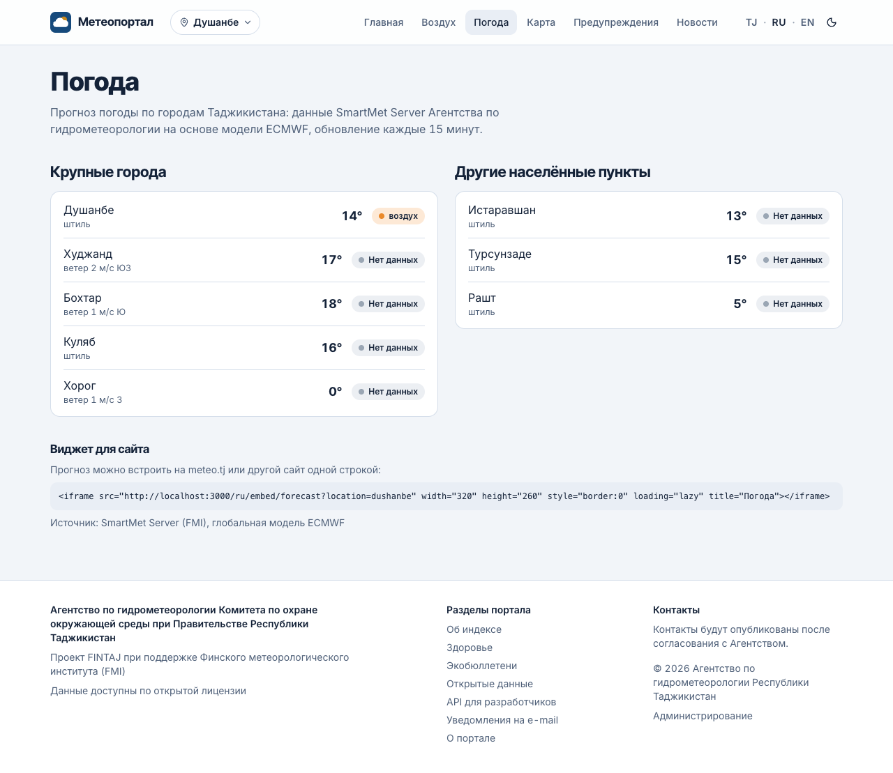

Cards of major cities show the current temperature, wind, precipitation and weather symbol; below is a list of other localities. City page (`/weather/<slug>`):

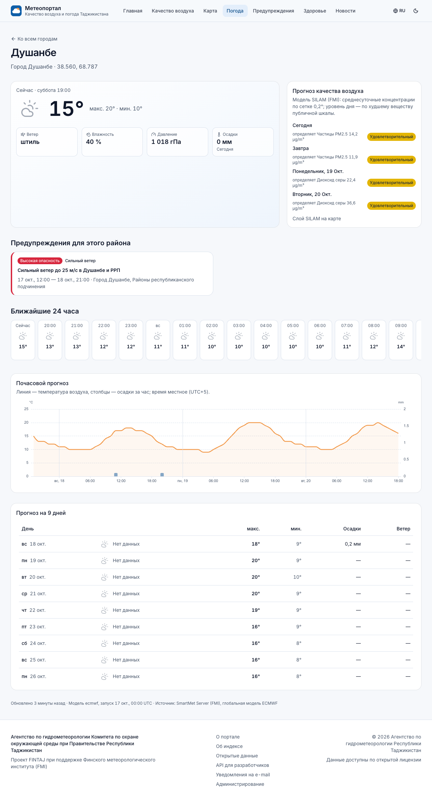

- **Now** — temperature, wind, humidity, pressure, dew point, cloudiness, precipitation.
- **Next 24 hours** — hourly strip.
- **Chart** for 72 hours: line — temperature, bars — hourly precipitation.
- **10‑day forecast** — table: minimum/maximum temperature, precipitation, wind, weather symbol.
- **Air‑quality forecast** (SILAM) for the coming days with the dominant pollutant and a link to the map layer.
- **Warnings for this area**, if any.
- At the bottom — model run time and source. The note "Forecast is stale" means no update has arrived from the source for a long time.
- **Website widget** — ready‑made code to embed the forecast (section 12).

## 8. Warnings

The "Warnings" section (`/warnings`) — the Agency's severe‑weather warnings in CAP format (SmartMet Alert editor).

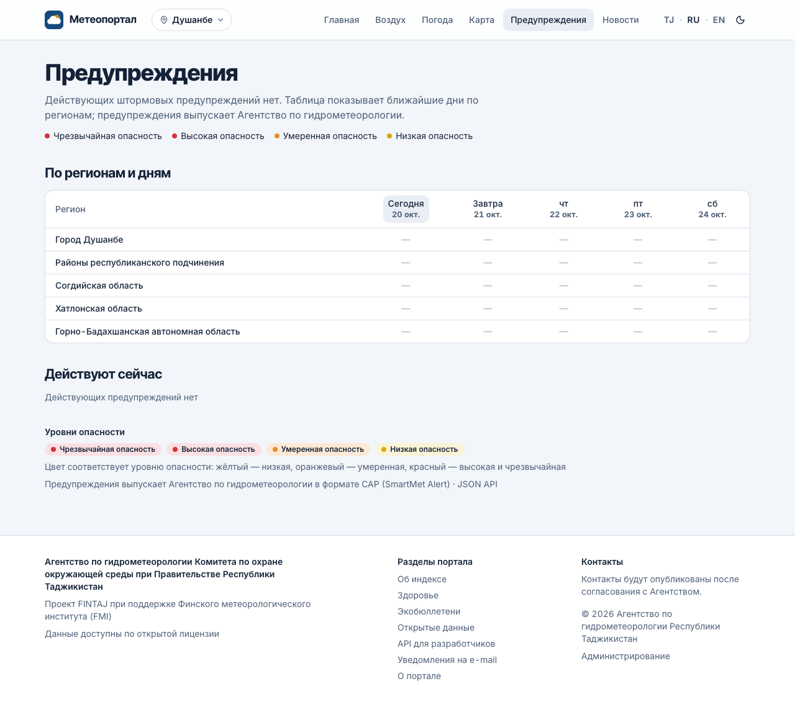

- **Active now** and **Upcoming** — cards with headline, danger level, validity period, area, description and instructions; the "CAP XML" button opens the source message.
- **By region and day** — a table: rows — regions (Dushanbe, RRP, Sughd, Khatlon, GBAO), columns — the coming days; the cell colour is the maximum danger level. A region link filters the list.
- Danger levels: yellow — minor, orange — moderate, red — severe and extreme.
- An updated warning replaces the previous one, a cancelled one disappears; expired warnings are not shown.

Active warnings are also visible as a banner on the home page, on the map, on the weather pages of the affected area and in the widget.

## 9. Health

The "Health" section (`/health`) — advice for each index level for different groups: general population, children, pregnant and breastfeeding women, elderly people, people with chronic respiratory and cardiovascular diseases. Choose a group and read what to do at each of the five levels. The advice is general and does not replace a doctor's consultation.

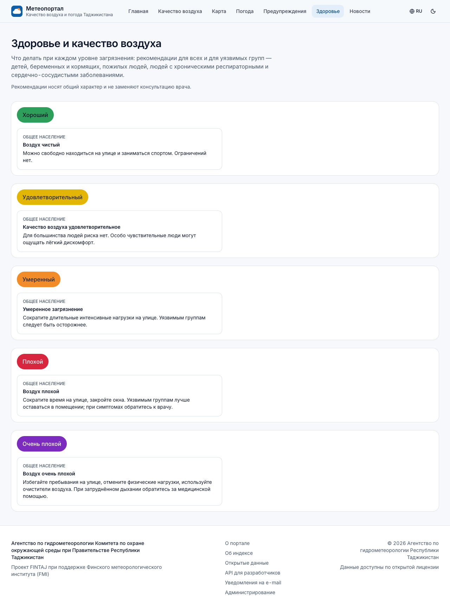

## 10. News

The "News" section (`/news`) — Agency publications with categories, pinned ("Important") items and pagination. RSS feed: `/api/v1/news/rss.xml?locale=en` (the "RSS feed" link in the section). The "Get the newsletter by e‑mail" link leads to the subscription.

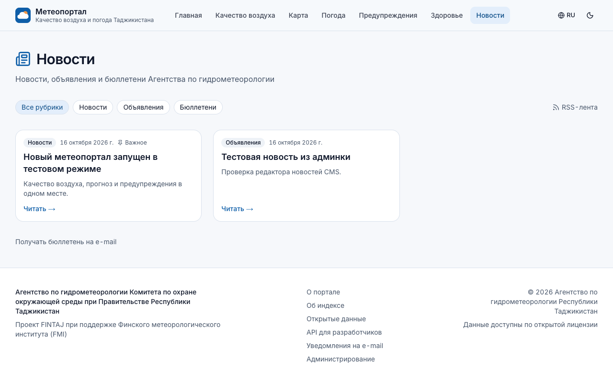

## 11. E‑mail alerts subscription

The "E‑mail alerts" page (`/subscribe`, linked from the footer, the home page and station pages):

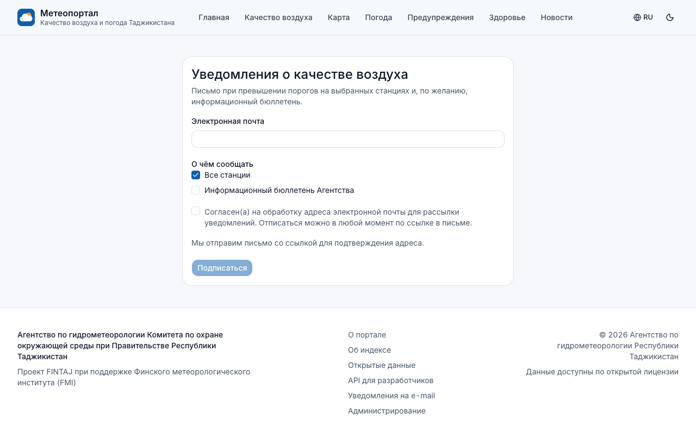

1. Enter your e‑mail address.
2. Choose what to receive: all stations or selected stations (an e‑mail when thresholds are exceeded), and/or the Agency's newsletter.
3. Confirm consent to processing the address and click "Subscribe".
4. Open the e‑mail and follow the confirmation link — without it no alerts are sent (protection against subscribing someone else's address).

E‑mails arrive in the language in which the subscription was made. You can unsubscribe at any time through the link at the bottom of any message. If the e‑mail does not arrive, check the spam folder and the address; subscribing the same address again is safe.

## 12. Widgets for websites

Ready‑made blocks for embedding on meteo.tj and other websites via `<iframe>` — no programming needed. Addresses (replace `<portal>` with the portal address):

| Widget | Address | Parameters |
|---|---|---|
| Station index | `<portal>/embed/aqi?station=<slug>&lang=tg` | `station` — station slug from the station list (without it — the first station with data); `lang` — `tg`, `ru`, `en` |
| Weather forecast | `<portal>/embed/forecast?location=dushanbe&lang=ru` | `location` — forecast point slug (`dushanbe`, `khujand`, `bokhtar`, `kulob`, `khorugh`, …) |
| Warnings | `<portal>/embed/alerts?region=DU&lang=en&limit=5` | `region` — region code (`DU`, `RRP`, `SU`, `KT`, `GB`), without it — the whole country; `limit` — number of messages |

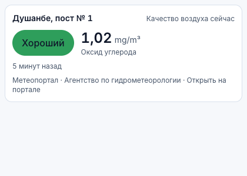

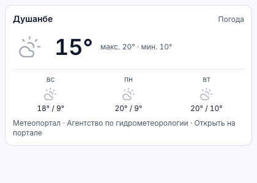

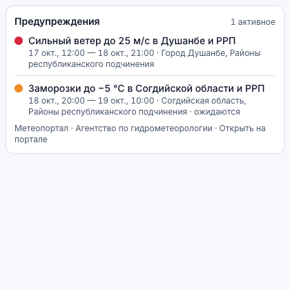

Example code (a ready line is available on a city page in "Weather" and in "Open data"):

```html
<iframe src="https://portal.meteo.tj/en/embed/forecast?location=dushanbe"
        width="320" height="260" style="border:0" loading="lazy"
        title="Weather in Dushanbe"></iframe>
```

Recommended width 300–400 px; the height depends on the content (the widget adapts to the width). Each widget has an "Open on the portal" link at the bottom. Embedding is allowed for the Agency's websites; the list of allowed domains for other sites is configured by the IT service.

## 13. Open data and API for developers

The "Open data" section (`/data`) lists datasets, formats and the licence; "API for developers" (`/data/api`) — interactive documentation with parameters, response schemas and examples.

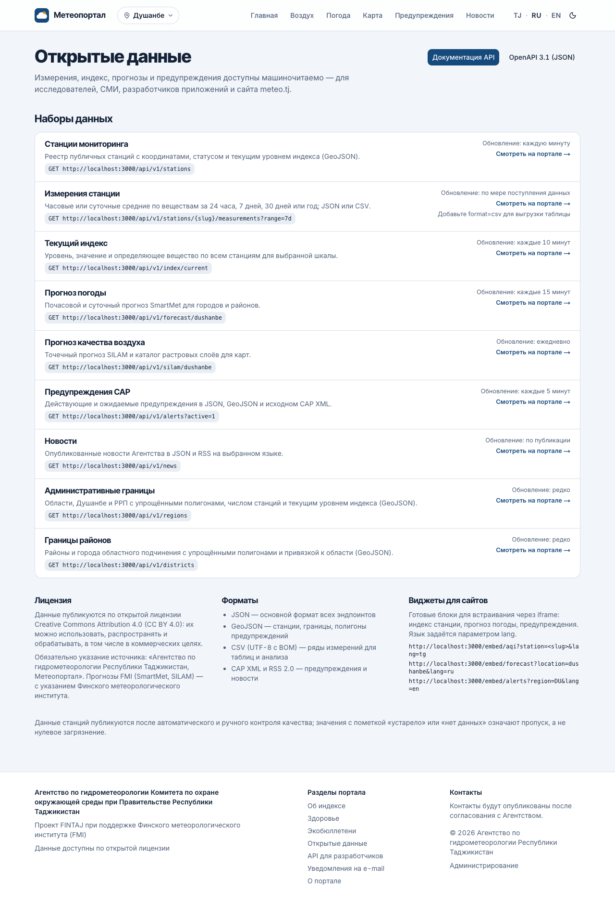

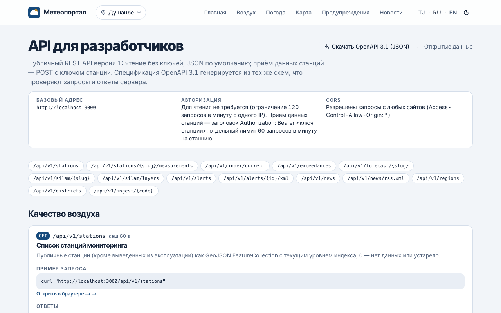

Essentials:

- **Base address**: `https://<portal>/api/v1`. Read‑only, `GET` method, no keys required.
- **Format**: JSON by default; GeoJSON for stations, boundaries and warnings; CSV for measurement series; CAP XML and RSS 2.0.
- **Time** — UTC in ISO 8601; local time — `Asia/Dushanbe` (UTC+5). Multilingual fields are objects `{ "tg": …, "ru": …, "en": … }`.
- **Rate limit**: 120 requests per minute per IP address (default, may be changed by the Agency); above it — response `429` with a `Retry-After` header. Current limits are in `X-RateLimit-Limit`, `X-RateLimit-Remaining`, `X-RateLimit-Reset`.
- **Cache**: responses are cached for 60–3600 seconds (`Cache-Control` header, `X-Cache: HIT|MISS`); do not poll the API more often than the data updates.
- **CORS**: requests from any site are allowed (`Access-Control-Allow-Origin: *`).
- **Licence**: CC BY 4.0 — credit "Agency for Hydrometeorology of the Republic of Tajikistan, Meteoportal"; forecasts — with credit to FMI (SmartMet, SILAM).
- **OpenAPI 3.1 specification**: `GET /api/v1/openapi.json?lang=en` (works with Swagger UI, Postman, client generators).

### 13.1. Endpoint reference

| Endpoint | Purpose | Parameters | Cache |
|---|---|---|---|
| `GET /api/v1/stations` | public stations (GeoJSON) with the current index level | — | 60 s |
| `GET /api/v1/stations/{slug}/measurements` | station measurement series | `range` = `24h` (default) / `7d` / `30d` / `1y`; `pollutant` = pollutant code (all if omitted); `format` = `json` / `csv` | 60 s |
| `GET /api/v1/index/current` | current index of all stations | `scale` = `NATIONAL_OPERATIONAL` (default) / `WHO_24H` / `IZA` | 60 s |
| `GET /api/v1/exceedances` | active threshold exceedances | — | 60 s |
| `GET /api/v1/forecast/{slug}` | weather forecast for a point | `hours` 1–240 (72), `days` 1–16 (10) | 300 s |
| `GET /api/v1/silam/{slug}` | SILAM point air‑quality forecast | — | 600 s |
| `GET /api/v1/silam/layers` | catalogue of raster layers of the latest SILAM run | — | 600 s |
| `GET /api/v1/alerts` | CAP warnings | `active=1` — only active; `region` = `DU` / `RRP` / `SU` / `KT` / `GB`; `lang` = `tg` / `ru` / `en`; `days` 1–14 (7); `format` = `json` / `geojson` | 60 s |
| `GET /api/v1/alerts/{id}/xml` | source CAP 1.2 message | — | 300 s |
| `GET /api/v1/news` | published news | `locale`, `page`, `pageSize` 1–50 (12), `category` | 300 s |
| `GET /api/v1/news/rss.xml` | RSS 2.0 | `locale` | 300 s |
| `GET /api/v1/regions` | region boundaries (GeoJSON, simplified) | — | 3600 s |

Errors: `400` — invalid parameters, `404` — object not found; body — `{ "error": "…" }`.

### 13.2. Response examples

Station list — `GET /api/v1/stations` (abridged):

```json
{
  "type": "FeatureCollection",
  "features": [
    {
      "type": "Feature",
      "id": 1,
      "geometry": { "type": "Point", "coordinates": [68.787, 38.5598] },
      "properties": {
        "id": 1, "slug": "dushanbe-post-no-1", "code": "DU-01",
        "name": { "tg": "Душанбе, пости № 1", "ru": "Душанбе, пост № 1", "en": "Dushanbe, post No. 1" },
        "kind": "air", "status": "active",
        "region": { "tg": "Шаҳри Душанбе", "ru": "Город Душанбе", "en": "Dushanbe city" },
        "level": 1, "indexValue": 1.26, "indexTime": "2026-10-17T14:00:00.000Z"
      }
    }
  ]
}
```

Measurement series — `GET /api/v1/stations/dushanbe-post-no-1/measurements?range=24h&pollutant=PM25`:

```json
{
  "station": { "id": 1, "slug": "dushanbe-post-no-1", "code": "DU-01", "name": { "en": "Dushanbe, post No. 1" } },
  "range": "24h",
  "from": "2026-10-16T13:30:03.699Z",
  "to": "2026-10-17T13:30:03.699Z",
  "aggregation": "hour",
  "timezone": "Asia/Dushanbe",
  "series": [
    {
      "pollutant": { "id": 1, "code": "PM25", "shortName": "PM2.5", "unit": "µg/m³", "decimals": 1 },
      "points": [
        { "t": "2026-10-16T14:00:00.000Z", "v": 25.5, "min": 25.5, "max": 25.5, "n": 1 },
        { "t": "2026-10-16T15:00:00.000Z", "v": 26.6, "min": 26.6, "max": 26.6, "n": 1 }
      ]
    }
  ]
}
```

The same request with `format=csv`:

```csv
time_utc,time_local,station,pollutant,value,unit,aggregation,samples,min,max
2026-10-16T14:00:00.000Z,2026-10-16 19:00,DU-01,PM25,25.5,µg/m³,hour,1,25.5,25.5
2026-10-16T15:00:00.000Z,2026-10-16 20:00,DU-01,PM25,26.6,µg/m³,hour,1,26.6,26.6
```

Current index — `GET /api/v1/index/current`:

```json
{
  "scale": {
    "code": "NATIONAL_OPERATIONAL", "kind": "breakpoints",
    "levels": [ { "level": 1, "color": "#2E9E5B", "label": { "tg": "Хуб", "ru": "Хороший", "en": "Good" } } ]
  },
  "generatedAt": "2026-10-17T13:30:03.726Z",
  "stations": [
    {
      "id": 1, "slug": "dushanbe-post-no-1", "code": "DU-01",
      "name": { "en": "Dushanbe, post No. 1" },
      "level": 1, "value": 1.26, "time": "2026-10-17T14:00:00.000Z", "stale": false,
      "dominantPollutant": "CO",
      "subIndices": { "CO": { "index": 1.26, "level": 1, "value": 1.02 } }
    }
  ]
}
```

Weather forecast — `GET /api/v1/forecast/dushanbe?hours=3&days=2` (fields: `t` temperature °C, `ws`/`wd`/`gust` wind m/s and direction °, `rh` humidity %, `p` pressure hPa, `dew` dew point, `cloud` cloudiness %, `precip` precipitation mm, `symbol` weather symbol code):

```json
{
  "location": { "slug": "dushanbe", "name": { "en": "Dushanbe" }, "lat": 38.5598, "lon": 68.787 },
  "producer": "ecmwf",
  "originTime": "2026-10-17T00:00:00.000Z",
  "fetchedAt": "2026-10-17T13:16:55.557Z",
  "timeZone": "Asia/Dushanbe",
  "hourly": [ { "time": "2026-10-17T13:00:00.000Z", "t": 16, "ws": 0, "wd": null, "rh": 38, "p": 1018, "precip": 0, "symbol": null } ],
  "daily": [ { "date": "2026-10-17T00:00:00.000Z", "tmin": 10, "tmax": 20, "precipSum": 0, "symbol": null } ]
}
```

Air‑quality forecast — `GET /api/v1/silam/dushanbe` (hourly series per pollutant and a daily summary with the level):

```json
{
  "location": { "slug": "dushanbe", "name": { "en": "Dushanbe" }, "lat": 38.5598, "lon": 68.787 },
  "run": { "originTime": "2026-10-16T01:00:00.000Z", "fetchedAt": "2026-10-17T13:15:26.460Z" },
  "units": { "PM25": "µg/m³", "PM10": "µg/m³", "NO2": "µg/m³", "SO2": "µg/m³", "CO": "mg/m³", "O3": "µg/m³" },
  "hourly": { "PM25": [ ["2026-10-16T19:00:00.000Z", 12.4] ] },
  "days": [ { "date": "2026-10-17", "level": 2, "dominantPollutant": "PM25",
              "means": { "PM25": 14.22, "PM10": 19.69, "NO2": 17.02, "SO2": 25.69, "CO": 0.29, "O3": 62.24 } } ]
}
```

Warnings — `GET /api/v1/alerts?active=1&lang=en`:

```json
{
  "generatedAt": "2026-10-17T13:30:03.816Z",
  "lang": "en",
  "count": 1,
  "alerts": [
    {
      "id": 16, "identifier": "tj.meteo.2026.0001", "sent": "2026-10-17T01:00:00.000Z",
      "msgType": "Alert", "language": "en-GB",
      "event": "Strong wind",
      "headline": "Strong wind up to 25 m/s in Dushanbe and RRP",
      "description": "Strong westerly wind of 18–25 m/s is expected from midday 16 October until the evening of 17 October.",
      "instruction": "Stay away from trees and unstable structures, secure loose objects.",
      "severity": "Severe", "color": "red", "colorHex": "#D7263D",
      "urgency": "Expected", "certainty": "Likely",
      "onset": "2026-10-17T07:00:00.000Z", "expires": "2026-10-18T16:00:00.000Z",
      "active": true, "upcoming": false,
      "regions": [ { "code": "DU", "name": { "en": "Dushanbe city" } } ],
      "areas": [ "Dushanbe and the Districts of Republican Subordination" ],
      "xml": "https://portal.meteo.tj/api/v1/alerts/16/xml"
    }
  ]
}
```

News — `GET /api/v1/news?locale=en&pageSize=1`:

```json
{
  "locale": "en", "page": 1, "pageSize": 1, "total": 2,
  "items": [
    {
      "id": 1, "slug": "portal-launch-week6",
      "title": "New meteoportal launched in test mode",
      "excerpt": "Air quality, forecast and warnings in one place.",
      "publishedAt": "2026-10-16T09:47:58.056Z", "pinned": true,
      "category": { "slug": "news", "name": "News" }, "cover": null,
      "url": "https://portal.meteo.tj/en/news/portal-launch-week6"
    }
  ]
}
```

Active exceedances — `GET /api/v1/exceedances`:

```json
{
  "generatedAt": "2026-10-17T13:30:03.743Z",
  "events": [
    { "id": 2, "startedAt": "2026-10-17T13:16:52.683Z",
      "station": { "id": 3, "slug": "bokhtar-post-no-1", "name": { "en": "Bokhtar, post No. 1" } },
      "rule": "PM10 above 50 µg/m³", "kind": "pollutant", "pollutant": "PM10", "unit": "µg/m³",
      "value": 103.9, "threshold": 50, "level": null }
  ]
}
```

SILAM layers — `GET /api/v1/silam/layers` returns the raster bounds and, for each pollutant, a list of frames `{ "time", "url", "max" }`; the PNG images are available at `url` (for example `/silam/2026101601/PM25/000.png`) and are overlaid on the map in Web Mercator using `run.bounds`.

### 13.3. Tips

- Use `format=csv` for tables and analysis; for charts use JSON with `range=7d` (hourly) or `1y` (daily).
- `stale: true` or `level: 0` means no current data — do not show such values as zero pollution.
- SILAM forecasts update once a day, weather every 15 minutes, warnings every 5 minutes; do not poll the API more often.
- Take station and forecast‑point slugs from `/api/v1/stations` and from the "Weather" section (city addresses).

## 14. Frequently asked questions

| Question | Answer |
|---|---|
| Why does a station show "no data"? | No measurements for more than 6 hours, or they did not pass quality control. Posts with discrete samples report several times a day |
| Why is the index "good" while I smell smoke? | The index is computed from the pollutants measured at the nearest station; local sources may not reach the measurements. Check the SILAM forecast and warnings |
| How does the SILAM forecast differ from measurements? | SILAM is an FMI model calculation on a 20 km grid for 5 days; measurements are facts at a station. The forecast helps to plan, measurements show the current state |
| How often is the data updated? | index and stations — every 10 minutes (pages refresh every minute), weather — every 15 minutes, SILAM — daily, warnings — every 5 minutes |
| May the data be used in media and apps? | Yes, under CC BY 4.0 with attribution; forecasts — with credit to FMI |
| How do I unsubscribe? | Through the link at the bottom of any e‑mail |
| The map does not show | The browser lacks WebGL support or hardware acceleration is off; update the browser or use the station list |
| Where is historical data for past years? | The chart offers one year; longer series — on request from the Agency |
