# Руководство пользователя Метеопортала

Версия 1.1 · 02.11.2026 · Языки: [Тоҷикӣ](tg.md) · **Русский** · [English](en.md)

Метеопортал - официальный сайт Агентства по гидрометеорологии Республики Таджикистан о качестве воздуха и погоде: измерения сети станций мониторинга, индекс качества воздуха, прогнозы погоды и качества воздуха, штормовые предупреждения, рекомендации для здоровья, новости. Руководство описывает публичную часть портала; работа сотрудников в административной панели описана в [Руководстве администратора](../admin/ru.md).

## 1. Общие сведения

- **Адрес**: `https://<домен портала>` (например, `https://havo.tj`). Портал открывается на компьютере, планшете и телефоне; регистрация не нужна.
- **Языки**: таджикский (основной, адреса без префикса - `/air`), русский (`/ru/air`) и английский (`/en/air`). Переключатель языка - в правом верхнем углу (значок глобуса).
- **Тема**: светлая или тёмная (значок луны/солнца рядом с языком; на телефоне - в меню ☰).
- **Разделы** - в меню ☰ слева в шапке (как на data.meteo.uz): MeteoAlert (SmartMet) - предупреждения, SmartMet (прогноз) - погода, SmartMet (SILAM) - прогноз качества воздуха, Мониторинг воздуха, Карта, Новости, Здоровье, Открытые данные · API, О портале; ниже - «Об индексе», «Экобюллетени», «Уведомления на e‑mail». Там же язык, тема и сведения о проекте. На всех страницах, кроме главной, внизу есть подвал с теми же ссылками и контактами.
- **Время** на портале показывается по Душанбе (UTC+5); в API и CSV - в UTC с указанием местного времени.
- **Доступность**: уровни загрязнения всегда подписаны словами, а не только цветом; интерфейс работает с клавиатуры и с программами чтения с экрана.

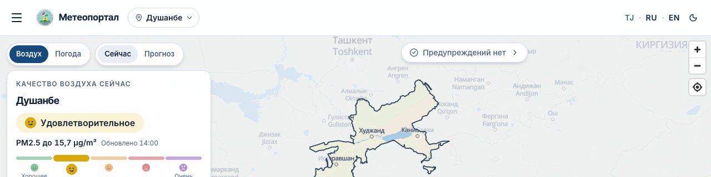

## 2. Индекс качества воздуха и уровни

Портал показывает **оперативный пятиуровневый индекс**: по каждому веществу берётся последнее часовое среднее (для CO - восьмичасовое), сравнивается с таблицей порогов и получает уровень от 1 до 5; индекс станции - худший из под‑индексов, а вещество с наибольшим под‑индексом называется **определяющим** и показывается рядом с уровнем. Внутри уровня считается доля, поэтому индекс можно показать и числом (например, 1,3).

| Уровень | Цвет | Что это значит |
|---|---|---|
| 1 · Хороший | зелёный | Воздух чистый, ограничений нет |
| 2 · Удовлетворительный | жёлтый | Качество приемлемое; особо чувствительные люди могут заметить лёгкий дискомфорт |
| 3 · Умеренный | оранжевый | Чувствительным группам стоит сократить длительные нагрузки на улице |
| 4 · Плохой | красный | Загрязнение заметно для всех: ограничьте пребывание на улице, особенно детям и пожилым |
| 5 · Очень плохой | фиолетовый | Очень высокое загрязнение: по возможности оставайтесь в помещении, закройте окна |
| Нет данных | серый | Измерений нет или они устарели (старше 6 часов) |

Уровень везде показывается тремя способами: цветом, словом и значком‑лицом - от улыбки (1) до перечёркнутых глаз (5), прочерк - нет данных. Поэтому уровень различим и без цветового зрения, и на чёрно‑белой распечатке.

Учитываются только измерения, прошедшие контроль качества Агентства. Если последнее измерение старше 6 часов, портал честно показывает «нет данных», а не устаревшую цифру.

Вещества: взвешенные частицы PM2.5 и PM10, диоксид азота NO₂, диоксид серы SO₂, оксид углерода CO, озон O₃; на автоматической станции Душанбе и постах также оксид азота NO, формальдегид CH₂O, фенол, фтористый водород HF, взвешенные частицы (пыль), диоксид углерода CO₂ (ppm) и летучие органические соединения (ЛОС, ppb). Единицы отображения выбирает Агентство: µg/m³ (CO - mg/m³) или mg/m³, как в ежедневных бюллетенях; единица всегда подписана рядом со значением, в API и CSV - поле `unit`.

Страница «Об индексе» (`/air/index`) содержит действующие пороги по веществам, описание методики Агентства по гидрометеорологии (кратность ПДКс.с. и ПДКм.р., суммация NO₂+SO₂, случаи ВЗ и ЭВЗ), национального индекса (кратность ПДК и комплексный ИЗА), шкалы по рекомендациям ВОЗ, таблицу ПДК и правила контроля качества.

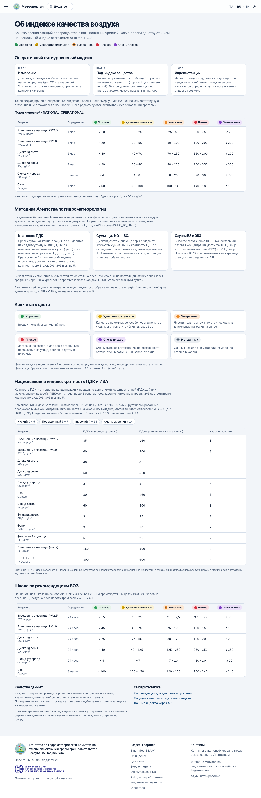

## 3. Главная страница

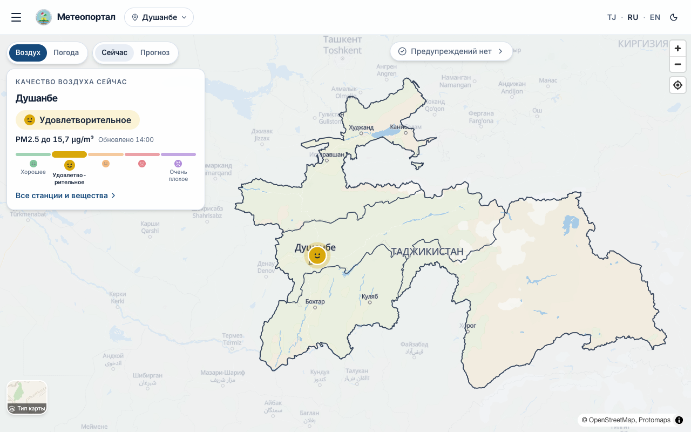

Главная страница - карта Таджикистана на весь экран (по образцу портала data.meteo.uz); соседние страны приглушены, чтобы взгляд оставался на Таджикистане. Вверху слева два переключателя:

- **Воздух · Погода** - что показать: станции мониторинга воздуха или погоду в городах. Одновременно показывается что‑то одно, чтобы значки не перекрывали друг друга.
- **Сейчас · Прогноз** - текущие данные или прогноз с ползунком времени (переключатель появляется, когда прогноз загружен).

Под переключателями (на телефоне - внизу экрана) - карточка города, выбранного в шапке. В режиме «Воздух» - уровень качества воздуха словом и цветом, определяющее вещество, время обновления и шкала уровней, она же легенда цветов карты; в режиме «Погода» - значок, температура, максимум и минимум за сутки и ссылка на подробный прогноз. При выборе другого города карточка меняется, а карта перелетает к нему. Над картой - плашки:

- **Предупреждения** - число действующих штормовых предупреждений и тех, что начнутся в ближайшие 24 часа («1 предупреждение · ещё 1 ожидается»); если предупреждений нет, плашка так и пишет: «Предупреждений нет». Если данные о предупреждениях давно не обновлялись, плашка предупреждает, что они могут быть устаревшими. Плашка ведёт в раздел «Предупреждения», а районы предупреждений закрашиваются на карте.
- **Превышения порогов** (оранжевая, когда есть) - например, «PM10 выше порога: Центр города Вахдат» или «PM10 выше порога на 3 станциях»; ведёт к списку превышений в разделе «Мониторинг воздуха». Все остальные разделы - в меню ☰.

## 4. Станции и графики

Раздел «Качество воздуха» (`/air`) - список станций с текущим уровнем, значением и определяющим веществом; данные обновляются каждую минуту.

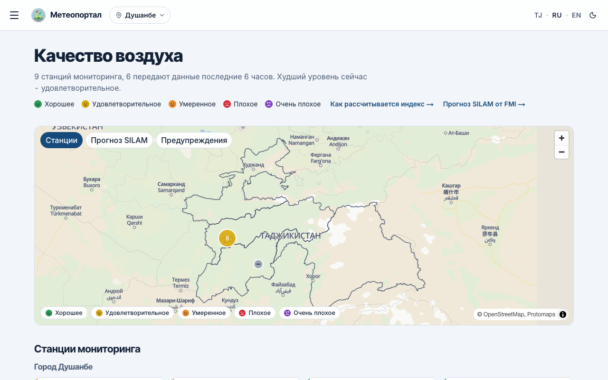

Страница станции (`/air/stations/<адрес станции>`):

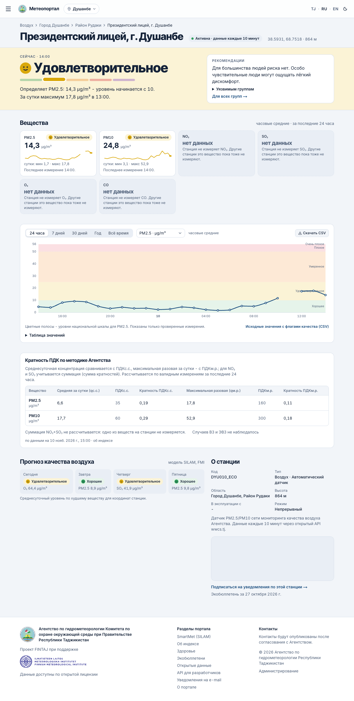

- **Текущие значения** - индекс с уровнем, определяющее вещество, карточки по каждому веществу (значение, единица, уровень) и шкала, по которой считался индекс.
- **Расположение** - карта с положением станции.
- **Погода - прогноз GFS** - карты погоды с SmartMet Server Агентства: температура воздуха, осадки, ветер (скорость цветом и стрелки направления) или облачность - параметр выбирается в выпадающем списке. Ползунок и кнопки «‹ ›» листают прогноз с шагом 3 часа на 5 суток, далее 6 часов до 10 суток; «▶» запускает анимацию. Под ползунком - шкала значений и время запуска модели GFS. Одновременно показывается один прогнозный слой: при включении погоды слой SILAM выключается, и наоборот.
- **Прогноз SILAM** - модельный прогноз качества воздуха для координат станции на сегодня, завтра и послезавтра (среднесуточный уровень по худшему веществу).
- **Кратность ПДК по методике Агентства** - таблица, как в ежедневных бюллетенях: среднесуточная концентрация (qс.с.) и её кратность ПДКс.с., максимальная разовая за сутки (qм.р.) и кратность ПДКм.р. по каждому веществу; ниже - суммация NO₂+SO₂ (сумма кратностей ПДКс.с., если станция измеряет оба вещества) и отметка о случаях ВЗ (≥ 10 ПДКм.р.) и ЭВЗ (≥ 50 ПДКм.р.). Кратности ≥ 1 выделены. Рассчитывается по валидным измерениям за последние 24 часа.
- **Рекомендации** - что делать при текущем уровне: для общего населения и (раскрывающийся блок «Уязвимым группам») для детей, беременных и кормящих, пожилых, людей с хроническими болезнями органов дыхания и сердца; ссылка ведёт к этому уровню в разделе «Здоровье».
- **Получать уведомления о превышениях на этой станции** - ссылка на подписку.
- **Динамика измерений** - график с выбором периода и вещества (раздел 4.1).
- **Паспорт станции** - код, тип, координаты, высота, дата ввода в эксплуатацию, режим отбора проб, источник данных.

### 4.1. График

- **Период**: 24 часа, 7 дней, 30 дней, Год или **Всё время** (до 10 лет).
- **Осреднение**: «По часам», «По суткам» или «По месяцам» - сутки и месяцы считаются по местному времени. Для каждого периода доступны подходящие варианты: 24 часа - по часам; 7 и 30 дней - по часам или суткам; Год - по суткам или месяцам; Всё время - по месяцам или суткам.
- Выбор вещества - выпадающий список рядом с периодами.
- Цветные полосы на фоне - уровни шкалы для выбранного вещества: сразу видно, в какой уровень попадает значение.
- Наведите курсор (или коснитесь на телефоне) на точку, чтобы увидеть время и значение; при осреднении по суткам и месяцам - также минимум и максимум. Если точек много, под графиком появляется ползунок масштаба.
- **Таблица значений** под графиком (раскрывается по нажатию) - те же данные текстом, для программ чтения с экрана и копирования.
- Показываются только валидные и скорректированные измерения; пропуски означают отсутствие данных, а не нулевое загрязнение.

## 5. Выгрузка CSV

Кнопка **«Скачать CSV»** над графиком сохраняет средние выбранного периода, осреднения и вещества (без выбора вещества - по всем веществам станции) в файл для Excel, LibreOffice или анализа.

Формат файла: кодировка UTF‑8 с BOM (Excel открывает его без настройки), разделитель - запятая, столбцы:

| Столбец | Содержание |
|---|---|
| `time_utc` | время начала интервала в UTC (ISO 8601) |
| `time_local` | то же по времени Душанбе (`ГГГГ-ММ-ДД ЧЧ:ММ`) |
| `station` | код станции |
| `pollutant` | код вещества (`PM25`, `PM10`, `NO2`, `SO2`, `CO`, `O3`, `NO`, `CH2O`, `C6H5OH`, `HF`, `TSP`, `CO2`, `TVOC`) |
| `value` | среднее за интервал в единице отображения портала (по валидным и скорректированным значениям) |
| `unit` | единица (`µg/m³` или `mg/m³`; `ppm` для CO₂, `ppb` для ЛОС) - та, что выбрана Агентством в настройках |
| `aggregation` | `hour` - часовое среднее, `day` - суточное, `month` - месячное |
| `samples` | число измерений, вошедших в среднее |
| `min`, `max` | минимум и максимум в интервале |
| `qc_flag` | качество точки: `valid` - все значения прошли контроль, `corrected` - среди них есть исправленные оператором; если валидных нет - худший флаг исключённых (`suspect`, `invalid`, `raw`) или `missing` |
| `excluded` | сколько значений в интервале исключено контролем качества |

Ссылка **«Исходные значения с флагами качества (CSV)»** выгружает каждое измерение без осреднения (не больше 30 суток): `time_utc`, `time_local`, `station`, `pollutant`, `value`, `unit`, `averaging_min` (период осреднения прибора, мин) и `qc_flag` по каждому значению.

Тот же файл можно получить по адресу `…/api/v1/stations/<slug>/measurements?range=7d&agg=day&pollutant=PM25&format=csv`, исходные значения - `…&agg=raw&format=csv` (см. раздел 13).

## 6. Карта

Карта - главная страница портала (`/`; старый адрес `/map` ведёт туда же). Она работает без внешних сервисов; масштаб - колесом мыши, кнопками «+/−» (на телефоне - жестами); кнопка «моё местоположение» центрирует карту (с разрешения браузера). Выбор на карте отражается в адресе страницы, поэтому ссылкой можно поделиться: `/?layer=silam` открывает прогноз качества воздуха, `/?layer=weather` - погоду.

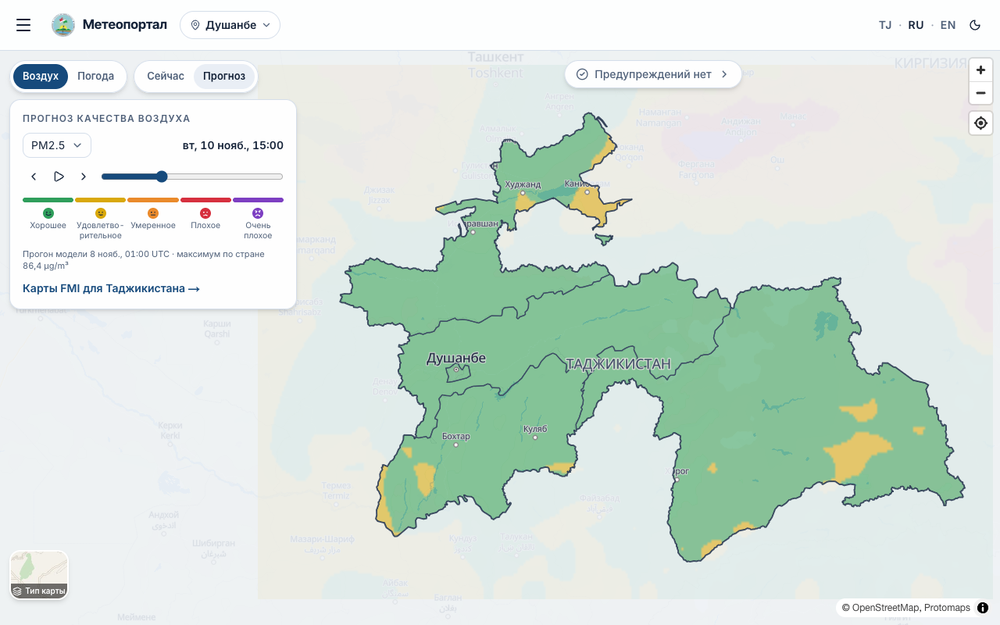

**Воздух · Сейчас** (открывается по умолчанию):

- Цветные точки - станции с текущим уровнем индекса. Нажмите на станцию - появится карточка с названием, уровнем словом, определяющим веществом и его значением, временем обновления и ссылкой на страницу станции.
- При уменьшении масштаба близкие станции объединяются в кружок цвета худшего уровня с ореолом; нажмите на него, чтобы приблизить.
- Станции без свежих данных показываются бледными кольцами при приближении; на масштабе страны они скрыты.

**Воздух · Прогноз** - модельный прогноз SILAM: цветная сетка уровней публичной шкалы по выбранному веществу (`PM2.5`, `PM10` и др.). Ползунок и кнопки «‹ ›» листают прогноз по часам на 5 суток вперёд; «▶» запускает анимацию. Под ползунком - шкала уровней, время запуска модели и максимум по стране; ссылка «Карты FMI для Таджикистана» ведёт на готовые карты FMI (раздел «SmartMet (SILAM)»).

**Погода · Сейчас** - значок погоды и температура сейчас в городах (точки прогноза SmartMet); нажмите на город - описание погоды, максимум и минимум за сутки и ссылка на подробный прогноз. Остальные населённые пункты появляются при приближении.

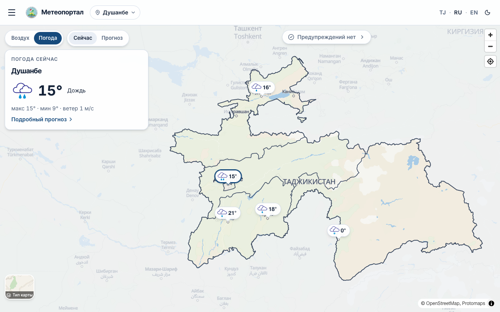

**Погода · Прогноз** (когда подключены карты SmartMet Server) - температура воздуха, осадки, ветер или облачность с ползунком времени и шкалой значений.

**Тип карты** - кнопка с миниатюрой карты (на компьютере - слева внизу, на телефоне - справа вверху под кнопкой местоположения): «Схема» (обычная цветная карта: растительность, вода, дороги), «Серая» (та же карта без цвета - цвета станций и прогноза заметнее всего), «Рельеф» (затенение гор по цифровой модели рельефа Copernicus) и «Спутник» (безоблачный снимок Sentinel-2 за 2021 год). Выбор запоминается в браузере. Все подложки построены на открытых данных и хранятся на сервере портала.

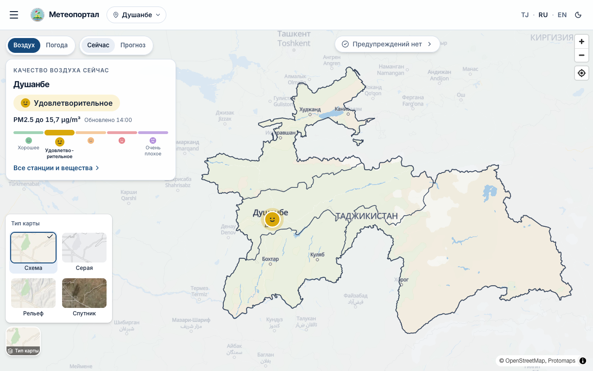

На карте всегда видны контуры областей, Душанбе и РРП, при приближении - пунктирные границы районов. Наведите указатель на область - она подсветится и покажет название; нажмите - откроется карточка с числом станций и ссылкой на список станций. Действующие предупреждения - полигоны цвета уровня опасности; ожидаемые в ближайшие 24 часа - бледная заливка с пунктирным контуром. Рядом с плашкой появляется легенда уровней опасности с цифрами 1–4. Нажмите на полигон, чтобы прочитать уровень (цифрой и словом), заголовок и срок действия. Ссылка `/?layer=warnings` сразу приближает карту к районам предупреждений. Маркеры станций и кружки групп станций несут значок‑лицо уровня (у группы - худшего).

Если браузер не поддерживает WebGL (очень старые компьютеры, отключённое аппаратное ускорение), вместо карты показывается сообщение - используйте список станций.

### 6.1. Карты FMI «SmartMet (SILAM)»

Раздел «SmartMet (SILAM)» (`/air/silam`, в меню ☰) - готовые карты прогноза загрязнения воздуха над Таджикистаном и соседними странами, которые Финский метеорологический институт (FMI) каждый день рассчитывает по модели SILAM в рамках проекта FINTAJ. Портал показывает их без изменений.

- **Показатель** выбирается кнопками над картой: индекс качества воздуха AQI (худший из уровней веществ), PM2.5, PM10, NO₂, O₃, CO, SO₂ и высота пограничного слоя (ABL - чем она ниже, тем сильнее загрязнение копится у земли).
- **Время** меняется колесом мыши над картой (вниз - позже, вверх - раньше) или наведением на полосу часов; на телефоне - движением пальца по карте влево‑вправо, с клавиатуры - стрелками. «Анимация» прокручивает все 48 часов.
- Прогноз на 48 часов обычно рассчитывается от 00 UTC предыдущих суток, новые карты выходят около 07:00 по Душанбе; если FMI выпускает карты позже, прогон начинается в 00 UTC того же дня - портал это учитывает. На карте время указано по UTC («06Z» = 11:00 по Душанбе), над картой - местное время. Если FMI давно не обновлял карты, портал пишет об этом и показывает последний прогон.
- Ниже карты - пояснения, таблица порогов индекса FMI и ссылки на слой SILAM на карте портала и на измерения станций. Модельный прогноз показывает фон загрязнения с шагом в десятки километров; официальная оценка - по данным станций.

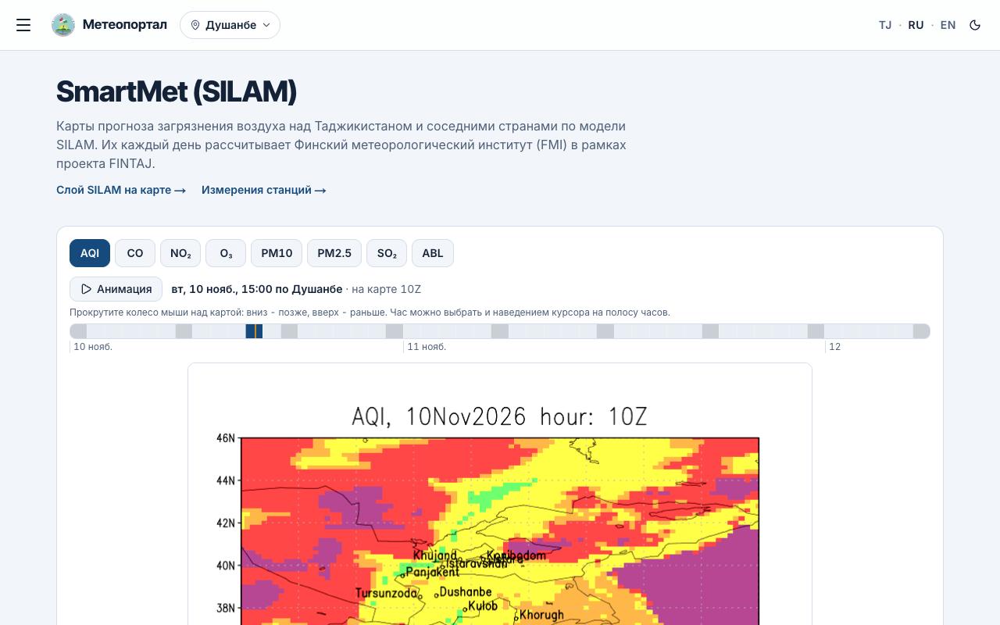

## 7. Погода

Раздел «Погода» (`/weather`) - прогноз SmartMet Server (FMI) для городов и районов, обновляется каждые 15 минут.

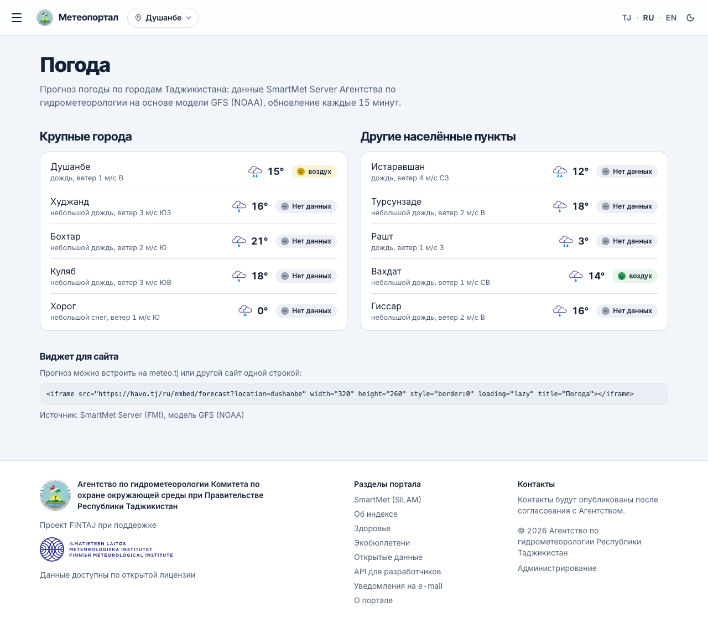

Карточки крупных городов показывают текущую температуру, ветер, осадки и символ погоды; ниже - список других населённых пунктов. Страница города (`/weather/<адрес>`):

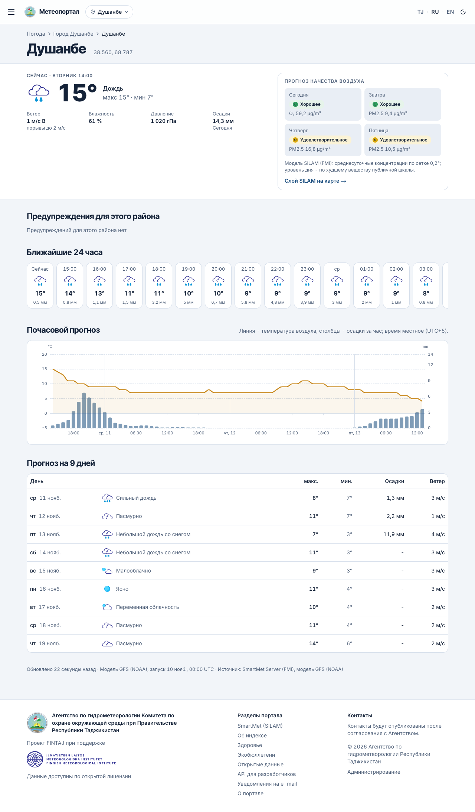

- **Сейчас** - температура, ощущения ветра, влажность, давление, точка росы, облачность, осадки.
- **Ближайшие 24 часа** - лента по часам.
- **График** на 72 часа: линия - температура, столбцы - осадки за час.
- **Прогноз на 10 дней** - таблица: минимум/максимум температуры, осадки, ветер, символ погоды.
- **Прогноз качества воздуха** (SILAM) на ближайшие дни с определяющим веществом и ссылкой на слой на карте.
- **Предупреждения для этого района**, если они есть.
- Внизу - время запуска модели и источник. Пометка «Прогноз устарел» означает, что обновление от источника давно не поступало.
- **Виджет для сайта** - готовый код для встраивания прогноза (раздел 12).

## 8. Предупреждения

Раздел «Предупреждения» (`/warnings`) - штормовые предупреждения Агентства в формате CAP (редактор SmartMet Alert).

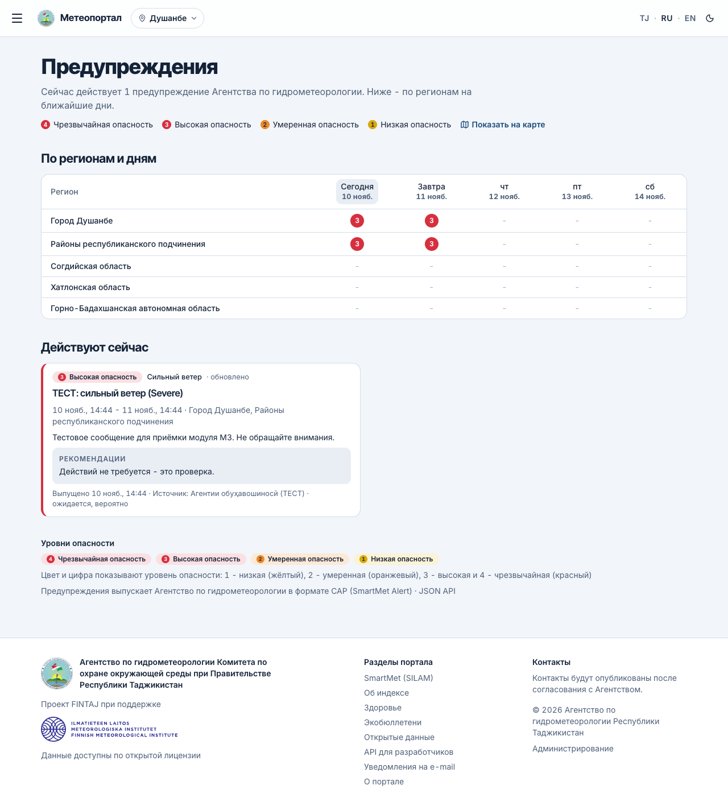

- **Действуют сейчас** и **Ожидаются** - карточки с заголовком, уровнем опасности, периодом действия, территорией, описанием и рекомендациями; кнопка «CAP XML» открывает исходное сообщение.
- **По регионам и дням** - таблица: строки - регионы (Душанбе, РРП, Согдийская, Хатлонская, ГБАО), столбцы - ближайшие дни; в ячейке - кружок с цифрой максимального уровня опасности. Ссылка на регион фильтрует список.
- Уровни опасности показываются цветом и цифрой: 1 - низкая (жёлтый), 2 - умеренная (оранжевый), 3 - высокая и 4 - чрезвычайная (красный).
- Ссылка «Показать на карте» открывает главную карту, приближенную к районам предупреждений.
- Если данные от редактора предупреждений давно не поступали, вверху раздела появляется пометка: список может быть неполным.
- Обновлённое предупреждение заменяет предыдущее, отменённое - исчезает; истёкшие не показываются.

Действующие предупреждения также видны на карте главной страницы, на страницах погоды соответствующего района и в виджете.

## 9. Здоровье

Раздел «Здоровье» (`/health`) - рекомендации по каждому уровню индекса для разных групп: общее население, дети, беременные и кормящие, пожилые люди, люди с хроническими респираторными и сердечно‑сосудистыми заболеваниями. Выберите группу - и читайте, что делать при каждом из пяти уровней. Рекомендации носят общий характер и не заменяют консультацию врача.

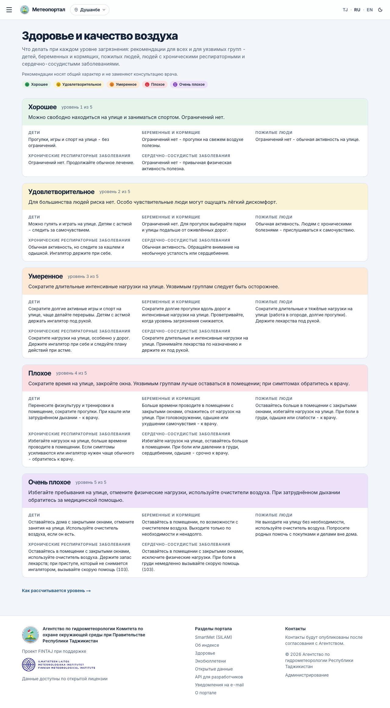

## 10. Новости

Раздел «Новости» (`/news`) - публикации Агентства с рубриками, закреплёнными («Важное») материалами и постраничной навигацией. RSS‑лента: `/api/v1/news/rss.xml?locale=ru` (ссылка «RSS‑лента» в разделе). Ссылка «Получать бюллетень на e‑mail» ведёт к подписке.

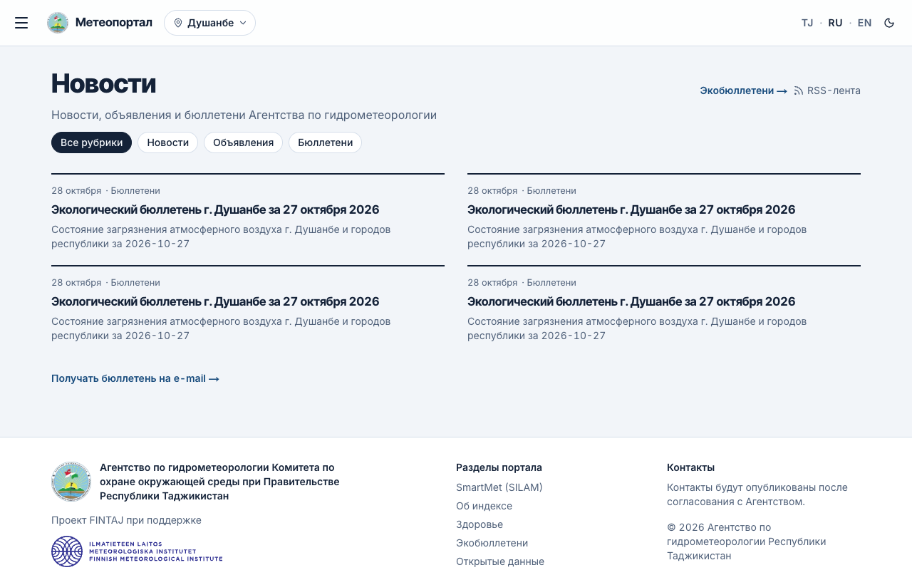

### 10.1. Экобюллетени

Раздел «Экобюллетени» (`/air/bulletins`, в меню ☰ и в подвале) - архив ежедневных экологических бюллетеней Агентства о загрязнении атмосферного воздуха в городах республики за прошедшие сутки. Откройте бюллетень за нужную дату: документ показан прямо на странице. Переключатели над ним выбирают вид документа («Бюллетень города», «Сводка по городам», «Форма 4а») и язык (таджикский или русский - документы составляются на этих двух языках). Кнопки DOCX и PDF скачивают документ, HTML открывает версию для печати. Каждый опубликованный бюллетень также появляется в разделе «Новости».

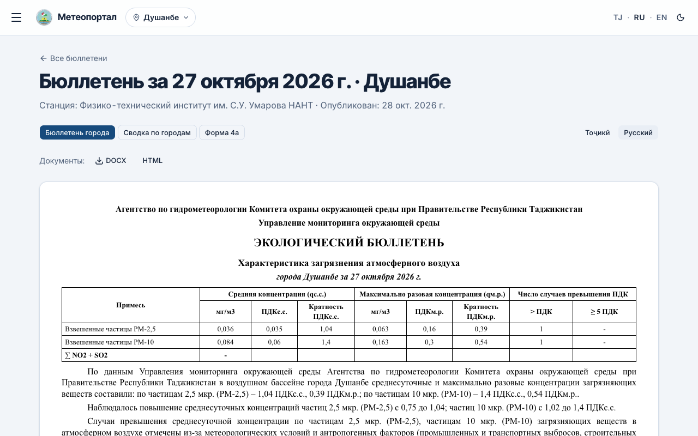

## 11. Подписка на уведомления

Страница «Уведомления на e‑mail» (`/subscribe`, ссылка в меню ☰, в подвале и на страницах станций):

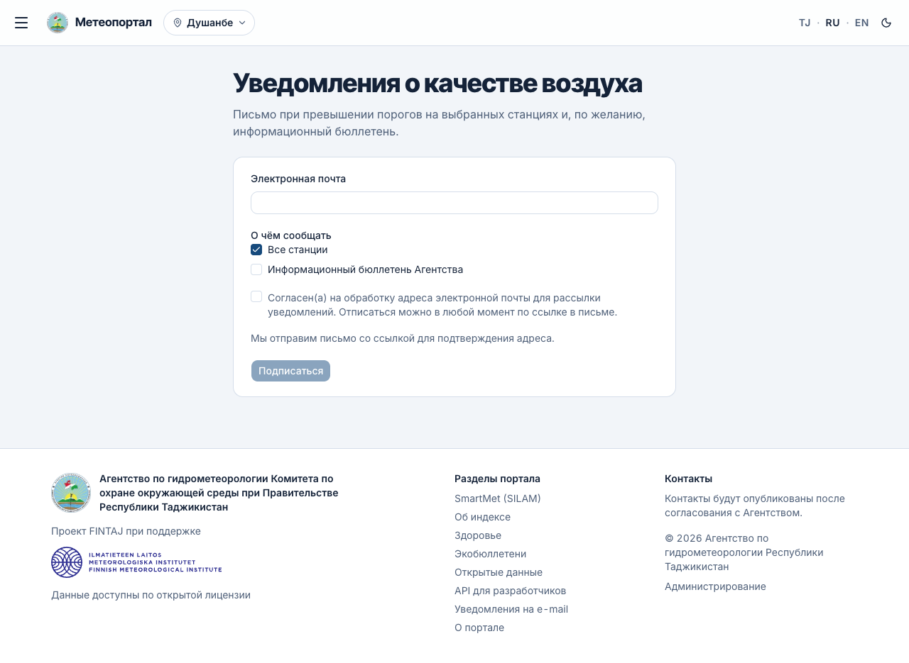

1. Введите адрес электронной почты.
2. Выберите, о чём сообщать: все станции или отдельные станции (письмо при превышении порогов), и/или информационный бюллетень Агентства.
3. Подтвердите согласие на обработку адреса и нажмите «Подписаться».
4. Откройте письмо и перейдите по ссылке подтверждения - без этого уведомления не отправляются (защита от подписки чужого адреса).

Письма приходят на языке, на котором оформлена подписка. Отписаться можно в любой момент по ссылке внизу любого письма. Если письмо не пришло, проверьте папку «Спам» и правильность адреса; повторная подписка того же адреса безопасна.

## 12. Виджеты для сайтов

Готовые блоки для встраивания на meteo.tj и другие сайты через `<iframe>` - без программирования. Адреса (вместо `<портал>` подставьте адрес портала):

| Виджет | Адрес | Параметры |
|---|---|---|
| Индекс станции | `<портал>/embed/aqi?station=<slug>&lang=tg` | `station` - адрес станции из списка станций (без параметра - первая станция с данными); `lang` - `tg`, `ru`, `en` |
| Прогноз погоды | `<портал>/embed/forecast?location=dushanbe&lang=ru` | `location` - адрес точки прогноза (`dushanbe`, `khujand`, `bokhtar`, `kulob`, `khorugh`, …; полный список - `/api/v1/forecast`). Если прогноз давно не обновлялся, виджет показывает пометку «устарело» |
| Предупреждения | `<портал>/embed/alerts?region=DU&lang=en&limit=5` | `region` - код региона (`DU`, `RRP`, `SU`, `KT`, `GB`), без параметра - вся страна; `limit` - число сообщений |

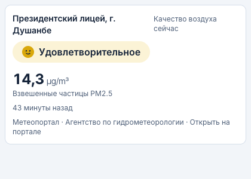

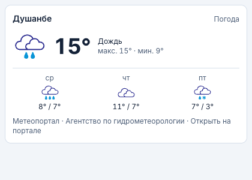

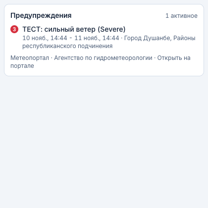

Пример кода (готовая строка есть на странице города в разделе «Погода» и в разделе «Открытые данные»):

```html
<iframe src="https://havo.tj/ru/embed/forecast?location=dushanbe"
        width="320" height="260" style="border:0" loading="lazy"
        title="Погода в Душанбе"></iframe>
```

Рекомендуемая ширина 300–400 px; высота подбирается по содержимому (виджет адаптируется к ширине). Внизу каждого виджета - ссылка «Открыть на портале». Встраивание разрешено для сайтов Агентства; для других доменов список разрешённых сайтов настраивает IT‑служба.

## 13. Открытые данные и API для разработчиков

Раздел «Открытые данные» (`/data`) перечисляет наборы данных, форматы и лицензию; «API для разработчиков» (`/data/api`) - интерактивную документацию с параметрами, схемами ответов и примерами.

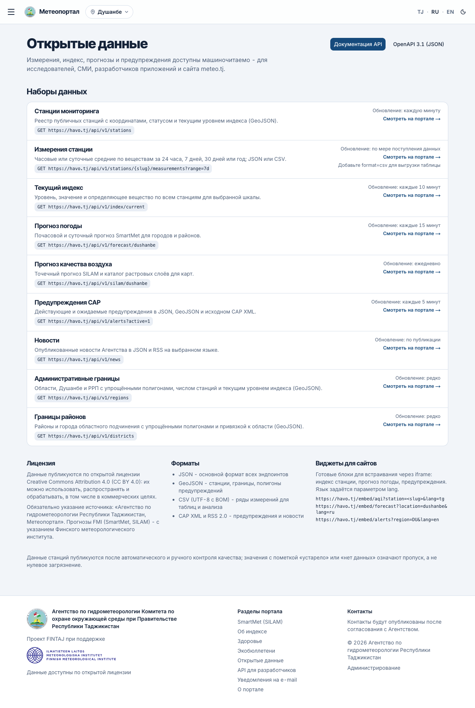

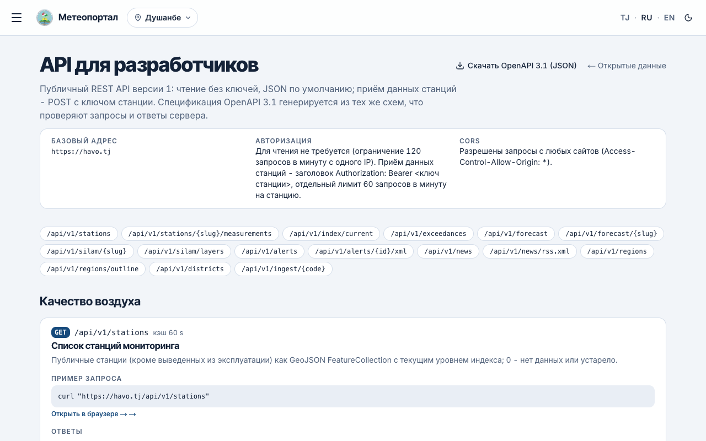

Основное:

- **Базовый адрес**: `https://<портал>/api/v1`. Только чтение, метод `GET`, ключи не нужны.
- **Формат**: JSON по умолчанию; GeoJSON для станций, границ и предупреждений; CSV для рядов измерений; CAP XML и RSS 2.0.
- **Время** - UTC в ISO 8601; местное время - `Asia/Dushanbe` (UTC+5). Многоязычные поля - объект `{ "tg": …, "ru": …, "en": … }`.
- **Лимит**: 120 запросов в минуту с одного IP‑адреса (значение по умолчанию, может быть изменено Агентством); при превышении - ответ `429` с заголовком `Retry-After`. Текущие лимиты - в заголовках `X-RateLimit-Limit`, `X-RateLimit-Remaining`, `X-RateLimit-Reset`.
- **Кэш**: ответы кэшируются на 60–3600 секунд (заголовок `Cache-Control`, `X-Cache: HIT|MISS`); не опрашивайте API чаще, чем обновляются данные.
- **CORS**: разрешены запросы с любых сайтов (`Access-Control-Allow-Origin: *`).
- **Лицензия**: CC BY 4.0 - укажите источник «Агентство по гидрометеорологии Республики Таджикистан, Метеопортал»; прогнозы - с указанием FMI (SmartMet, SILAM).
- **Спецификация OpenAPI 3.1**: `GET /api/v1/openapi.json?lang=ru` (подходит для Swagger UI, Postman, генераторов клиентов).

### 13.1. Справочник эндпоинтов

| Эндпоинт | Назначение | Параметры | Кэш |
|---|---|---|---|
| `GET /api/v1/stations` | публичные станции (GeoJSON) с текущим уровнем индекса | - | 60 с |
| `GET /api/v1/stations/{slug}/measurements` | ряды измерений станции | `range` = `24h` (по умолчанию) / `7d` / `30d` / `1y` / `all` (до 10 лет); `agg` = `hour` / `day` / `month` (допустимые сочетания - как в разделе 4.1) или `raw` - исходные значения с флагом качества (только CSV, до 30 суток); `pollutant` = код вещества (без параметра - все); `format` = `json` / `csv` | 60 с |
| `GET /api/v1/index/current` | текущий индекс всех станций | `scale` = `NATIONAL_OPERATIONAL` (по умолчанию) / `WHO_24H` / `RATIO_TO_LIMIT` / `US_AQI` / `IZA` | 60 с |
| `GET /api/v1/exceedances` | активные превышения порогов | - | 60 с |
| `GET /api/v1/forecast` | список точек прогноза: адрес (`slug`), названия на трёх языках, координаты, вид (`city`, `district`, `station`), область | - | 600 с |
| `GET /api/v1/forecast/{slug}` | прогноз погоды для точки; поле `stale: true` - прогноз давно не обновлялся | `hours` 1–240 (72), `days` 1–16 (10) | 300 с |
| `GET /api/v1/silam/{slug}` | точечный прогноз качества воздуха SILAM | - | 600 с |
| `GET /api/v1/silam/layers` | каталог растровых слоёв последнего прогона SILAM | - | 600 с |
| `GET /api/v1/alerts` | предупреждения CAP | `active=1` - только действующие; `region` = `DU` / `RRP` / `SU` / `KT` / `GB`; `lang` = `tg` / `ru` / `en`; `days` 1–14 (7); `format` = `json` / `geojson` | 60 с |
| `GET /api/v1/alerts/{id}/xml` | исходное сообщение CAP 1.2 | - | 300 с |
| `GET /api/v1/news` | опубликованные новости | `locale`, `page`, `pageSize` 1–50 (12), `category` | 300 с |
| `GET /api/v1/news/rss.xml` | RSS 2.0 | `locale` | 300 с |
| `GET /api/v1/regions` | границы областей (GeoJSON, упрощённые) | - | 3600 с |

Ошибки: `400` - некорректные параметры, `404` - объект не найден; тело - `{ "error": "…" }`.

### 13.2. Примеры ответов

Список станций - `GET /api/v1/stations` (сокращено):

```json
{
  "type": "FeatureCollection",
  "features": [
    {
      "type": "Feature",
      "id": 1,
      "geometry": { "type": "Point", "coordinates": [68.787, 38.5598] },
      "properties": {
        "id": 1, "slug": "dushanbe-post-no-1", "code": "DU-01",
        "name": { "tg": "Душанбе, пости № 1", "ru": "Душанбе, пост № 1", "en": "Dushanbe, post No. 1" },
        "kind": "air", "status": "active",
        "region": { "tg": "Шаҳри Душанбе", "ru": "Город Душанбе", "en": "Dushanbe city" },
        "level": 1, "indexValue": 1.26, "indexTime": "2026-10-17T14:00:00.000Z"
      }
    }
  ]
}
```

Ряды измерений - `GET /api/v1/stations/dushanbe-post-no-1/measurements?range=24h&pollutant=PM25`:

```json
{
  "station": { "id": 1, "slug": "dushanbe-post-no-1", "code": "DU-01", "name": { "ru": "Душанбе, пост № 1" } },
  "range": "24h",
  "from": "2026-10-16T13:30:03.699Z",
  "to": "2026-10-17T13:30:03.699Z",
  "aggregation": "hour",
  "timezone": "Asia/Dushanbe",
  "series": [
    {
      "pollutant": { "id": 1, "code": "PM25", "shortName": "PM2.5", "unit": "µg/m³", "decimals": 1 },
      "points": [
        { "t": "2026-10-16T14:00:00.000Z", "v": 25.5, "min": 25.5, "max": 25.5, "n": 1 },
        { "t": "2026-10-16T15:00:00.000Z", "v": 26.6, "min": 26.6, "max": 26.6, "n": 1 }
      ]
    }
  ]
}
```

Тот же запрос с `format=csv`:

```csv
time_utc,time_local,station,pollutant,value,unit,aggregation,samples,min,max
2026-10-16T14:00:00.000Z,2026-10-16 19:00,DU-01,PM25,25.5,µg/m³,hour,1,25.5,25.5
2026-10-16T15:00:00.000Z,2026-10-16 20:00,DU-01,PM25,26.6,µg/m³,hour,1,26.6,26.6
```

Текущий индекс - `GET /api/v1/index/current`:

```json
{
  "scale": {
    "code": "NATIONAL_OPERATIONAL", "kind": "breakpoints",
    "levels": [ { "level": 1, "color": "#2E9E5B", "label": { "tg": "Хуб", "ru": "Хороший", "en": "Good" } } ]
  },
  "generatedAt": "2026-10-17T13:30:03.726Z",
  "stations": [
    {
      "id": 1, "slug": "dushanbe-post-no-1", "code": "DU-01",
      "name": { "ru": "Душанбе, пост № 1" },
      "level": 1, "value": 1.26, "time": "2026-10-17T14:00:00.000Z", "stale": false,
      "dominantPollutant": "CO",
      "subIndices": { "CO": { "index": 1.26, "level": 1, "value": 1.02 } }
    }
  ]
}
```

Прогноз погоды - `GET /api/v1/forecast/dushanbe?hours=3&days=2` (поля: `t` температура °C, `ws`/`wd`/`gust` ветер м/с и направление °, `rh` влажность %, `p` давление гПа, `dew` точка росы, `cloud` облачность %, `precip` осадки мм, `symbol` код символа погоды):

```json
{
  "location": { "slug": "dushanbe", "name": { "ru": "Душанбе" }, "lat": 38.5598, "lon": 68.787 },
  "producer": "ecmwf",
  "originTime": "2026-10-17T00:00:00.000Z",
  "fetchedAt": "2026-10-17T13:16:55.557Z",
  "timeZone": "Asia/Dushanbe",
  "hourly": [ { "time": "2026-10-17T13:00:00.000Z", "t": 16, "ws": 0, "wd": null, "rh": 38, "p": 1018, "precip": 0, "symbol": null } ],
  "daily": [ { "date": "2026-10-17T00:00:00.000Z", "tmin": 10, "tmax": 20, "precipSum": 0, "symbol": null } ]
}
```

Прогноз качества воздуха - `GET /api/v1/silam/dushanbe` (почасовые ряды по веществам и суточная сводка с уровнем):

```json
{
  "location": { "slug": "dushanbe", "name": { "ru": "Душанбе" }, "lat": 38.5598, "lon": 68.787 },
  "run": { "originTime": "2026-10-16T01:00:00.000Z", "fetchedAt": "2026-10-17T13:15:26.460Z" },
  "units": { "PM25": "µg/m³", "PM10": "µg/m³", "NO2": "µg/m³", "SO2": "µg/m³", "CO": "mg/m³", "O3": "µg/m³" },
  "hourly": { "PM25": [ ["2026-10-16T19:00:00.000Z", 12.4] ] },
  "days": [ { "date": "2026-10-17", "level": 2, "dominantPollutant": "PM25",
              "means": { "PM25": 14.22, "PM10": 19.69, "NO2": 17.02, "SO2": 25.69, "CO": 0.29, "O3": 62.24 } } ]
}
```

Предупреждения - `GET /api/v1/alerts?active=1&lang=ru`:

```json
{
  "generatedAt": "2026-10-17T13:30:03.816Z",
  "lang": "ru",
  "count": 1,
  "alerts": [
    {
      "id": 16, "identifier": "tj.meteo.2026.0001", "sent": "2026-10-17T01:00:00.000Z",
      "msgType": "Alert", "language": "ru-RU",
      "event": "Сильный ветер",
      "headline": "Сильный ветер до 25 м/с в Душанбе и РРП",
      "description": "С полудня 16 октября до вечера 17 октября ожидается сильный западный ветер 18–25 м/с.",
      "instruction": "Не оставайтесь под деревьями и неустойчивыми конструкциями, закрепите лёгкие предметы.",
      "severity": "Severe", "color": "red", "colorHex": "#D7263D",
      "urgency": "Expected", "certainty": "Likely",
      "onset": "2026-10-17T07:00:00.000Z", "expires": "2026-10-18T16:00:00.000Z",
      "active": true, "upcoming": false,
      "regions": [ { "code": "DU", "name": { "ru": "Город Душанбе" } } ],
      "areas": [ "Душанбе и районы республиканского подчинения" ],
      "xml": "https://havo.tj/api/v1/alerts/16/xml"
    }
  ]
}
```

Новости - `GET /api/v1/news?locale=ru&pageSize=1`:

```json
{
  "locale": "ru", "page": 1, "pageSize": 1, "total": 2,
  "items": [
    {
      "id": 1, "slug": "portal-launch-week6",
      "title": "Новый метеопортал запущен в тестовом режиме",
      "excerpt": "Качество воздуха, прогноз и предупреждения в одном месте.",
      "publishedAt": "2026-10-16T09:47:58.056Z", "pinned": true,
      "category": { "slug": "news", "name": "Новости" }, "cover": null,
      "url": "https://havo.tj/ru/news/portal-launch-week6"
    }
  ]
}
```

Активные превышения - `GET /api/v1/exceedances`:

```json
{
  "generatedAt": "2026-10-17T13:30:03.743Z",
  "events": [
    { "id": 2, "startedAt": "2026-10-17T13:16:52.683Z",
      "station": { "id": 3, "slug": "bokhtar-post-no-1", "name": { "ru": "Бохтар, пост № 1" } },
      "rule": "PM10 выше 50 µg/m³", "kind": "pollutant", "pollutant": "PM10", "unit": "µg/m³",
      "value": 103.9, "threshold": 50, "level": null }
  ]
}
```

Слои SILAM - `GET /api/v1/silam/layers` возвращает границы растра и для каждого вещества список кадров `{ "time", "url", "max" }`; PNG‑изображения доступны по `url` (например, `/silam/2026101601/PM25/000.png`) и накладываются на карту в проекции Web Mercator по `run.bounds`.

### 13.3. Советы

- Для таблиц и анализа используйте `format=csv`; для графиков - JSON с `range=7d` (часовые) или `1y` (суточные).
- Поле `stale: true` или `level: 0` означает отсутствие актуальных данных - не показывайте такие значения как нулевое загрязнение.
- Прогнозы SILAM обновляются раз в сутки, погода - каждые 15 минут, предупреждения - каждые 5 минут; опрашивайте API не чаще.
- Коды станций берите из `/api/v1/stations`, адреса точек прогноза - из `/api/v1/forecast`.

## 14. Частые вопросы

| Вопрос | Ответ |
|---|---|
| Почему у станции «нет данных»? | Измерения не поступали больше 6 часов или не прошли контроль качества. Посты с разовыми пробами передают данные несколько раз в сутки |
| Почему индекс «хороший», а запах дыма? | Индекс считается по измеряемым веществам на ближайшей станции; локальные источники могут не попадать в измерения. Смотрите прогноз SILAM и предупреждения |
| Чем прогноз SILAM отличается от измерений? | SILAM - модельный расчёт FMI по сетке 20 км на 5 суток; измерения - факт на станции. Прогноз помогает планировать, измерения - оценить текущее состояние |
| Как часто обновляются данные? | индекс и станции - каждые 10 минут (страницы - ежеминутно), погода - каждые 15 минут, SILAM - ежедневно, предупреждения - каждые 5 минут |
| Можно ли использовать данные в СМИ и приложениях? | Да, по лицензии CC BY 4.0 с указанием источника; прогнозы - с указанием FMI |
| Как отписаться от писем? | По ссылке внизу любого письма |
| Карта не отображается | Браузер без поддержки WebGL или отключено аппаратное ускорение; обновите браузер или используйте список станций |
| Где исторические данные за прошлые годы? | На странице станции выберите период «Всё время» (до 10 лет, месячные или суточные средние); данные, которых нет на портале, - по запросу в Агентство |
