# Дастури корбари Метеопортал

> ⚠️ Матни тоҷикӣ бо ёрии тарҷумаи автоматӣ омода шудааст ва **аз ҷониби соҳибзабон тафтиш карда шавад** (требует проверки носителем). Истилоҳот мувофиқи `packages/i18n/GLOSSARY.md` истифода шудаанд.

Нусхаи 1.1 · 02.11.2026 · Забонҳо: **Тоҷикӣ** · [Русский](ru.md) · [English](en.md)

Метеопортал - сомонаи расмии Агентии обуҳавошиносии Ҷумҳурии Тоҷикистон дар бораи сифати ҳаво ва обу ҳаво: ченакҳои шабакаи истгоҳҳои мониторинг, индекси сифати ҳаво, пешгӯиҳои обу ҳаво ва сифати ҳаво, огоҳиҳои тӯфонӣ, тавсияҳо барои саломатӣ, ахбор. Дастур қисми оммавии порталро тасвир мекунад; кори кормандон дар панели маъмурӣ дар [Дастури маъмур](../admin/tg.md) тасвир шудааст.

## 1. Маълумоти умумӣ

- **Суроға**: `https://<домени портал>` (масалан, `https://havo.tj`). Портал дар компютер, планшет ва телефон кушода мешавад; бақайдгирӣ лозим нест.
- **Забонҳо**: тоҷикӣ (асосӣ, суроғаҳо бе пешванд - `/air`), русӣ (`/ru/air`) ва англисӣ (`/en/air`). Интихоби забон - дар кунҷи болои рост (нишонаи глобус).
- **Мавзӯъ**: равшан ё торик (нишонаи моҳ/офтоб дар назди забон; дар телефон - дар менюи ☰).
- **Бахшҳо** - дар менюи ☰ дар тарафи чапи сарлавҳа (мисли data.meteo.uz): MeteoAlert (SmartMet) - огоҳиҳо, SmartMet (пешгӯӣ) - обу ҳаво, SmartMet (SILAM) - пешгӯии сифати ҳаво, Мониторинги ҳаво, Харита, Ахбор, Саломатӣ, Маълумоти кушода · API, Дар бораи портал; поёнтар - «Дар бораи индекс», «Экобюллетенҳо», «Огоҳиҳо ба e‑mail». Дар он ҷо забон, мавзӯъ ва маълумот дар бораи лоиҳа низ ҳаст. Дар ҳамаи саҳифаҳо, ба ҷуз саҳифаи асосӣ, дар поён ҳамин истинодҳо ва тамос ҳастанд.
- **Вақт** дар портал бо вақти Душанбе (UTC+5) нишон дода мешавад; дар API ва CSV - бо UTC ва нишон додани вақти маҳаллӣ.
- **Дастрасӣ**: сатҳҳои ифлосшавӣ ҳамеша бо калимаҳо навишта мешаванд, на танҳо бо ранг; интерфейс бо клавиатура ва барномаҳои хониши экран кор мекунад.

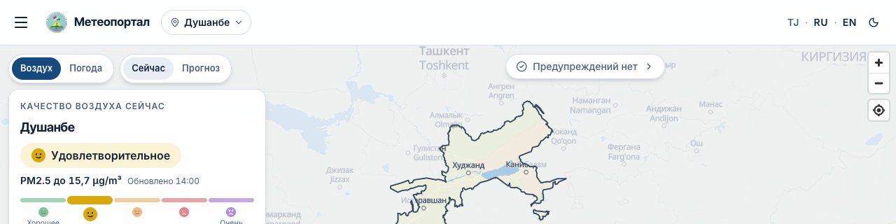

## 2. Индекси сифати ҳаво ва сатҳҳо

Портал **индекси оперативии панҷсатҳаро** нишон медиҳад: барои ҳар модда миёнаи соатии охирин гирифта мешавад (барои CO - ҳаштсоата), бо ҷадвали ҳадҳо муқоиса шуда, сатҳи аз 1 то 5 мегирад; индекси истгоҳ - бадтарин аз зериндексҳо, ва моддаи дорои зериндекси калонтарин **муайянкунанда** номида шуда, дар назди сатҳ нишон дода мешавад. Дар дохили сатҳ ҳисса ҳисоб карда мешавад, бинобар ин индексро бо рақам ҳам нишон додан мумкин аст (масалан, 1,3).

| Сатҳ | Ранг | Маънои он |
|---|---|---|
| 1 · Хуб | сабз | Ҳаво тоза аст, маҳдудият нест |
| 2 · Қаноатбахш | зард | Сифат қобили қабул; одамони махсусан ҳассос метавонанд нороҳатии сабукро ҳис кунанд |
| 3 · Миёна | норанҷӣ | Ба гурӯҳҳои ҳассос лозим аст, ки фаъолияти дарозмуддатро дар кӯча кам кунанд |
| 4 · Бад | сурх | Ифлосшавӣ барои ҳама ҳис мешавад: буданро дар кӯча маҳдуд кунед, махсусан кӯдакон ва пиронсолон |
| 5 · Хеле бад | бунафш | Ифлосшавии хеле баланд: ҳатталимкон дар дохили бино бимонед, тирезаҳоро пӯшед |
| Маълумот нест | хокистарӣ | Ченакҳо нестанд ё кӯҳна шудаанд (аз 6 соат кӯҳнатар) |

Сатҳ ҳамеша бо се роҳ нишон дода мешавад: ранг, калима ва нишонаи чеҳра - аз табассум (1) то чашмони хатзада (5), тире - маълумот нест. Бинобар ин сатҳро бе диди рангӣ ва дар чопи сиёҳу сафед низ фарқ кардан мумкин аст.

Танҳо ченакҳое ба ҳисоб гирифта мешаванд, ки назорати сифати Агентиро гузаштаанд. Агар ченаки охирин аз 6 соат кӯҳнатар бошад, портал ба ҷои рақами кӯҳна ростқавлона «маълумот нест» нишон медиҳад.

Моддаҳо: зарачаҳои 2,5 мкр. (PM2.5) ва 10 мкр. (PM10), дуоксиди нитроген NO₂, дуоксиди сулфур SO₂, оксиди карбон CO, озон O₃; дар истгоҳи худкори Душанбе ва нуқтаҳо инчунин оксиди нитроген NO, формалдегид CH₂O, фенол, фториди гидроген HF, моддаҳои муаллақ (чанг), гази карбонат CO₂ (ppm) ва пайвастагиҳои органикии зудбухоршаванда (ПОЗ, ppb). Воҳидҳои намоишро Агентӣ интихоб мекунад: µg/m³ (CO - mg/m³) ё mg/m³, мисли бюллетенҳои ҳаррӯза; воҳид ҳамеша дар назди қимат навишта шудааст, дар API ва CSV - майдони `unit`.

Саҳифаи «Дар бораи индекс» (`/air/index`) ҳадҳои амалкунанда аз рӯи моддаҳо, тавсифи методикаи Агентии обуҳавошиносӣ (нисбат ба ҲМҒ(м.ш.р) ва ҲМҒ(як), ҷамъи NO₂+SO₂, ҳолатҳои ИБ ва НИБ), индекси миллӣ (каррати ҲМҒ ва ИИА-и маҷмӯӣ), шкала аз рӯи тавсияҳои ТУТ, ҷадвали ҲМҒ ва қоидаҳои назорати сифатро дар бар мегирад.

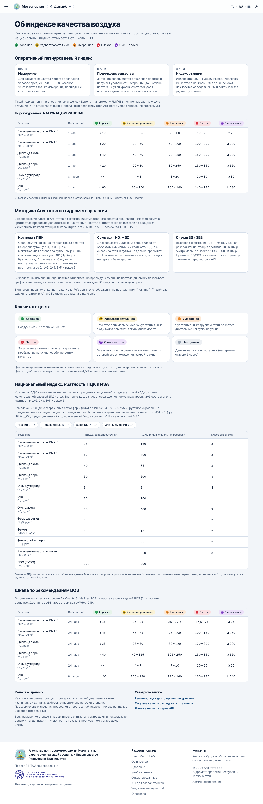

## 3. Саҳифаи асосӣ

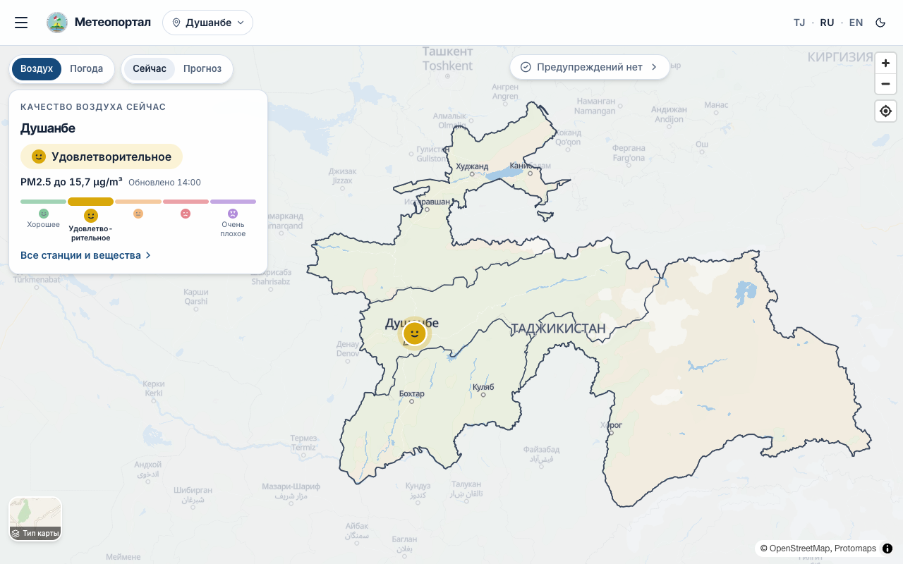

Саҳифаи асосӣ - харитаи Тоҷикистон дар тамоми экран (мисли портали data.meteo.uz); кишварҳои ҳамсоя хира нишон дода мешаванд, то диққат ба Тоҷикистон равона бошад. Дар боло аз чап ду интихобгар ҳаст:

- **Сифати ҳаво · Обу ҳаво** - чӣ нишон дода шавад: истгоҳҳои мониторинги ҳаво ё обу ҳаво дар шаҳрҳо. Дар як вақт танҳо яке нишон дода мешавад, то нишонаҳо якдигарро напӯшанд.
- **Ҳозир · Пешгӯӣ** - маълумоти ҷорӣ ё пешгӯӣ бо лағжонаки вақт (интихобгар вақте пайдо мешавад, ки пешгӯӣ бор шудааст).

Дар зери интихобгарҳо (дар телефон - дар поёни экран) корти шаҳри дар сарлавҳа интихобшуда ҷойгир аст. Дар ҳолати «Сифати ҳаво» - сатҳи сифати ҳаво бо калима ва ранг, моддаи муайянкунанда, вақти навсозӣ ва шкалаи сатҳҳо, ки ҳамзамон легендаи рангҳои харита аст; дар ҳолати «Обу ҳаво» - нишона, ҳарорат, ҳадди аксар ва ҳадди ақали шабонарӯз ва истинод ба пешгӯии муфассал. Ҳангоми интихоби шаҳри дигар корт иваз мешавад ва харита ба он мегузарад. Дар болои харита лавҳачаҳо ҳастанд:

- **Огоҳиҳо** - шумораи огоҳиҳои тӯфонии амалкунанда ва онҳое, ки дар 24 соати наздик оғоз мешаванд («1 огоҳӣ · боз 1 интизор меравад»); агар огоҳӣ набошад, лавҳача ҳамин тавр менависад: «Огоҳӣ нест». Агар маълумот дар бораи огоҳиҳо муддати дароз нав нашуда бошад, лавҳача огоҳ мекунад, ки он метавонад кӯҳна бошад. Лавҳача ба бахши «Огоҳиҳо» мебарад, ва минтақаҳои огоҳӣ дар харита ранг карда мешаванд.
- **Аз ҳад гузаштани ҳадҳо** (норанҷӣ, вақте ки ҳаст) - масалан, «PM10 аз меъёр баландтар дар 1 истгоҳ»; ба рӯйхати аз ҳад гузаштанҳо дар бахши «Мониторинги ҳаво» мебарад. Ҳамаи бахшҳои дигар - дар менюи ☰.

## 4. Истгоҳҳо ва графикҳо

Бахши «Сифати ҳаво» (`/air`) - рӯйхати истгоҳҳо бо сатҳи ҷорӣ, қимат ва моддаи муайянкунанда; маълумот ҳар дақиқа нав мешавад.

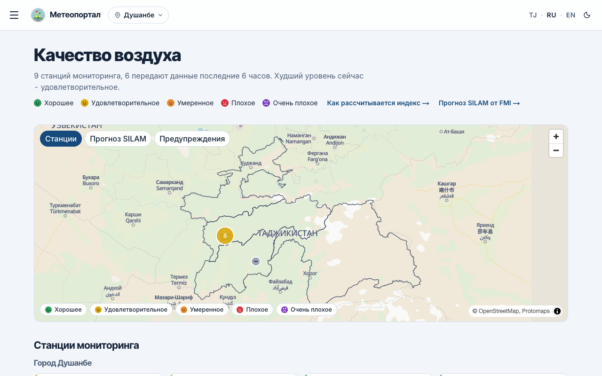

Саҳифаи истгоҳ (`/air/stations/<суроғаи истгоҳ>`):

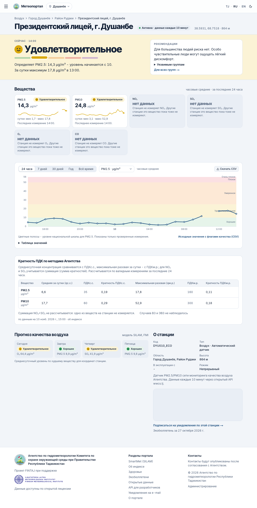

- **Қиматҳои ҷорӣ** - индекс бо сатҳ, моддаи муайянкунанда, кортҳо аз рӯи ҳар модда (қимат, воҳид, сатҳ) ва шкалае, ки индекс аз рӯи он ҳисоб шудааст.
- **Ҷойгиршавӣ** - харита бо мавқеи истгоҳ.
- **Обу ҳаво - пешгӯии GFS** - харитаҳои обу ҳаво аз SmartMet Server-и Агентӣ: ҳарорати ҳаво, боришот, шамол (суръат бо ранг ва тирчаҳои самт) ё абрнокӣ - нишондиҳанда дар рӯйхати афтанда интихоб мешавад. Лағжонак ва тугмаҳои «‹ ›» пешгӯиро бо қадами 3 соат то 5 шабонарӯз, баъд 6 соат то 10 шабонарӯз варақ мезананд; «▶» аниматсияро оғоз мекунад. Дар зери лағжонак - миқёси қиматҳо ва вақти оғози модели GFS. Дар як вақт як қабати пешгӯӣ нишон дода мешавад: ҳангоми фаъол кардани обу ҳаво қабати SILAM хомӯш мешавад ва баръакс.
- **Пешгӯии SILAM** - пешгӯии моделии сифати ҳаво барои координатаҳои истгоҳ барои имрӯз, фардо ва пасфардо (сатҳи миёнаи шабонарӯзӣ аз рӯи бадтарин модда).
- **Каррати ҲМҒ аз рӯи методикаи Агентӣ** - ҷадвал мисли бюллетенҳои ҳаррӯза: консентратсияи миёнаи шабонарӯзӣ (м.ш.б) ва нисбати он ба ҲМҒ(м.ш.р), якмаротибагии баландтарин дар як шабонарӯз (я.м.б) ва нисбат ба ҲМҒ(як) аз рӯи ҳар модда; дар зер - ҷамъи NO₂+SO₂ (ҷамъи карратҳои ҲМҒ(м.ш.р), агар истгоҳ ҳар ду моддаро чен кунад) ва қайд дар бораи ҳолатҳои ИБ (≥ 10 ҲМҒ(як)) ва НИБ (≥ 50 ҲМҒ(як)). Карратҳои ≥ 1 ҷудо карда шудаанд. Аз рӯи ченакҳои эътимодноки 24 соати охир ҳисоб карда мешавад.
- **Тавсияҳо** - ҳангоми сатҳи ҷорӣ чӣ кор кардан лозим аст: барои аҳолии умумӣ ва (блоки кушодашавандаи «Ба гурӯҳҳои осебпазир») барои кӯдакон, занони ҳомила ва ширдеҳ, пиронсолон, одамони гирифтори бемориҳои музмини роҳи нафас ва дил; истинод ба ҳамин сатҳ дар бахши «Саломатӣ» мебарад.
- **Гирифтани огоҳиҳо дар бораи аз ҳад гузаштан дар ин истгоҳ** - истинод ба обуна.
- **Динамикаи ченакҳо** - график бо интихоби давра ва модда (бахши 4.1).
- **Шиносномаи истгоҳ** - рамз, навъ, координатаҳо, баландӣ, санаи ба истифода додан, тартиби намунагирӣ, манбаи маълумот.

### 4.1. График

- **Давра**: 24 соат, 7 рӯз, 30 рӯз, Сол ё **Ҳамаи давра** (то 10 сол).
- **Миёнакунӣ**: «Соатӣ», «Шабонарӯзӣ» ё «Моҳона» - шабонарӯз ва моҳ бо вақти маҳаллӣ ҳисоб карда мешаванд. Барои ҳар давра вариантҳои мувофиқ дастрасанд: 24 соат - соатӣ; 7 ва 30 рӯз - соатӣ ё шабонарӯзӣ; Сол - шабонарӯзӣ ё моҳона; Ҳамаи давра - моҳона ё шабонарӯзӣ.
- Интихоби модда - рӯйхати афтанда дар назди давраҳо.
- Навораҳои ранга дар замина - сатҳҳои шкала барои моддаи интихобшуда: фавран дида мешавад, ки қимат ба кадом сатҳ меафтад.
- Курсорро ба нуқта оред (ё дар телефон ламс кунед), то вақт ва қиматро бинед; ҳангоми миёнакунии шабонарӯзӣ ва моҳона - инчунин ҳадди ақал ва ҳадди аксар. Агар нуқтаҳо бисёр бошанд, дар зери график лағжандаи миқёс пайдо мешавад.
- **Ҷадвали қиматҳо** дар зери график (бо пахш кушода мешавад) - ҳамон маълумот ба шакли матн, барои барномаҳои хондани экран ва нусхабардорӣ.
- Танҳо ченакҳои эътимоднок ва ислоҳшуда нишон дода мешаванд; холигиҳо маънои набудани маълумотро доранд, на ифлосшавии сифрӣ.

## 5. Боргирии CSV

Тугмаи **«Боргирии CSV»** дар болои график миёнаҳои давра, миёнакунӣ ва моддаи интихобшударо (бе интихоби модда - аз рӯи ҳамаи моддаҳои истгоҳ) ба файл барои Excel, LibreOffice ё таҳлил нигоҳ медорад.

Формати файл: рамзгузории UTF‑8 бо BOM (Excel онро бе танзим мекушояд), ҷудокунанда - вергул, сутунҳо:

| Сутун | Мундариҷа |
|---|---|
| `time_utc` | вақти оғози фосила бо UTC (ISO 8601) |
| `time_local` | ҳамон бо вақти Душанбе (`СССС-ММ-РР СС:ДД`) |
| `station` | рамзи истгоҳ |
| `pollutant` | рамзи модда (`PM25`, `PM10`, `NO2`, `SO2`, `CO`, `O3`, `NO`, `CH2O`, `C6H5OH`, `HF`, `TSP`, `CO2`, `TVOC`) |
| `value` | миёна барои фосила дар воҳиди намоиши портал (аз рӯи қиматҳои эътимоднок ва ислоҳшуда) |
| `unit` | воҳид (`µg/m³` ё `mg/m³`; `ppm` барои CO₂, `ppb` барои ПОУ) - он ки Агентӣ дар танзимот интихоб кардааст |
| `aggregation` | `hour` - миёнаи соатӣ, `day` - шабонарӯзӣ, `month` - моҳона |
| `samples` | шумораи ченакҳое, ки ба миёна дохил шудаанд |
| `min`, `max` | ҳадди ақал ва ҳадди аксар дар фосила |
| `qc_flag` | сифати нуқта: `valid` - ҳамаи қиматҳо аз назорат гузаштаанд, `corrected` - дар байни онҳо қиматҳои аз ҷониби оператор ислоҳшуда ҳастанд; агар қиматҳои эътимоднок набошанд - бадтарин парчами истисношудаҳо (`suspect`, `invalid`, `raw`) ё `missing` |
| `excluded` | чанд қимат дар фосила аз ҷониби назорати сифат истисно шудааст |

Истиноди **«Қиматҳои аслӣ бо парчами сифат (CSV)»** ҳар ченакро бе миёнакунӣ (на зиёда аз 30 шабонарӯз) мебарорад: `time_utc`, `time_local`, `station`, `pollutant`, `value`, `unit`, `averaging_min` (давраи миёнакунии асбоб, дақ.) ва `qc_flag` барои ҳар қимат.

Ҳамон файлро бо суроғаи `…/api/v1/stations/<slug>/measurements?range=7d&agg=day&pollutant=PM25&format=csv`, қиматҳои аслиро - `…&agg=raw&format=csv` гирифтан мумкин аст (ниг. бахши 13).

## 6. Харита

Харита - саҳифаи асосии портал (`/`; суроғаи кӯҳнаи `/map` низ ба он ҷо мебарад). Он бе хидматҳои беруна кор мекунад; миқёс - бо чархи муш, тугмаҳои «+/−» (дар телефон - бо ишораҳо); тугмаи «мавқеи ман» харитаро дар марказ мегузорад (бо иҷозати браузер). Интихоб дар харита дар суроғаи саҳифа инъикос меёбад, бинобар ин истинодро ба дигарон фиристодан мумкин аст: `/?layer=silam` пешгӯии сифати ҳаворо мекушояд, `/?layer=weather` - обу ҳаворо.

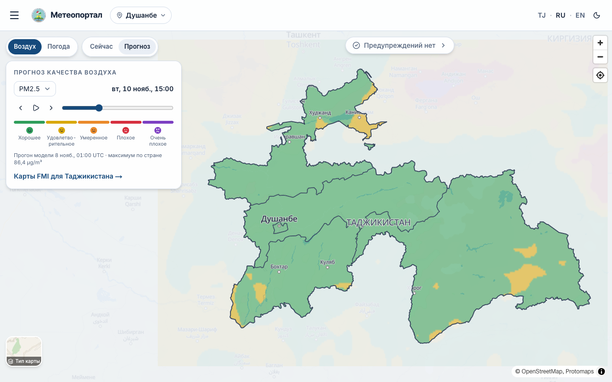

**Сифати ҳаво · Ҳозир** (бо нобаёнӣ кушода мешавад):

- Нуқтаҳои ранга - истгоҳҳо бо сатҳи ҷории индекс. Ба истгоҳ пахш кунед - корт бо ном, сатҳ бо калима, моддаи муайянкунанда ва қимати он, вақти навсозӣ ва истинод ба саҳифаи истгоҳ пайдо мешавад.
- Ҳангоми хурд кардани миқёс истгоҳҳои наздик ба доираи ранги бадтарин сатҳ бо ҳалқа муттаҳид мешаванд; барои наздик кардан ба он пахш кунед.
- Истгоҳҳои бе маълумоти нав ҳангоми наздик кардан ҳамчун ҳалқаҳои хира нишон дода мешаванд; дар миқёси кишвар онҳо пинҳонанд.

**Сифати ҳаво · Пешгӯӣ** - пешгӯии модели SILAM: тӯри рангаи сатҳҳои шкалаи оммавӣ аз рӯи моддаи интихобшуда (`PM2.5`, `PM10` ва ғайра). Лағжонак ва тугмаҳои «‹ ›» пешгӯиро аз рӯи соатҳо барои 5 шабонарӯзи оянда варақ мезананд; «▶» аниматсияро оғоз мекунад. Дар зери лағжонак - шкалаи сатҳҳо, вақти оғози модел ва ҳадди аксар аз рӯи кишвар; истиноди «Харитаҳои FMI барои Тоҷикистон» ба харитаҳои тайёри FMI мебарад (бахши «SmartMet (SILAM)»).

**Обу ҳаво · Ҳозир** - нишонаи обу ҳаво ва ҳарорати ҳозира дар шаҳрҳо (нуқтаҳои пешгӯии SmartMet); ба шаҳр пахш кунед - тавсифи обу ҳаво, ҳадди аксар ва ҳадди ақали шабонарӯз ва истинод ба пешгӯии муфассал. Маҳалҳои аҳолинишини дигар ҳангоми наздик кардан пайдо мешаванд.

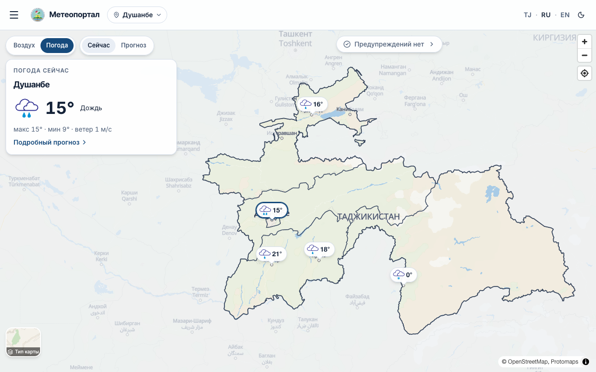

**Обу ҳаво · Пешгӯӣ** (вақте харитаҳои SmartMet Server пайваст шудаанд) - ҳарорати ҳаво, боришот, шамол ё абрнокӣ бо лағжонаки вақт ва шкалаи қиматҳо.

**Намуди харита** - тугма бо тасвири хурди харита (дар компютер - аз чап дар поён, дар телефон - аз рост дар боло, зери тугмаи мавқеъ): «Нақша» (харитаи оддии рангин: наботот, об, роҳҳо), «Хокистарӣ» (ҳамон харита бе ранг - рангҳои истгоҳҳо ва пешгӯӣ беҳтар намоён мешаванд), «Релйеф» (сояи кӯҳҳо аз рӯи модели рақамии релйефи Copernicus) ва «Моҳвора» (тасвири бебулути Sentinel-2 барои соли 2021). Интихоб дар браузер нигоҳ дошта мешавад. Ҳамаи заминаҳо аз маълумоти кушода сохта шуда, дар сервери портал нигоҳ дошта мешаванд.

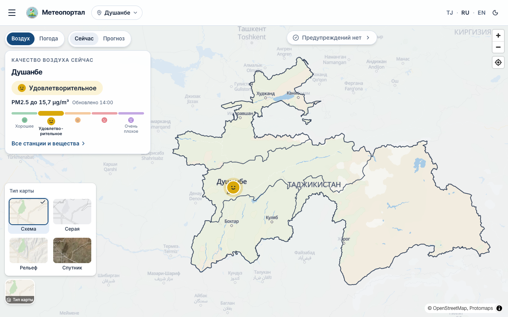

Дар харита ҳамеша контурҳои вилоятҳо, Душанбе ва НТҶ намоёнанд, ҳангоми наздик кардан - сарҳадҳои хатчаноки ноҳияҳо. Нишондиҳандаро ба вилоят баред - он равшан шуда номашро нишон медиҳад; пахш кунед - корт бо шумораи истгоҳҳо ва истинод ба рӯйхати истгоҳҳо кушода мешавад. Огоҳиҳои амалкунанда - полигонҳо бо ранги сатҳи хатар; огоҳиҳое, ки дар 24 соати наздик оғоз мешаванд - бо ранги камранг ва контури хатчин. Дар паҳлӯи лавҳача легендаи сатҳҳои хатар бо рақамҳои 1–4 пайдо мешавад. Барои хондани сатҳ (бо рақам ва калима), сарлавҳа ва мӯҳлати амал ба полигон пахш кунед. Истиноди `/?layer=warnings` харитаро фавран ба минтақаҳои огоҳӣ наздик мекунад. Аломатҳои истгоҳҳо ва доираҳои гурӯҳи истгоҳҳо нишонаи чеҳраи сатҳро доранд (дар гурӯҳ - бадтарин сатҳ).

Агар браузер WebGL-ро дастгирӣ накунад (компютерҳои хеле кӯҳна, суръатбахшии сахтафзорӣ хомӯш), ба ҷои харита паём нишон дода мешавад - рӯйхати истгоҳҳоро истифода баред.

### 6.1. Харитаҳои FMI «SmartMet (SILAM)»

Бахши «SmartMet (SILAM)» (`/air/silam`, дар менюи ☰) - харитаҳои тайёри пешгӯии ифлосшавии ҳаво дар қаламрави Тоҷикистон ва кишварҳои ҳамсоя, ки Институти обуҳавошиносии Финляндия (FMI) дар доираи лоиҳаи FINTAJ ҳар рӯз аз рӯи модели SILAM ҳисоб мекунад. Портал онҳоро бе тағйир нишон медиҳад.

- **Нишондиҳанда** бо тугмаҳои болои харита интихоб мешавад: индекси сифати ҳаво AQI (бадтарин сатҳи моддаҳо), PM2.5, PM10, NO₂, O₃, CO, SO₂ ва баландии қабати сарҳадӣ (ABL - чӣ қадар паст бошад, ҳамон қадар ифлосӣ дар назди замин бештар ҷамъ мешавад).
- **Вақт** бо чархаки муш дар болои харита (ба поён - дертар, ба боло - барвақттар) ё бо бурдани курсор ба тасмаи соатҳо иваз мешавад; дар телефон - бо кашидани ангушт ба чап ё рост, бо клавиатура - бо тирчаҳо. «Аниматсия» ҳамаи 48 соатро нишон медиҳад.
- Пешгӯии 48-соата одатан аз соати 00 UTC-и шабонарӯзи гузашта ҳисоб карда мешавад, харитаҳои нав тақрибан соати 07:00 бо вақти Душанбе нашр мешаванд; агар FMI харитаҳоро дертар нашр кунад, ҳисоб аз соати 00 UTC-и ҳамон рӯз оғоз мешавад - портал инро ба назар мегирад. Дар харита вақт бо UTC («06Z» = 11:00 бо вақти Душанбе), дар болои харита - вақти маҳаллӣ. Агар FMI муддати дароз харитаҳоро нав накунад, портал инро менависад ва ҳисоби охиринро нишон медиҳад.
- Дар поёни харита - шарҳҳо, ҷадвали ҳадҳои индекси FMI ва истинодҳо ба қабати SILAM дар харитаи портал ва ба ченкуниҳои истгоҳҳо. Модел ифлосии заминаро бо қадами даҳҳо километр нишон медиҳад; баҳодиҳии расмӣ - аз рӯи маълумоти истгоҳҳо.

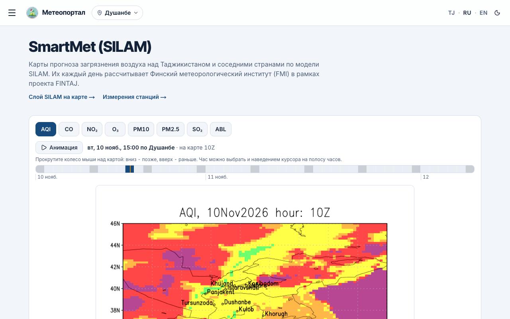

## 7. Обу ҳаво

Бахши «Обу ҳаво» (`/weather`) - пешгӯии SmartMet Server (FMI) барои шаҳрҳо ва ноҳияҳо, ҳар 15 дақиқа нав мешавад.

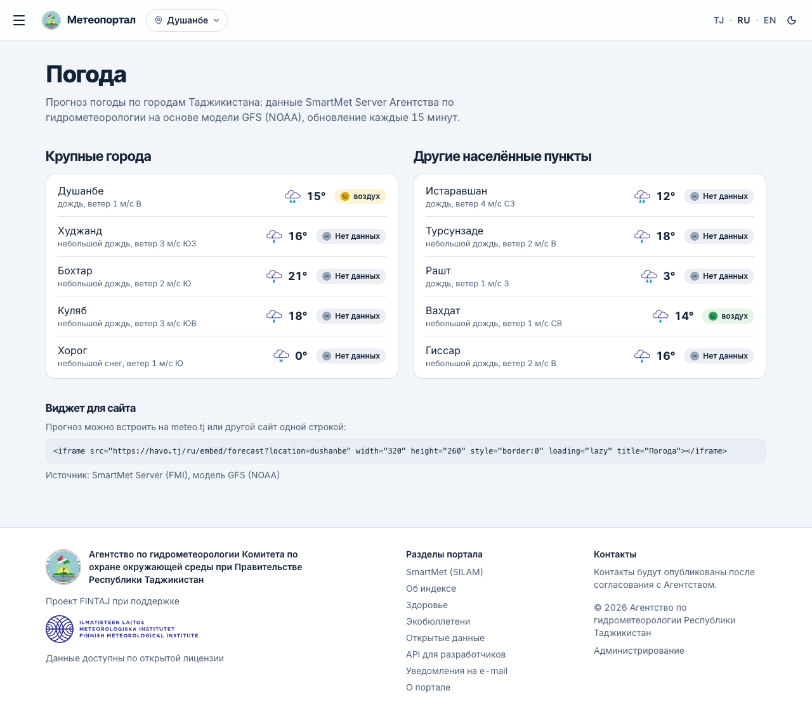

Кортҳои шаҳрҳои калон ҳарорати ҷорӣ, шамол, боришот ва рамзи обу ҳаворо нишон медиҳанд; дар поён - рӯйхати дигар маҳалҳои аҳолинишин. Саҳифаи шаҳр (`/weather/<суроға>`):

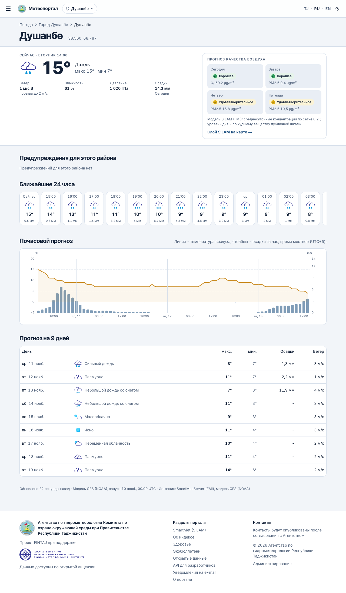

- **Ҳоло** - ҳарорат, шамол, намӣ, фишор, нуқтаи шабнам, абрнокӣ, боришот.
- **24 соати наздик** - навор аз рӯи соатҳо.
- **График** барои 72 соат: хат - ҳарорат, сутунҳо - боришот дар як соат.
- **Пешгӯии 10 рӯз** - ҷадвал: ҳадди ақал/ҳадди аксари ҳарорат, боришот, шамол, рамзи обу ҳаво.
- **Пешгӯии сифати ҳаво** (SILAM) барои рӯзҳои наздик бо моддаи муайянкунанда ва истинод ба қабат дар харита.
- **Огоҳиҳо барои ин ноҳия**, агар бошанд.
- Дар поён - вақти оғози модел ва манбаъ. Қайди «Пешгӯӣ кӯҳна шудааст» маънои онро дорад, ки навсозӣ аз манбаъ кайҳо наомадааст.
- **Виҷет барои сомона** - коди тайёр барои ҷойгир кардани пешгӯӣ (бахши 12).

## 8. Огоҳиҳо

Бахши «Огоҳиҳо» (`/warnings`) - огоҳиҳои тӯфонии Агентӣ дар формати CAP (муҳаррири SmartMet Alert).

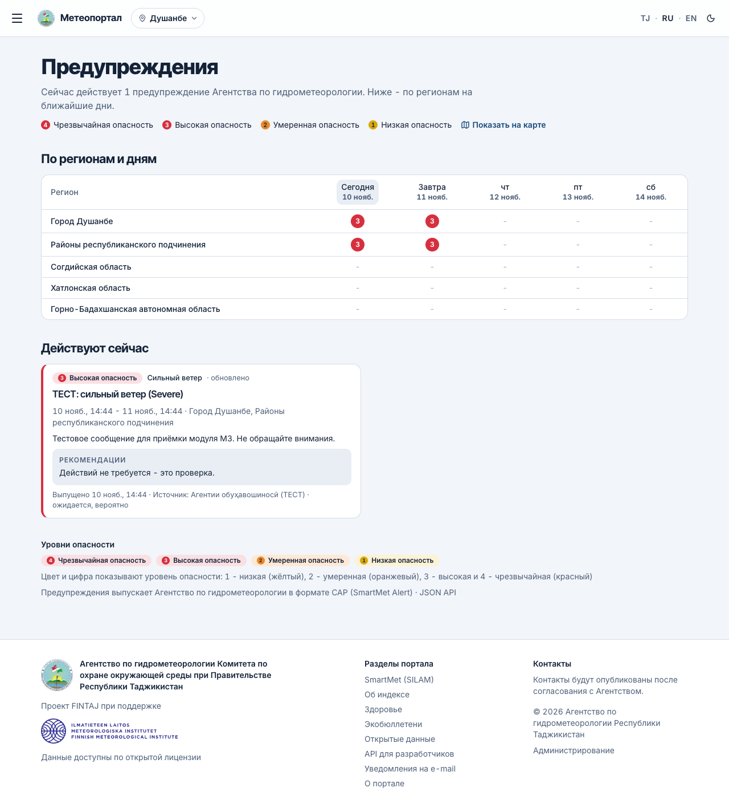

- **Ҳоло амал мекунанд** ва **Интизор мешаванд** - кортҳо бо сарлавҳа, сатҳи хатар, давраи амал, ҳудуд, тавсиф ва тавсияҳо; тугмаи «CAP XML» паёми аслиро мекушояд.
- **Аз рӯи минтақаҳо ва рӯзҳо** - ҷадвал: сатрҳо - минтақаҳо (Душанбе, НТҶ, Суғд, Хатлон, ВМКБ), сутунҳо - рӯзҳои наздик; дар ҳуҷайра - доирача бо рақами сатҳи баландтарини хатар. Истинод ба минтақа рӯйхатро филтр мекунад.
- Сатҳҳои хатар бо ранг ва рақам нишон дода мешаванд: 1 - паст (сабз), 2 - миёна (зард), 3 - баланд (норанҷӣ), 4 - фавқулодда (сурх).
- Истиноди «Дар харита нишон додан» харитаи асосиро, ки ба минтақаҳои огоҳӣ наздик шудааст, мекушояд.
- Агар маълумот аз муҳаррири огоҳиҳо муддати дароз наояд, дар болои бахш қайд пайдо мешавад: рӯйхат метавонад нопурра бошад.
- Огоҳии навшуда пешинаро иваз мекунад, бекоршуда - нопадид мешавад; мӯҳлатгузаштаҳо нишон дода намешаванд.

Огоҳиҳои амалкунанда инчунин дар харитаи саҳифаи асосӣ, дар саҳифаҳои обу ҳавои ноҳияи дахлдор ва дар виҷет дида мешаванд.

## 9. Саломатӣ

Бахши «Саломатӣ» (`/health`) - тавсияҳо аз рӯи ҳар сатҳи индекс барои гурӯҳҳои гуногун: аҳолии умумӣ, кӯдакон, занони ҳомила ва ширдеҳ, пиронсолон, одамони гирифтори бемориҳои музмини роҳи нафас ва дилу раг. Гурӯҳро интихоб кунед - ва хонед, ки дар ҳар яке аз панҷ сатҳ чӣ кор кардан лозим аст. Тавсияҳо хусусияти умумӣ доранд ва машварати духтурро иваз намекунанд.

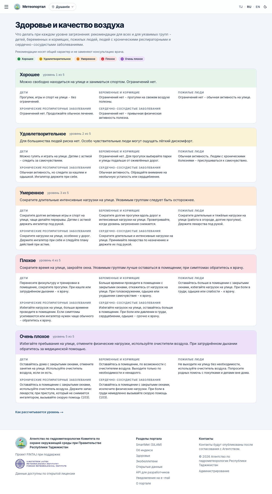

## 10. Ахбор

Бахши «Ахбор» (`/news`) - нашрияҳои Агентӣ бо рубрикаҳо, маводи мустаҳкамшуда («Муҳим») ва навигатсияи саҳифа ба саҳифа. Лентаи RSS: `/api/v1/news/rss.xml?locale=tg` (истиноди «Лентаи RSS» дар бахш). Истиноди «Гирифтани бюллетен ба e‑mail» ба обуна мебарад.

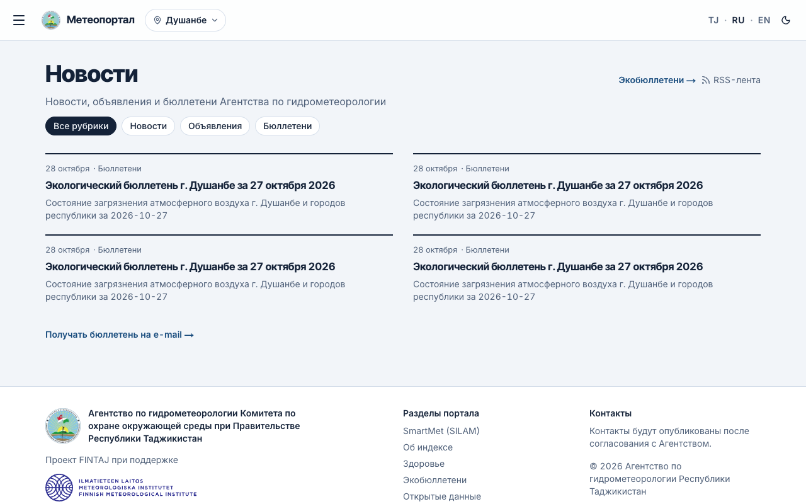

### 10.1. Экобюллетенҳо

Бахши «Экобюллетенҳо» (`/air/bulletins`, дар менюи ☰ ва дар поёни саҳифа) - бойгонии бюллетенҳои ҳаррӯзаи экологии Агентӣ дар бораи ифлосшавии ҳавои атмосферӣ дар шаҳрҳои ҷумҳурӣ барои шабонарӯзи гузашта. Бюллетенро барои санаи лозимӣ кушоед: ҳуҷҷат бевосита дар саҳифа нишон дода мешавад. Гузаргоҳҳои болои он намуди ҳуҷҷат («Бюллетени шаҳр», «Шарҳи шаҳрҳо», «Намунаи 4а») ва забонро (тоҷикӣ ё русӣ - ҳуҷҷатҳо бо ҳамин ду забон тартиб дода мешаванд) интихоб мекунанд. Тугмаҳои DOCX ва PDF ҳуҷҷатро боргирӣ мекунанд, HTML версияи чопиро мекушояд. Ҳар бюллетени нашршуда дар бахши «Ахбор» низ пайдо мешавад.

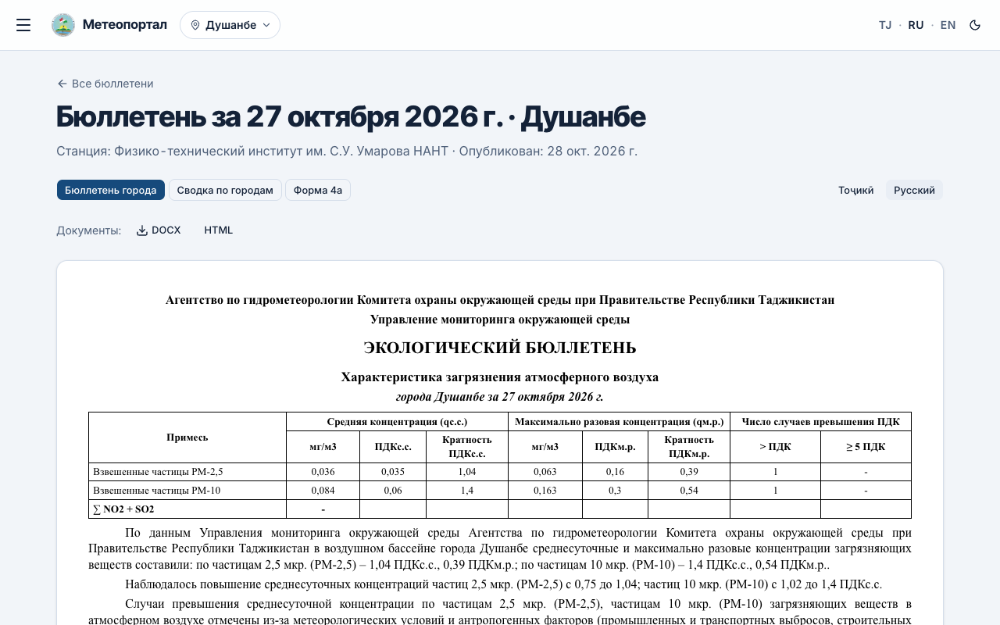

## 11. Обуна ба огоҳиҳо

Саҳифаи «Огоҳиҳо ба e‑mail» (`/subscribe`, истинод дар менюи ☰, дар поёни саҳифа ва дар саҳифаҳои истгоҳҳо):

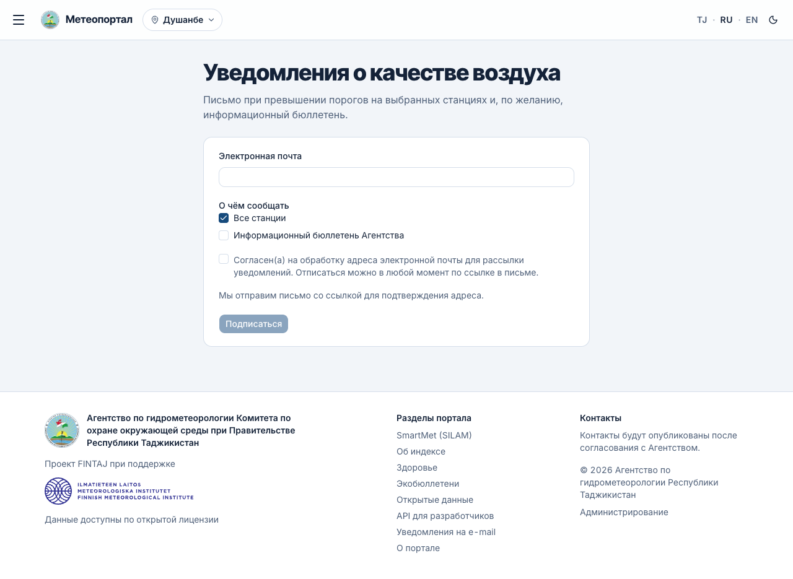

1. Суроғаи почтаи электрониро ворид кунед.
2. Интихоб кунед, ки дар бораи чӣ хабар дода шавад: ҳамаи истгоҳҳо ё истгоҳҳои алоҳида (нома ҳангоми аз ҳад гузаштани ҳадҳо), ва/ё бюллетени иттилоотии Агентӣ.
3. Розигиро ба коркарди суроға тасдиқ кунед ва «Обуна шудан»-ро пахш кунед.
4. Номаро кушоед ва ба истиноди тасдиқ гузаред - бе ин огоҳиҳо фиристода намешаванд (ҳифз аз обунаи суроғаи бегона).

Номаҳо ба забоне меоянд, ки обуна бо он расмӣ шудааст. Обунаро ҳар вақт тавассути истинод дар поёни ҳар нома қатъ кардан мумкин аст. Агар нома наояд, ҷузвдони «Спам» ва дурустии суроғаро тафтиш кунед; обунаи такрории ҳамон суроға бехатар аст.

## 12. Виҷетҳо барои сомонаҳо

Блокҳои тайёр барои ҷойгир кардан дар meteo.tj ва дигар сомонаҳо тавассути `<iframe>` - бе барномасозӣ. Суроғаҳо (ба ҷои `<портал>` суроғаи порталро гузоред):

| Виҷет | Суроға | Параметрҳо |
|---|---|---|
| Индекси истгоҳ | `<портал>/embed/aqi?station=<slug>&lang=tg` | `station` - суроғаи истгоҳ аз рӯйхати истгоҳҳо (бе параметр - истгоҳи аввал бо маълумот); `lang` - `tg`, `ru`, `en` |
| Пешгӯии обу ҳаво | `<портал>/embed/forecast?location=dushanbe&lang=ru` | `location` - суроғаи нуқтаи пешгӯӣ (`dushanbe`, `khujand`, `bokhtar`, `kulob`, `khorugh`, …; рӯйхати пурра - `/api/v1/forecast`). Агар пешгӯӣ муддати дароз нав нашуда бошад, виҷет қайди «кӯҳна шудааст»-ро нишон медиҳад |
| Огоҳиҳо | `<портал>/embed/alerts?region=DU&lang=en&limit=5` | `region` - рамзи минтақа (`DU`, `RRP`, `SU`, `KT`, `GB`), бе параметр - тамоми кишвар; `limit` - шумораи паёмҳо |

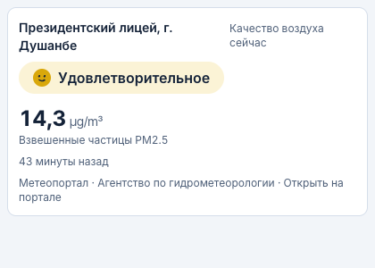

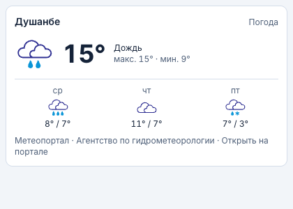

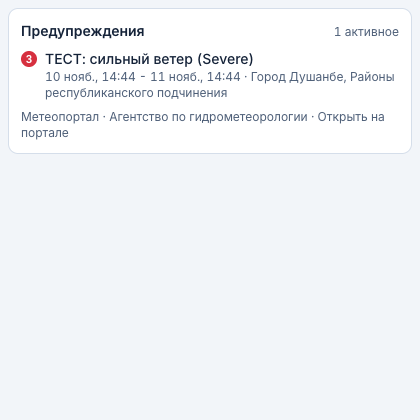

Намунаи код (сатри тайёр дар саҳифаи шаҳр дар бахши «Обу ҳаво» ва дар бахши «Маълумоти кушода» ҳаст):

```html
<iframe src="https://havo.tj/embed/forecast?location=dushanbe"
        width="320" height="260" style="border:0" loading="lazy"
        title="Обу ҳаво дар Душанбе"></iframe>
```

Паҳнои тавсияшаванда 300–400 px; баландӣ аз рӯи мундариҷа интихоб мешавад (виҷет ба паҳно мутобиқ мешавад). Дар поёни ҳар виҷет - истиноди «Дар портал кушодан». Ҷойгиркунӣ барои сомонаҳои Агентӣ иҷозат дода шудааст; барои доменҳои дигар рӯйхати сомонаҳои иҷозатдодашударо хадамоти IT танзим мекунад.

## 13. Маълумоти кушода ва API барои таҳиягарон

Бахши «Маълумоти кушода» (`/data`) маҷмӯи маълумот, форматҳо ва литсензияро номбар мекунад; «API барои таҳиягарон» (`/data/api`) - ҳуҷҷатҳои интерактивӣ бо параметрҳо, схемаҳои ҷавобҳо ва намунаҳо.

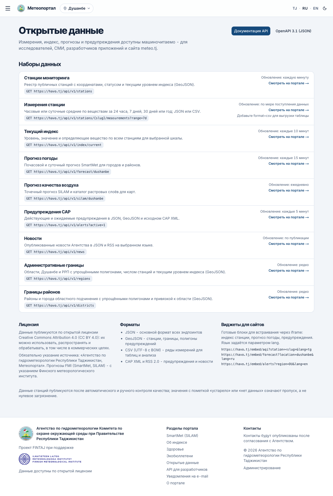

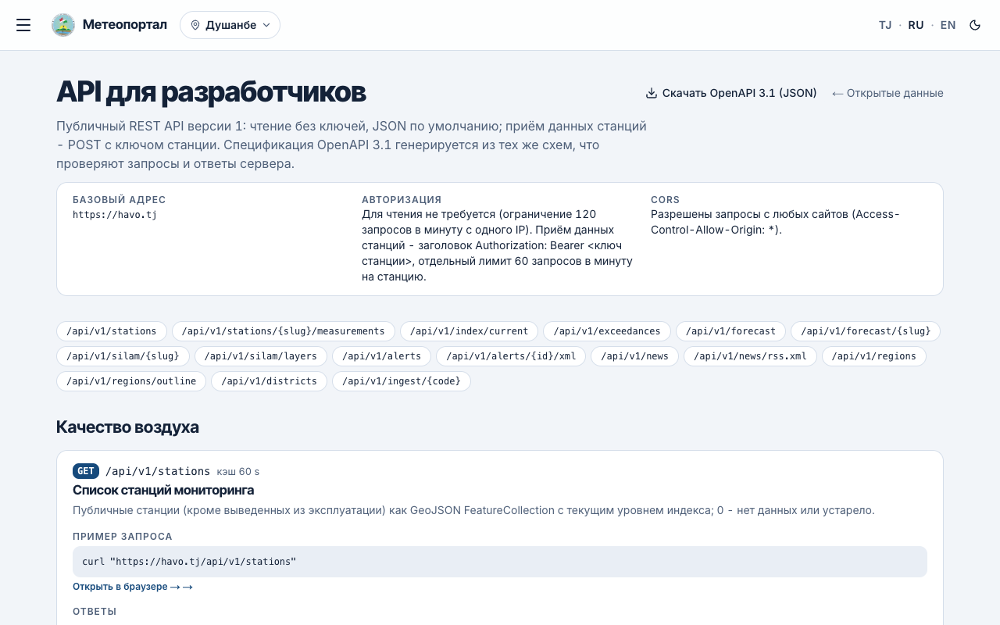

Асосӣ:

- **Суроғаи асосӣ**: `https://<портал>/api/v1`. Танҳо хондан, усули `GET`, калидҳо лозим нестанд.
- **Формат**: JSON бо нобаёнӣ; GeoJSON барои истгоҳҳо, ҳудудҳо ва огоҳиҳо; CSV барои қаторҳои ченакҳо; CAP XML ва RSS 2.0.
- **Вақт** - UTC дар ISO 8601; вақти маҳаллӣ - `Asia/Dushanbe` (UTC+5). Майдонҳои бисёрзабона - объекти `{ "tg": …, "ru": …, "en": … }`.
- **Маҳдудият**: 120 дархост дар як дақиқа аз як суроғаи IP (қимати нобаёнӣ, метавонад аз ҷониби Агентӣ тағйир дода шавад); ҳангоми аз ҳад гузаштан - ҷавоби `429` бо сарлавҳаи `Retry-After`. Маҳдудиятҳои ҷорӣ - дар сарлавҳаҳои `X-RateLimit-Limit`, `X-RateLimit-Remaining`, `X-RateLimit-Reset`.
- **Кэш**: ҷавобҳо 60–3600 сония кэш мешаванд (сарлавҳаи `Cache-Control`, `X-Cache: HIT|MISS`); API-ро аз навшавии маълумот зудтар пурсиш накунед.
- **CORS**: дархостҳо аз ҳама сомонаҳо иҷозат дода шудаанд (`Access-Control-Allow-Origin: *`).
- **Литсензия**: CC BY 4.0 - манбаъро нишон диҳед: «Агентии обуҳавошиносии Ҷумҳурии Тоҷикистон, Метеопортал»; пешгӯиҳо - бо нишон додани FMI (SmartMet, SILAM).
- **Спетсификатсияи OpenAPI 3.1**: `GET /api/v1/openapi.json?lang=tg` (барои Swagger UI, Postman, генераторҳои клиент мувофиқ аст).

### 13.1. Маълумотномаи эндпоинтҳо

| Эндпоинт | Таъинот | Параметрҳо | Кэш |
|---|---|---|---|
| `GET /api/v1/stations` | истгоҳҳои оммавӣ (GeoJSON) бо сатҳи ҷории индекс | - | 60 с |
| `GET /api/v1/stations/{slug}/measurements` | қаторҳои ченакҳои истгоҳ | `range` = `24h` (нобаёнӣ) / `7d` / `30d` / `1y` / `all` (то 10 сол); `agg` = `hour` / `day` / `month` (омезишҳои иҷозатдодашуда - мисли бахши 4.1) ё `raw` - қиматҳои аслӣ бо парчами сифат (танҳо CSV, то 30 шабонарӯз); `pollutant` = рамзи модда (бе параметр - ҳама); `format` = `json` / `csv` | 60 с |
| `GET /api/v1/index/current` | индекси ҷории ҳамаи истгоҳҳо | `scale` = `NATIONAL_OPERATIONAL` (нобаёнӣ) / `WHO_24H` / `RATIO_TO_LIMIT` / `US_AQI` / `IZA` | 60 с |
| `GET /api/v1/exceedances` | аз ҳад гузаштанҳои фаъоли ҳадҳо | - | 60 с |
| `GET /api/v1/forecast` | рӯйхати нуқтаҳои пешгӯӣ: суроға (`slug`), номҳо ба се забон, координатаҳо, намуд (`city`, `district`, `station`), вилоят | - | 600 с |
| `GET /api/v1/forecast/{slug}` | пешгӯии обу ҳаво барои нуқта; майдони `stale: true` - пешгӯӣ муддати дароз нав нашудааст | `hours` 1–240 (72), `days` 1–16 (10) | 300 с |
| `GET /api/v1/silam/{slug}` | пешгӯии нуқтавии сифати ҳавои SILAM | - | 600 с |
| `GET /api/v1/silam/layers` | феҳристи қабатҳои растрии оғози охирини SILAM | - | 600 с |
| `GET /api/v1/alerts` | огоҳиҳои CAP | `active=1` - танҳо амалкунанда; `region` = `DU` / `RRP` / `SU` / `KT` / `GB`; `lang` = `tg` / `ru` / `en`; `days` 1–14 (7); `format` = `json` / `geojson` | 60 с |
| `GET /api/v1/alerts/{id}/xml` | паёми аслии CAP 1.2 | - | 300 с |
| `GET /api/v1/news` | ахбори нашршуда | `locale`, `page`, `pageSize` 1–50 (12), `category` | 300 с |
| `GET /api/v1/news/rss.xml` | RSS 2.0 | `locale` | 300 с |
| `GET /api/v1/regions` | ҳудудҳои вилоятҳо (GeoJSON, соддакардашуда) | - | 3600 с |

Хатоҳо: `400` - параметрҳои нодуруст, `404` - объект ёфт нашуд; бадан - `{ "error": "…" }`.

### 13.2. Намунаҳои ҷавобҳо

Рӯйхати истгоҳҳо - `GET /api/v1/stations` (кӯтоҳ карда шудааст):

```json
{
  "type": "FeatureCollection",
  "features": [
    {
      "type": "Feature",
      "id": 1,
      "geometry": { "type": "Point", "coordinates": [68.787, 38.5598] },
      "properties": {
        "id": 1, "slug": "dushanbe-post-no-1", "code": "DU-01",
        "name": { "tg": "Душанбе, пости № 1", "ru": "Душанбе, пост № 1", "en": "Dushanbe, post No. 1" },
        "kind": "air", "status": "active",
        "region": { "tg": "Шаҳри Душанбе", "ru": "Город Душанбе", "en": "Dushanbe city" },
        "level": 1, "indexValue": 1.26, "indexTime": "2026-10-17T14:00:00.000Z"
      }
    }
  ]
}
```

Қаторҳои ченакҳо - `GET /api/v1/stations/dushanbe-post-no-1/measurements?range=24h&pollutant=PM25`:

```json
{
  "station": { "id": 1, "slug": "dushanbe-post-no-1", "code": "DU-01", "name": { "tg": "Душанбе, пости № 1" } },
  "range": "24h",
  "from": "2026-10-16T13:30:03.699Z",
  "to": "2026-10-17T13:30:03.699Z",
  "aggregation": "hour",
  "timezone": "Asia/Dushanbe",
  "series": [
    {
      "pollutant": { "id": 1, "code": "PM25", "shortName": "PM2.5", "unit": "µg/m³", "decimals": 1 },
      "points": [
        { "t": "2026-10-16T14:00:00.000Z", "v": 25.5, "min": 25.5, "max": 25.5, "n": 1 },
        { "t": "2026-10-16T15:00:00.000Z", "v": 26.6, "min": 26.6, "max": 26.6, "n": 1 }
      ]
    }
  ]
}
```

Ҳамон дархост бо `format=csv`:

```csv
time_utc,time_local,station,pollutant,value,unit,aggregation,samples,min,max
2026-10-16T14:00:00.000Z,2026-10-16 19:00,DU-01,PM25,25.5,µg/m³,hour,1,25.5,25.5
2026-10-16T15:00:00.000Z,2026-10-16 20:00,DU-01,PM25,26.6,µg/m³,hour,1,26.6,26.6
```

Индекси ҷорӣ - `GET /api/v1/index/current`:

```json
{
  "scale": {
    "code": "NATIONAL_OPERATIONAL", "kind": "breakpoints",
    "levels": [ { "level": 1, "color": "#2E9E5B", "label": { "tg": "Хуб", "ru": "Хороший", "en": "Good" } } ]
  },
  "generatedAt": "2026-10-17T13:30:03.726Z",
  "stations": [
    {
      "id": 1, "slug": "dushanbe-post-no-1", "code": "DU-01",
      "name": { "tg": "Душанбе, пости № 1" },
      "level": 1, "value": 1.26, "time": "2026-10-17T14:00:00.000Z", "stale": false,
      "dominantPollutant": "CO",
      "subIndices": { "CO": { "index": 1.26, "level": 1, "value": 1.02 } }
    }
  ]
}
```

Пешгӯии обу ҳаво - `GET /api/v1/forecast/dushanbe?hours=3&days=2` (майдонҳо: `t` ҳарорат °C, `ws`/`wd`/`gust` шамол м/с ва самт °, `rh` намӣ %, `p` фишор гПа, `dew` нуқтаи шабнам, `cloud` абрнокӣ %, `precip` боришот мм, `symbol` рамзи аломати обу ҳаво):

```json
{
  "location": { "slug": "dushanbe", "name": { "tg": "Душанбе" }, "lat": 38.5598, "lon": 68.787 },
  "producer": "ecmwf",
  "originTime": "2026-10-17T00:00:00.000Z",
  "fetchedAt": "2026-10-17T13:16:55.557Z",
  "timeZone": "Asia/Dushanbe",
  "hourly": [ { "time": "2026-10-17T13:00:00.000Z", "t": 16, "ws": 0, "wd": null, "rh": 38, "p": 1018, "precip": 0, "symbol": null } ],
  "daily": [ { "date": "2026-10-17T00:00:00.000Z", "tmin": 10, "tmax": 20, "precipSum": 0, "symbol": null } ]
}
```

Пешгӯии сифати ҳаво - `GET /api/v1/silam/dushanbe` (қаторҳои соатӣ аз рӯи моддаҳо ва ҷамъбасти шабонарӯзӣ бо сатҳ):

```json
{
  "location": { "slug": "dushanbe", "name": { "tg": "Душанбе" }, "lat": 38.5598, "lon": 68.787 },
  "run": { "originTime": "2026-10-16T01:00:00.000Z", "fetchedAt": "2026-10-17T13:15:26.460Z" },
  "units": { "PM25": "µg/m³", "PM10": "µg/m³", "NO2": "µg/m³", "SO2": "µg/m³", "CO": "mg/m³", "O3": "µg/m³" },
  "hourly": { "PM25": [ ["2026-10-16T19:00:00.000Z", 12.4] ] },
  "days": [ { "date": "2026-10-17", "level": 2, "dominantPollutant": "PM25",
              "means": { "PM25": 14.22, "PM10": 19.69, "NO2": 17.02, "SO2": 25.69, "CO": 0.29, "O3": 62.24 } } ]
}
```

Огоҳиҳо - `GET /api/v1/alerts?active=1&lang=tg`:

```json
{
  "generatedAt": "2026-10-17T13:30:03.816Z",
  "lang": "tg",
  "count": 1,
  "alerts": [
    {
      "id": 16, "identifier": "tj.meteo.2026.0001", "sent": "2026-10-17T01:00:00.000Z",
      "msgType": "Alert", "language": "tg-TJ",
      "event": "Шамоли сахт",
      "headline": "Шамоли сахт то 25 м/с дар Душанбе ва НТҶ",
      "description": "Аз нисфирӯзии 16 октябр то бегоҳии 17 октябр шамоли сахти ғарбии 18–25 м/с интизор аст.",
      "instruction": "Дар зери дарахтон ва сохторҳои ноустувор намонед, ашёи сабукро мустаҳкам кунед.",
      "severity": "Severe", "color": "orange", "colorHex": "#EA8A2B",
      "urgency": "Expected", "certainty": "Likely",
      "onset": "2026-10-17T07:00:00.000Z", "expires": "2026-10-18T16:00:00.000Z",
      "active": true, "upcoming": false,
      "regions": [ { "code": "DU", "name": { "tg": "Шаҳри Душанбе" } } ],
      "areas": [ "Душанбе ва ноҳияҳои тобеи ҷумҳурӣ" ],
      "xml": "https://havo.tj/api/v1/alerts/16/xml"
    }
  ]
}
```

Ахбор - `GET /api/v1/news?locale=tg&pageSize=1`:

```json
{
  "locale": "tg", "page": 1, "pageSize": 1, "total": 2,
  "items": [
    {
      "id": 1, "slug": "portal-launch-week6",
      "title": "Метеопортали нав дар реҷаи озмоишӣ ба кор даромад",
      "excerpt": "Сифати ҳаво, пешгӯӣ ва огоҳиҳо дар як ҷо.",
      "publishedAt": "2026-10-16T09:47:58.056Z", "pinned": true,
      "category": { "slug": "news", "name": "Ахбор" }, "cover": null,
      "url": "https://havo.tj/news/portal-launch-week6"
    }
  ]
}
```

Аз ҳад гузаштанҳои фаъол - `GET /api/v1/exceedances`:

```json
{
  "generatedAt": "2026-10-17T13:30:03.743Z",
  "events": [
    { "id": 2, "startedAt": "2026-10-17T13:16:52.683Z",
      "station": { "id": 3, "slug": "bokhtar-post-no-1", "name": { "tg": "Бохтар, пости № 1" } },
      "rule": "PM10 аз 50 µg/m³ боло", "kind": "pollutant", "pollutant": "PM10", "unit": "µg/m³",
      "value": 103.9, "threshold": 50, "level": null }
  ]
}
```

Қабатҳои SILAM - `GET /api/v1/silam/layers` ҳудудҳои растр ва барои ҳар модда рӯйхати кадрҳои `{ "time", "url", "max" }`-ро бармегардонад; тасвирҳои PNG бо `url` дастрасанд (масалан, `/silam/2026101601/PM25/000.png`) ва дар харита дар проексияи Web Mercator аз рӯи `run.bounds` гузошта мешаванд.

### 13.3. Маслиҳатҳо

- Барои ҷадвалҳо ва таҳлил `format=csv`-ро истифода баред; барои графикҳо - JSON бо `range=7d` (соатӣ) ё `1y` (шабонарӯзӣ).
- Майдони `stale: true` ё `level: 0` маънои набудани маълумоти ҷориро дорад - чунин қиматҳоро ҳамчун ифлосшавии сифрӣ нишон надиҳед.
- Пешгӯиҳои SILAM як бор дар шабонарӯз, обу ҳаво - ҳар 15 дақиқа, огоҳиҳо - ҳар 5 дақиқа нав мешаванд; API-ро аз ин зудтар пурсиш накунед.
- Рамзҳои истгоҳҳоро аз `/api/v1/stations`, суроғаҳои нуқтаҳои пешгӯиро аз `/api/v1/forecast` гиред.

## 14. Саволҳои маъмул

| Савол | Ҷавоб |
|---|---|
| Чаро дар истгоҳ «маълумот нест»? | Ченакҳо беш аз 6 соат наомадаанд ё назорати сифатро нагузаштаанд. Постҳо бо намунаҳои яккарата маълумотро рӯзе якчанд маротиба мефиристанд |
| Чаро индекс «хуб» аст, аммо бӯи дуд меояд? | Индекс аз рӯи моддаҳои ченшаванда дар истгоҳи наздиктарин ҳисоб мешавад; манбаъҳои маҳаллӣ метавонанд ба ченакҳо наафтанд. Пешгӯии SILAM ва огоҳиҳоро бинед |
| Пешгӯии SILAM аз ченакҳо чӣ фарқ дорад? | SILAM - ҳисоби моделии FMI аз рӯи тӯри 20 км барои 5 шабонарӯз; ченакҳо - далел дар истгоҳ. Пешгӯӣ ба банақшагирӣ кӯмак мекунад, ченакҳо - ба баҳодиҳии ҳолати ҷорӣ |
| Маълумот чанд вақт нав мешавад? | индекс ва истгоҳҳо - ҳар 10 дақиқа (саҳифаҳо - ҳар дақиқа), обу ҳаво - ҳар 15 дақиқа, SILAM - ҳар рӯз, огоҳиҳо - ҳар 5 дақиқа |
| Оё маълумотро дар ВАО ва барномаҳо истифода бурдан мумкин аст? | Ҳа, бо литсензияи CC BY 4.0 бо нишон додани манбаъ; пешгӯиҳо - бо нишон додани FMI |
| Чӣ тавр обунаро аз номаҳо қатъ кунам? | Тавассути истинод дар поёни ҳар нома |
| Харита нишон дода намешавад | Браузер бе дастгирии WebGL ё суръатбахшии сахтафзорӣ хомӯш аст; браузерро нав кунед ё рӯйхати истгоҳҳоро истифода баред |
| Маълумоти таърихии солҳои гузашта дар куҷост? | Дар саҳифаи истгоҳ давраи «Ҳамаи давра»-ро интихоб кунед (то 10 сол, миёнаҳои моҳона ё шабонарӯзӣ); маълумоте, ки дар портал нест - бо дархост ба Агентӣ |
